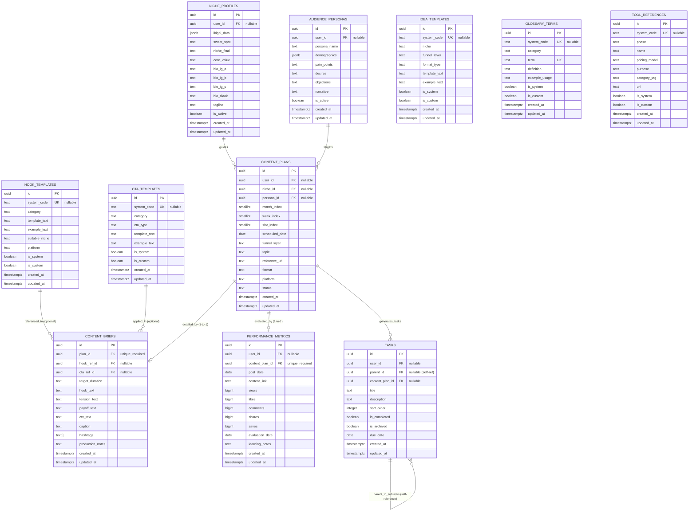

# DESAIN BASIS DATA & ATURAN BISNIS (SUPABASE POSTGRESQL)
## Productivity Studio: Content Creator & Business Operating System

---

### 1. Ruang Lingkup dan Referensi Sumber Otoritatif

| Parameter | Keterangan |
| :--- | :--- |
| **Dokumen** | Desain Basis Data & Aturan Bisnis Produksi (*Production-Grade Database Specification*) |
| **Target Platform** | **Supabase PostgreSQL 15+** |
| **Sumber Kebutuhan Tunggal** | `e:/CODING/PROJECT/productivity-studio/PRODUCT_SPECIFICATION.md` |
| **Versi Desain** | 1.0.0-PROPOSED |
| **Status Persetujuan** | **Draft Arsitektur — Menunggu Persetujuan Resmi (*Awaiting Approval*)** |
| **Tanggal Pembuatan** | 14 Oktober 2026 |
| **Batasan Implementasi** | Desain konseptual dan spesifikasi DDL PostgreSQL murni. **Tidak ada** migrasi fisik, eksekusi SQL di database, inisialisasi instance Supabase, atau penulisan kode aplikasi yang dilakukan sebelum dokumen ini disetujui. |

> [!IMPORTANT]
> **Dasar Kepatuhan Sumber:**  
> Seluruh entitas, relasi, batasan (*constraints*), dan aturan bisnis di dalam dokumen ini diekstraksi secara ketat dari `PRODUCT_SPECIFICATION.md`. Dokumen ini tidak menambahkan entitas yang tidak memiliki dasar kebutuhan pada spesifikasi produk.

---

### 2. Matriks Ketertelusuran Kebutuhan (*Requirements Traceability*)

Tabel berikut membuktikan bahwa setiap tabel PostgreSQL diturunkan secara langsung dari kebutuhan produk yang telah divalidasi pada `PRODUCT_SPECIFICATION.md`:

| Kebutuhan Produk | Sumber Spesifikasi | Tujuan Fungsional | Tabel PostgreSQL Terkait | Peran Relasional |
| :--- | :--- | :--- | :--- | :--- |
| **REQ-FND-01** | Bab 5 (Modul 1), Bab 7 (Entitas 2) | Menyimpan 4 kuadran Ikigai, Sweet Spot, Core Value, dan 3 variasi formula bio medsos. | `niche_profiles` | User-created profile data. |
| **REQ-FND-02** | Bab 5 (Modul 1), Bab 7 (Entitas 3) | Menyimpan profil Ideal Customer Profile (ICP), demografis, psikografis, dan narasi persona. | `audience_personas` | User-created persona data. |
| **REQ-PLN-01** | Bab 5 (Modul 3), Bab 7 (Entitas 5) | Kalender 336 slot (12 bulan $\times$ 4 minggu $\times$ 7 hari) dengan ritme 3-3-1 (*Engagement, Authority, Sales*). | `content_plans` | Scheduled operational records. |
| **REQ-BRF-01** | Bab 5 (Modul 3), Bab 7 (Entitas 5) | Kartu instruksi naskah terstruktur berbasis 4 blok HTPC (*Hook, Tension, Payoff, CTV*). | `content_briefs` | 1-to-1 extension dari `content_plans`. |
| **REQ-BNK-01** | Bab 5 (Modul 2), Bab 7 (Entitas 4) | Repositori 105 template hook lintas 6 kategori pemicu psikologis. | `hook_templates` | System reference data (dengan dukungan custom copy). |
| **REQ-BNK-02** | Bab 5 (Modul 2), Bab 7 (Entitas 4) | Repositori 104 template ide konten lintas 10 niche industri dan 3 layer funnel. | `idea_templates` | System reference data (dengan dukungan custom copy). |
| **REQ-BNK-03** | Bab 5 (Modul 2), Bab 7 (Entitas 4) | Repositori 45 template penutup konten dengan pembeda tegas antara CTA (aksi) vs CTV (nilai). | `cta_templates` | System reference data (dengan dukungan custom copy). |
| **REQ-TRK-01** | Bab 5 (Modul 5), Bab 7 (Entitas 7) | Pencatatan metrik aktual (views, likes, saves, dll.) dan evaluasi otomatis (*Winning Content Identifier*). | `performance_metrics` | 1-to-1 operational evaluation data. |
| **REQ-LIB-01** | Bab 5 (Modul 6), Bab 7 (Entitas 8) | Direktori 31 tools produksi (5 fase) dan 100 istilah media sosial dalam bahasa awam. | `tool_references`, `glossary_terms` | System reference library. |
| **REQ-TODO-01** | Bab 6 (Phase 3 Todo Engine), Bab 7 (Entitas 6) | Pohon tugas hierarkis rekursif tanpa batas kedalaman buatan, kalkulasi progres cabang rata-rata. | `tasks` | Self-referencing recursive task tree. |

---

### 3. Analisis Entitas dan Arsitektur Data (*Entity Inventory*)

#### 3.1 Klasifikasi Kategori Entitas
Basis data dibagi ke dalam 4 kategori data yang memiliki karakteristik siklus hidup berbeda:
1. **Source / User Operational Data:** `niche_profiles`, `audience_personas`, `content_plans`, `content_briefs`, `tasks`. Dibuat, diubah, dan dihapus langsung oleh pengguna.
2. **Evaluation Data:** `performance_metrics`. Berisi metrik performa historis dan catatan evaluasi pasca tayang.
3. **Reference / System Seed Data:** `hook_templates`, `idea_templates`, `cta_templates`, `tool_references`, `glossary_terms`. Berisi aset terkurasi bawaan sistem (*read-only* secara default) yang dapat diduplikasi oleh pengguna menjadi salinan kustom.
4. **Tenant / Identity Context:** Analisis evaluasi `user_id` dibahas khusus pada Sub-bab 3.2.

---

#### 3.2 Evaluasi Kepemilikan Data (*Data Ownership*) & Batas Multi-Tenansi

> [!NOTE]
> **Analisis Kritis Sesuai Instruksi User:**  
> Ruang lingkup MVP adalah **single-user local studio workspace tanpa halaman login**. Dokumen ini secara tegas menolak anggapan bahwa penambahan kolom `user_id` semata otomatis menghadirkan isolasi keamanan (*security isolation*).

##### Opsi A: Menghilangkan `user_id` Sama Sekali pada MVP
- *Karakteristik:* Tabel tidak memiliki kolom `user_id`. Seluruh baris data dianggap milik satu instalasi lokal.
- *Kelebihan:* Skema sangat bersih, tidak ada foreign key buatan.
- *Kelemahan:* Ketika aplikasi nantinya dideploy ke Supabase Cloud multi-user dengan Supabase Auth (`auth.users`), skema harus dimigrasikan secara destruktif: menambahkan kolom `user_id UUID REFERENCES auth.users(id)` ke 6 tabel operasional, menulis ulang seluruh query API, dan merekayasa ulang seluruh indeks komposit.

##### Opsi B: Skema Multi-Tenant Ready dengan Nullable `user_id` (Rekomendasi Arsitektural)
- *Karakteristik:* Kolom `user_id UUID REFERENCES auth.users(id) ON DELETE CASCADE` ditambahkan pada tabel operasional pengguna (`niche_profiles`, `audience_personas`, `content_plans`, `tasks`, `performance_metrics`), dengan konfigurasi **`NULLABLE`** (default `NULL` untuk mode local single-user).
- *Manfaat:*
  1. **Mode Local MVP (Tanpa Login):** Kolom `user_id` bernilai `NULL`. Aplikasi lokal beroperasi penuh tanpa hambatan autentikasi.
  2. **Transisi ke Supabase Hosted (Multi-User):** Saat Supabase Auth diaktifkan di masa depan, kolom sudah tersedia secara native tanpa perlu migrasi DDL struktural. Cukup jalankan migrasi data untuk mengisi data lokal ke akun pemilik pertama.
  3. **Penegasan Keamanan:** Keamanan data multi-tenant di masa depan tidak didasarkan pada kolom `user_id` semata, melainkan ditegakkan melalui **Supabase Row Level Security (RLS)** yang mengevaluasi `auth.uid() = user_id` pada sesi terotentikasi.

---

### 4. Diagram Hubungan Entitas (*Mermaid ER Diagram*)



---

### 5. Spesifikasi Skema Detail Kolom (*Field-Level Schema Specification*)

Seluruh DDL dirancang menggunakan tipe data native PostgreSQL 15+ dan konvensi penamaan Supabase (`snake_case`, jamak untuk nama tabel, `UUID` sebagai Primary Key).

#### 5.1 Tabel Fondasi: `niche_profiles` & `audience_personas`

```sql
-- ----------------------------------------------------
-- 1. TABEL: niche_profiles (Fondasi Ikigai & Value)
-- ----------------------------------------------------
CREATE TABLE IF NOT EXISTS public.niche_profiles (
    id UUID PRIMARY KEY DEFAULT gen_random_uuid(),
    user_id UUID NULL, -- Menyiapkan relasi ke auth.users(id) untuk masa depan
    
    -- 4 Kuadran Ikigai disimpan dalam JSONB terstruktur:
    -- {"love_topics": [...], "skill_topics": [...], "market_needs": [...], "monetizable": [...]}
    ikigai_data JSONB NOT NULL DEFAULT '{}'::jsonb,
    
    sweet_spot TEXT NULL,
    niche_final TEXT NOT NULL,
    core_value TEXT NOT NULL,
    
    -- 3 Formula Bio Instagram
    bio_ig_a TEXT NULL, -- Fokus Masalah (Problem-focused)
    bio_ig_b TEXT NULL, -- Fokus Hasil (Result-focused)
    bio_ig_c TEXT NULL, -- Fokus Identitas (Identity-focused)
    
    bio_tiktok TEXT NULL, -- Maks 80 karakter
    tagline TEXT NULL,    -- Maks 7 kata
    
    is_active BOOLEAN NOT NULL DEFAULT true,
    created_at TIMESTAMPTZ NOT NULL DEFAULT timezone('utc'::text, now()),
    updated_at TIMESTAMPTZ NOT NULL DEFAULT timezone('utc'::text, now()),

    CONSTRAINT chk_niche_final_not_empty CHECK (length(trim(niche_final)) > 0),
    CONSTRAINT chk_core_value_not_empty CHECK (length(trim(core_value)) > 0)
);

CREATE INDEX IF NOT EXISTS idx_niche_profiles_user_active 
ON public.niche_profiles(user_id, is_active);

-- ----------------------------------------------------
-- 2. TABEL: audience_personas (Customer Avatar / ICP)
-- ----------------------------------------------------
CREATE TABLE IF NOT EXISTS public.audience_personas (
    id UUID PRIMARY KEY DEFAULT gen_random_uuid(),
    user_id UUID NULL,
    
    persona_name TEXT NOT NULL, -- Contoh: "Dinda, 25 tahun, Karyawan Swasta"
    
    -- Demografis terstruktur:
    -- {"age_range": "25-30", "gender": "Wanita", "occupation": "Karyawan Swasta", "income": "8-15 Juta", "location": "Jabodetabek"}
    demographics JSONB NOT NULL DEFAULT '{}'::jsonb,
    
    pain_points TEXT NOT NULL,
    desires TEXT NOT NULL,
    objections TEXT NOT NULL,
    narrative TEXT NULL, -- A Day in the Life narrative
    
    is_active BOOLEAN NOT NULL DEFAULT true,
    created_at TIMESTAMPTZ NOT NULL DEFAULT timezone('utc'::text, now()),
    updated_at TIMESTAMPTZ NOT NULL DEFAULT timezone('utc'::text, now()),

    CONSTRAINT chk_persona_name_not_empty CHECK (length(trim(persona_name)) > 0)
);

CREATE INDEX IF NOT EXISTS idx_audience_personas_user_active 
ON public.audience_personas(user_id, is_active);
```

---

#### 5.2 Tabel Perencanaan & Naskah: `content_plans` & `content_briefs`

```sql
-- ----------------------------------------------------
-- 3. TABEL: content_plans (Kalender Perencanaan 3-3-1)
-- ----------------------------------------------------
CREATE TABLE IF NOT EXISTS public.content_plans (
    id UUID PRIMARY KEY DEFAULT gen_random_uuid(),
    user_id UUID NULL,
    niche_id UUID NULL REFERENCES public.niche_profiles(id) ON DELETE SET NULL,
    persona_id UUID NULL REFERENCES public.audience_personas(id) ON DELETE SET NULL,
    
    month_index SMALLINT NOT NULL, -- 1 s/d 12 (Januari s/d Desember)
    week_index SMALLINT NOT NULL,  -- 1 s/d 4
    slot_index SMALLINT NOT NULL,  -- 1 s/d 7 per minggu (3-3-1 cadence)
    scheduled_date DATE NULL,
    
    -- Aturan BCP Funnel Layer
    funnel_layer TEXT NOT NULL,
    topic TEXT NOT NULL,
    reference_url TEXT NULL,       -- Link acuan riset FLSR
    format TEXT NOT NULL,          -- Single Image, Carousel, Reels
    platform TEXT NOT NULL,        -- Instagram, TikTok, YouTube
    status TEXT NOT NULL DEFAULT 'Ide', -- Ide, On Process, Done, Posted
    
    created_at TIMESTAMPTZ NOT NULL DEFAULT timezone('utc'::text, now()),
    updated_at TIMESTAMPTZ NOT NULL DEFAULT timezone('utc'::text, now()),

    -- Constraint Validasi Domain
    CONSTRAINT chk_month_range CHECK (month_index BETWEEN 1 AND 12),
    CONSTRAINT chk_week_range CHECK (week_index BETWEEN 1 AND 4),
    CONSTRAINT chk_slot_range CHECK (slot_index BETWEEN 1 AND 7),
    CONSTRAINT chk_funnel_layer CHECK (funnel_layer IN ('Engagement', 'Authority', 'Sales')),
    CONSTRAINT chk_format CHECK (format IN ('Single Image', 'Carousel', 'Reels')),
    CONSTRAINT chk_status CHECK (status IN ('Ide', 'On Process', 'Done', 'Posted')),
    CONSTRAINT chk_topic_not_empty CHECK (length(trim(topic)) > 0)
);

CREATE INDEX IF NOT EXISTS idx_content_plans_schedule 
ON public.content_plans(month_index, week_index, slot_index);

CREATE INDEX IF NOT EXISTS idx_content_plans_status 
ON public.content_plans(status);

-- ----------------------------------------------------
-- 4. TABEL: content_briefs (Studio Naskah HTPC)
-- ----------------------------------------------------
CREATE TABLE IF NOT EXISTS public.content_briefs (
    id UUID PRIMARY KEY DEFAULT gen_random_uuid(),
    plan_id UUID NOT NULL UNIQUE REFERENCES public.content_plans(id) ON DELETE CASCADE,
    
    hook_ref_id UUID NULL REFERENCES public.hook_templates(id) ON DELETE SET NULL,
    cta_ref_id UUID NULL REFERENCES public.cta_templates(id) ON DELETE SET NULL,
    
    target_duration TEXT NULL, -- Contoh: "45-60 detik"
    
    -- 4 Blok Utama Arsitektur HTPC (Wajib Terisi sebelum Done)
    hook_text TEXT NOT NULL,
    tension_text TEXT NOT NULL,
    payoff_text TEXT NOT NULL,
    ctv_text TEXT NOT NULL,
    
    caption TEXT NULL,
    hashtags TEXT[] NULL DEFAULT '{}'::text[], -- Maksimal 5 hashtag
    production_notes TEXT NULL,
    
    created_at TIMESTAMPTZ NOT NULL DEFAULT timezone('utc'::text, now()),
    updated_at TIMESTAMPTZ NOT NULL DEFAULT timezone('utc'::text, now()),

    CONSTRAINT chk_brief_hook_not_empty CHECK (length(trim(hook_text)) > 0),
    CONSTRAINT chk_brief_tension_not_empty CHECK (length(trim(tension_text)) > 0),
    CONSTRAINT chk_brief_payoff_not_empty CHECK (length(trim(payoff_text)) > 0),
    CONSTRAINT chk_brief_ctv_not_empty CHECK (length(trim(ctv_text)) > 0),
    CONSTRAINT chk_hashtags_max_five CHECK (cardinality(hashtags) <= 5)
);
```

---

#### 5.3 Tabel Tugas Todo Rekursif: `tasks`

```sql
-- ----------------------------------------------------
-- 5. TABEL: tasks (Mesin Todo Hierarkis Rekursif)
-- ----------------------------------------------------
CREATE TABLE IF NOT EXISTS public.tasks (
    id UUID PRIMARY KEY DEFAULT gen_random_uuid(),
    user_id UUID NULL,
    
    -- Self-referencing parent foreign key untuk struktur pohon bertingkat
    parent_id UUID NULL REFERENCES public.tasks(id) ON DELETE CASCADE,
    
    -- Relasi opsional ke konten rencana (untuk pengelompokan batch sprint)
    content_plan_id UUID NULL REFERENCES public.content_plans(id) ON DELETE SET NULL,
    
    title TEXT NOT NULL,
    description TEXT NULL,
    sort_order INTEGER NOT NULL DEFAULT 0,
    is_completed BOOLEAN NOT NULL DEFAULT false,
    is_archived BOOLEAN NOT NULL DEFAULT false,
    due_date DATE NULL,
    
    created_at TIMESTAMPTZ NOT NULL DEFAULT timezone('utc'::text, now()),
    updated_at TIMESTAMPTZ NOT NULL DEFAULT timezone('utc'::text, now()),

    -- Constraint: Tugas tidak boleh menjadi induk bagi dirinya sendiri
    CONSTRAINT chk_tasks_no_self_parent CHECK (parent_id IS NULL OR parent_id != id),
    CONSTRAINT chk_tasks_title_not_empty CHECK (length(trim(title)) > 0)
);

CREATE INDEX IF NOT EXISTS idx_tasks_parent_id ON public.tasks(parent_id);
CREATE INDEX IF NOT EXISTS idx_tasks_plan_id ON public.tasks(content_plan_id);
CREATE INDEX IF NOT EXISTS idx_tasks_sort_order ON public.tasks(parent_id, sort_order);
CREATE INDEX IF NOT EXISTS idx_tasks_active ON public.tasks(is_archived, is_completed);
```

---

#### 5.4 Tabel Pelacak Kinerja: `performance_metrics`

```sql
-- ----------------------------------------------------
-- 6. TABEL: performance_metrics (Winning Content Identifier)
-- ----------------------------------------------------
CREATE TABLE IF NOT EXISTS public.performance_metrics (
    id UUID PRIMARY KEY DEFAULT gen_random_uuid(),
    user_id UUID NULL,
    content_plan_id UUID NOT NULL UNIQUE REFERENCES public.content_plans(id) ON DELETE CASCADE,
    
    post_date DATE NOT NULL,
    content_link TEXT NULL,
    
    -- Metrik Kuantitatif Aktual (Menggunakan BIGINT untuk keamanan angka viral)
    views BIGINT NOT NULL DEFAULT 0,
    likes BIGINT NOT NULL DEFAULT 0,
    comments BIGINT NOT NULL DEFAULT 0,
    shares BIGINT NOT NULL DEFAULT 0,
    saves BIGINT NOT NULL DEFAULT 0,
    
    evaluation_date DATE NULL,
    learning_notes TEXT NULL,
    
    created_at TIMESTAMPTZ NOT NULL DEFAULT timezone('utc'::text, now()),
    updated_at TIMESTAMPTZ NOT NULL DEFAULT timezone('utc'::text, now()),

    -- Validasi Nilai Non-Negatif
    CONSTRAINT chk_metrics_views_nonneg CHECK (views >= 0),
    CONSTRAINT chk_metrics_likes_nonneg CHECK (likes >= 0),
    CONSTRAINT chk_metrics_comments_nonneg CHECK (comments >= 0),
    CONSTRAINT chk_metrics_shares_nonneg CHECK (shares >= 0),
    CONSTRAINT chk_metrics_saves_nonneg CHECK (saves >= 0)
);

CREATE INDEX IF NOT EXISTS idx_performance_metrics_post_date 
ON public.performance_metrics(post_date);
```

---

#### 5.5 Tabel Repositori Sistem & Template Seed

```sql
-- ----------------------------------------------------
-- 7. TABEL: hook_templates (105 Template Terkurasi)
-- ----------------------------------------------------
CREATE TABLE IF NOT EXISTS public.hook_templates (
    id UUID PRIMARY KEY DEFAULT gen_random_uuid(),
    system_code TEXT NULL UNIQUE, -- Contoh: 'HOOK-001' s/d 'HOOK-105' (NULL untuk custom)
    category TEXT NOT NULL,       -- NEGATIVITY, CURIOSITY, LIST_NUMBER, CONTROVERSY, FOMO, AUTHORITY
    template_text TEXT NOT NULL,
    example_text TEXT NOT NULL,
    suitable_niche TEXT NULL,
    platform TEXT NOT NULL DEFAULT 'Keduanya', -- Instagram, TikTok, Keduanya
    is_system BOOLEAN NOT NULL DEFAULT true,
    is_custom BOOLEAN NOT NULL DEFAULT false,
    
    created_at TIMESTAMPTZ NOT NULL DEFAULT timezone('utc'::text, now()),
    updated_at TIMESTAMPTZ NOT NULL DEFAULT timezone('utc'::text, now()),

    CONSTRAINT chk_hook_category CHECK (
        category IN ('NEGATIVITY', 'CURIOSITY', 'LIST_NUMBER', 'CONTROVERSY', 'FOMO', 'AUTHORITY')
    ),
    CONSTRAINT chk_hook_origin CHECK (
        (is_system = true AND is_custom = false AND system_code IS NOT NULL) OR
        (is_system = false AND is_custom = true AND system_code IS NULL)
    )
);

CREATE INDEX IF NOT EXISTS idx_hook_templates_category 
ON public.hook_templates(category);

-- ----------------------------------------------------
-- 8. TABEL: idea_templates (104 Template Lintas 10 Niche)
-- ----------------------------------------------------
CREATE TABLE IF NOT EXISTS public.idea_templates (
    id UUID PRIMARY KEY DEFAULT gen_random_uuid(),
    system_code TEXT NULL UNIQUE, -- Contoh: 'IDEA-001' s/d 'IDEA-104'
    niche TEXT NOT NULL,
    funnel_layer TEXT NOT NULL,   -- Authority, Engagement, Sales
    format_type TEXT NOT NULL,    -- Storytelling, Talking Head, B-roll, Tutorial, dll.
    template_text TEXT NOT NULL,
    example_text TEXT NOT NULL,
    is_system BOOLEAN NOT NULL DEFAULT true,
    is_custom BOOLEAN NOT NULL DEFAULT false,
    
    created_at TIMESTAMPTZ NOT NULL DEFAULT timezone('utc'::text, now()),
    updated_at TIMESTAMPTZ NOT NULL DEFAULT timezone('utc'::text, now()),

    CONSTRAINT chk_idea_funnel CHECK (funnel_layer IN ('Authority', 'Engagement', 'Sales')),
    CONSTRAINT chk_idea_origin CHECK (
        (is_system = true AND is_custom = false AND system_code IS NOT NULL) OR
        (is_system = false AND is_custom = true AND system_code IS NULL)
    )
);

CREATE INDEX IF NOT EXISTS idx_idea_templates_niche_funnel 
ON public.idea_templates(niche, funnel_layer);

-- ----------------------------------------------------
-- 9. TABEL: cta_templates (45 Template CTA vs CTV)
-- ----------------------------------------------------
CREATE TABLE IF NOT EXISTS public.cta_templates (
    id UUID PRIMARY KEY DEFAULT gen_random_uuid(),
    system_code TEXT NULL UNIQUE, -- Contoh: 'CTA-001' s/d 'CTA-045'
    category TEXT NOT NULL,       -- ENGAGEMENT, AUTHORITY, SALES
    cta_type TEXT NOT NULL,       -- CTA (Action) vs CTV (Value)
    template_text TEXT NOT NULL,
    example_text TEXT NOT NULL,
    is_system BOOLEAN NOT NULL DEFAULT true,
    is_custom BOOLEAN NOT NULL DEFAULT false,
    
    created_at TIMESTAMPTZ NOT NULL DEFAULT timezone('utc'::text, now()),
    updated_at TIMESTAMPTZ NOT NULL DEFAULT timezone('utc'::text, now()),

    CONSTRAINT chk_cta_category CHECK (category IN ('ENGAGEMENT', 'AUTHORITY', 'SALES')),
    CONSTRAINT chk_cta_type CHECK (cta_type IN ('CTA', 'CTV')),
    CONSTRAINT chk_cta_origin CHECK (
        (is_system = true AND is_custom = false AND system_code IS NOT NULL) OR
        (is_system = false AND is_custom = true AND system_code IS NULL)
    )
);

CREATE INDEX IF NOT EXISTS idx_cta_templates_cat_type 
ON public.cta_templates(category, cta_type);

-- ----------------------------------------------------
-- 10. TABEL: glossary_terms (100 Istilah Media Sosial)
-- ----------------------------------------------------
CREATE TABLE IF NOT EXISTS public.glossary_terms (
    id UUID PRIMARY KEY DEFAULT gen_random_uuid(),
    system_code TEXT NULL UNIQUE, -- Contoh: 'GLOSS-001' s/d 'GLOSS-100'
    category TEXT NOT NULL,       -- Metrik & Analitik, Strategi Konten, Platform & Algoritma, Produksi Konten, Monetisasi & Bisnis
    term TEXT NOT NULL,
    definition TEXT NOT NULL,
    example_usage TEXT NULL,
    is_system BOOLEAN NOT NULL DEFAULT true,
    is_custom BOOLEAN NOT NULL DEFAULT false,
    
    created_at TIMESTAMPTZ NOT NULL DEFAULT timezone('utc'::text, now()),
    updated_at TIMESTAMPTZ NOT NULL DEFAULT timezone('utc'::text, now()),

    CONSTRAINT uq_glossary_category_term UNIQUE (category, term),
    CONSTRAINT chk_glossary_origin CHECK (
        (is_system = true AND is_custom = false AND system_code IS NOT NULL) OR
        (is_system = false AND is_custom = true AND system_code IS NULL)
    )
);

CREATE INDEX IF NOT EXISTS idx_glossary_category 
ON public.glossary_terms(category);

-- ----------------------------------------------------
-- 11. TABEL: tool_references (31 Tools Produksi Terkurasi)
-- ----------------------------------------------------
CREATE TABLE IF NOT EXISTS public.tool_references (
    id UUID PRIMARY KEY DEFAULT gen_random_uuid(),
    system_code TEXT NULL UNIQUE, -- Contoh: 'TOOL-001' s/d 'TOOL-031'
    phase TEXT NOT NULL,          -- Riset, Nulis, Produksi, Editing, Analisis
    name TEXT NOT NULL,
    pricing_model TEXT NOT NULL,  -- Gratis, Freemium, Berbayar
    purpose TEXT NOT NULL,
    category_tag TEXT NOT NULL,
    url TEXT NULL,
    is_system BOOLEAN NOT NULL DEFAULT true,
    is_custom BOOLEAN NOT NULL DEFAULT false,
    
    created_at TIMESTAMPTZ NOT NULL DEFAULT timezone('utc'::text, now()),
    updated_at TIMESTAMPTZ NOT NULL DEFAULT timezone('utc'::text, now()),

    CONSTRAINT chk_tool_phase CHECK (phase IN ('Riset', 'Nulis', 'Produksi', 'Editing', 'Analisis')),
    CONSTRAINT chk_tool_pricing CHECK (pricing_model IN ('Gratis', 'Freemium', 'Berbayar')),
    CONSTRAINT chk_tool_origin CHECK (
        (is_system = true AND is_custom = false AND system_code IS NOT NULL) OR
        (is_system = false AND is_custom = true AND system_code IS NULL)
    )
);

CREATE INDEX IF NOT EXISTS idx_tool_phase 
ON public.tool_references(phase);
```

---

### 6. Matriks Kebijakan Foreign Key & Penghapusan Data (*Deletion Policies*)

| Relasi Foreign Key | Tabel Anak $\rightarrow$ Tabel Induk | Kebijakan `ON DELETE` | Rationale & Dampak Bisnis |
| :--- | :--- | :--- | :--- |
| `tasks.parent_id` $\rightarrow$ `tasks.id` | `tasks` $\rightarrow$ `tasks` | **`CASCADE`** | Menghapus tugas induk secara logis menghapus seluruh sub-tugas dan rantai keturunannya (*clean tree pruning*). |
| `tasks.content_plan_id` $\rightarrow$ `content_plans.id` | `tasks` $\rightarrow$ `content_plans` | **`SET NULL`** | Jika jadwal konten dihapus, tugas produksi yang telah dibuat tidak boleh hilang; tugas hanya terlepas dari tautan kalender. |
| `content_briefs.plan_id` $\rightarrow$ `content_plans.id` | `content_briefs` $\rightarrow$ `content_plans` | **`CASCADE`** | Naskah HTPC adalah ekstensi 1-ke-1 dari slot rencana konten. Menghapus jadwal menghapus naskah terkait. |
| `performance_metrics.content_plan_id` $\rightarrow$ `content_plans.id` | `performance_metrics` $\rightarrow$ `content_plans` | **`CASCADE`** | Log evaluasi terikat langsung pada postingan kalender tersebut. |
| `content_plans.niche_id` $\rightarrow$ `niche_profiles.id` | `content_plans` $\rightarrow$ `niche_profiles` | **`SET NULL`** | Profil niche dapat dinonaktifkan/dihapus tanpa merusak riwayat postingan kalender historis. |
| `content_plans.persona_id` $\rightarrow$ `audience_personas.id` | `content_plans` $\rightarrow$ `audience_personas` | **`SET NULL`** | Persona audiens dapat dihapus tanpa membatalkan rencana konten yang sudah tersusun. |
| `content_briefs.hook_ref_id` $\rightarrow$ `hook_templates.id` | `content_briefs` $\rightarrow$ `hook_templates` | **`SET NULL`** | Jika template hook kustom dihapus, teks naskah pada brief tetap utuh; hanya referensi ID template yang menjadi null. |
| `content_briefs.cta_ref_id` $\rightarrow$ `cta_templates.id` | `content_briefs` $\rightarrow$ `cta_templates` | **`SET NULL`** | Jika template CTA kustom dihapus, teks naskah brief tetap tersimpan. |

#### Klasifikasi Penghapusan Fisik vs Pengarsipan (*Soft Delete*)
1. **Penghapusan Fisik (*Hard Delete*):**
   - Diizinkan untuk: baris `tasks` (kecuali yang diarsipkan), `content_plans` draf, naskah `content_briefs`, dan template kustom (`is_custom = true`).
2. **Pengarsipan (*Archival / Soft Toggle*):**
   - `tasks.is_archived = true`: Tugas dikeluarkan dari kalkulasi progres aktif tanpa dihapus secara fisik dari basis data.
   - `niche_profiles.is_active = false`: Profil dinonaktifkan agar tidak muncul di pemilih aktif, tetapi tetap menjaga referensi historis.
   - `audience_personas.is_active = false`: Persona diarsipkan tanpa menghapus riwayat postingan lama.
3. **Imutabilitas Absolut (*Strictly Protected*):**
   - Rekord sistem dengan flag `is_system = true` **tidak boleh dihapus secara fisik** maupun diubah langsung.

---

### 7. Aturan Bisnis Mesin Todo Hierarkis Rekursif (*Phase 3 Engine*)

#### 7.1 Definisi Matematis Progres
Sesuai Bagian 6 dari `PRODUCT_SPECIFICATION.md`:
1. **Tugas Daun (*Leaf Task*):**
   $$\text{is\_leaf}(T) \iff \text{ActiveChildren}(T) = \emptyset$$
   $$\text{progress}(T) = \begin{cases} 100.00\% & \text{jika } T.\text{is\_completed} = \text{true} \\ 0.00\% & \text{jika } T.\text{is\_completed} = \text{false} \end{cases}$$
2. **Tugas Induk (*Parent Task*):**
   $$\text{progress}(P) = \frac{1}{|\text{ActiveChildren}(P)|} \sum_{C \in \text{ActiveChildren}(P)} \text{progress}(C)$$
   Di mana $\text{ActiveChildren}(P) = \{ C \in \text{Children}(P) \mid \neg C.\text{is\_archived} \}$.
3. **Propagasi Rata-rata Cabang Langsung (*Equal-Weighted Direct Children*):**
   Setiap cabang anak langsung memiliki bobot $\frac{1}{n}$. Anak bersarang (*sub-branches*) tidak boleh dihitung secara datar (*flat leaf count*) agar cabang dalam tidak mendominasi persentase cabang dangkal.

#### 7.2 Pembuktian Matematis Contoh Spesifikasi Produk

```
Project (Root)
└── Task A
    ├── Task A1
    │   ├── Task A1a: completed (100%)
    │   └── Task A1b: incomplete (0%)
    └── Task A2: incomplete (0%)
```

- **Perhitungan Awal:**
  - $A1a = 100\%$, $A1b = 0\%$
  - $A1 = \frac{100\% + 0\%}{2} = 50.00\%$
  - $A2 = 0.00\%$
  - $A = \frac{50.00\% + 0.00\%}{2} = 25.00\%$
- **Transisi 1 (Task A1b selesai):**
  - $A1 = \frac{100\% + 100\%}{2} = 100.00\%$
  - $A = \frac{100.00\% + 0.00\%}{2} = 50.00\%$
- **Transisi 2 (Task A2 selesai):**
  - $A = \frac{100.00\% + 100.00\%}{2} = 100.00\%$
  - Status $A$ otomatis menjadi efektif selesai (*effective completion*).

---

#### 7.3 Strategi Evaluasi: In-Memory Runtime vs Database Query

| Aspek Pertimbangan | Strategi 1: In-Memory Runtime (Direkomendasikan) | Strategi 2: Trigger Materialized Column | Strategi 3: Recursive SQL View |
| :--- | :--- | :--- | :--- |
| **Penyimpanan Nilai** | Progres **tidak disimpan** di database (murni nilai turunan saat runtime). | Disimpan di kolom `cached_progress` via database triggers beruntun. | Dihitung on-the-fly melalui CTE di PostgreSQL. |
| **Konsistensi Data** | **100% Bebas Drift.** Mustahil terjadi angka palsu atau persentase usang. | **Rentan Inkonsistensi.** Transaksi parsial atau update massal merusak integritas angka. | 100% Bebas Drift. |
| **Kompleksitas Query** | Sangat rendah: `SELECT * FROM tasks WHERE ... ORDER BY sort_order`. | Sangat tinggi: Trigger bertingkat rawan deadlock saat mutasi bersamaan. | Kompleks: Rata-rata cabang bertingkat sulit diabstraksi dalam 1 query non-prosedural. |
| **Performa Eksekusi** | **< 3ms** untuk $N < 2.000$ tugas pada runtime Node.js/Next.js. | Lambat pada operasi tulis (*write penalty* tinggi). | $\approx 10-25\text{ms}$ pada server database. |
| **Keputusan Arsitektur** | **DISETUJUI SEBAGAI STANDAR UTAMA** | **DITOLAK SECARA MUTLAK** | Disediakan sebagai fungsi bantuan reporting opsional. |

---

#### 7.4 Fungsi Validasi Deteksi Siklus (*Cycle Prevention in PostgreSQL*)

Untuk menjamin pohon hierarki bebas dari referensi sirkular (Aturan 11) di level basis data, dibuat fungsi validasi independen:

```sql
-- ----------------------------------------------------
-- FUNGSI: fn_prevent_task_cycles()
-- Memastikan target parent_id bukan merupakan keturunan dari task_id
-- ----------------------------------------------------
CREATE OR REPLACE FUNCTION public.fn_prevent_task_cycles()
RETURNS TRIGGER AS $$
DECLARE
    curr_parent UUID;
    depth_count INTEGER := 0;
    max_depth CONSTANT INTEGER := 20;
BEGIN
    -- Jika parent_id tidak diubah atau diset NULL, operasi aman
    IF NEW.parent_id IS NULL OR (TG_OP = 'UPDATE' AND NEW.parent_id = OLD.parent_id) THEN
        RETURN NEW;
    END IF;

    -- Validasi 1: Tugas tidak boleh menjadi induk bagi dirinya sendiri
    IF NEW.parent_id = NEW.id THEN
        RAISE EXCEPTION 'CANNOT_SET_SELF_AS_PARENT: Task % cannot be its own parent.', NEW.id;
    END IF;

    -- Validasi 2: Telusuri rantai leluhur dari parent baru ke atas
    curr_parent := NEW.parent_id;
    WHILE curr_parent IS NOT NULL LOOP
        depth_count := depth_count + 1;
        
        IF depth_count > max_depth THEN
            RAISE EXCEPTION 'MAX_DEPTH_EXCEEDED: Maximum task nesting depth of % exceeded.', max_depth;
        END IF;

        IF curr_parent = NEW.id THEN
            RAISE EXCEPTION 'CIRCULAR_REFERENCE_DETECTED: Target parent % is a descendant of task %.', 
                NEW.parent_id, NEW.id;
        END IF;

        SELECT parent_id INTO curr_parent FROM public.tasks WHERE id = curr_parent;
    END LOOP;

    RETURN NEW;
END;
$$ LANGUAGE plpgsql;

-- Pasang trigger sebelum INSERT atau UPDATE pada tabel tasks
DROP TRIGGER IF EXISTS trg_tasks_prevent_cycles ON public.tasks;
CREATE TRIGGER trg_tasks_prevent_cycles
BEFORE INSERT OR UPDATE OF parent_id ON public.tasks
FOR EACH ROW
EXECUTE FUNCTION public.fn_prevent_task_cycles();
```

---

### 8. Integritas Data Bawaan Sistem (*Seed & Reference Data Strategy*)

#### 8.1 Inventaris Data Otoritatif dari Spesifikasi
Sesuai Bagian 3 `PRODUCT_SPECIFICATION.md`:
- **105 Hook Templates:** `HOOK-001` s/d `HOOK-105` (Negativity 20, Curiosity 20, List/Number 20, Controversy 15, FOMO 15, Authority 15).
- **104 Idea Templates:** `IDEA-001` s/d `IDEA-104` (Personal Brand 12, UMKM 12, Edukasi 12, Lifestyle 10, Finance 10, Health 10, Fashion 10, Kuliner 10, Creator 10, Parenting 8).
- **45 CTA/CTV Templates:** `CTA-001` s/d `CTA-045` (Engagement 15, Authority 15, Sales 15; 13 CTA vs 32 CTV).
- **100 Glossary Terms:** `GLOSS-001` s/d `GLOSS-100` (Metrik 20, Strategi 25, Platform 15, Produksi 20, Monetisasi 20).
- **31 Tool References:** `TOOL-001` s/d `TOOL-031` (Riset 8, Nulis 7, Produksi 3, Editing 8, Analisis 5).

#### 8.2 Strategi Idempotensi & Proteksi Record Sistem
1. **Penanda Record:**
   - Record bawaan: `is_system = true`, `is_custom = false`, dan memiliki `system_code` unik (`UNIQUE NOT NULL`).
   - Salinan buatan pengguna: `is_system = false`, `is_custom = true`, dan `system_code = NULL`.
2. **Idempotent Upsert Script (SQL / Supabase Migration):**
   ```sql
   INSERT INTO public.hook_templates (
       system_code, category, template_text, example_text, suitable_niche, platform, is_system, is_custom
   ) VALUES (
       'HOOK-001', 'NEGATIVITY', 'Jangan [lakukan ini] kalau lo belum siap dengan [konsekuensinya]',
       'Jangan mulai bisnis online kalau lo belum siap dengan 6 bulan tanpa pendapatan', 'Bisnis', 'Keduanya', true, false
   )
   ON CONFLICT (system_code) DO UPDATE SET
       category = EXCLUDED.category,
       template_text = EXCLUDED.template_text,
       example_text = EXCLUDED.example_text,
       suitable_niche = EXCLUDED.suitable_niche,
       platform = EXCLUDED.platform,
       updated_at = timezone('utc'::text, now());
   ```
3. **Proteksi Imutabilitas di Level PostgreSQL:**
   ```sql
   CREATE OR REPLACE FUNCTION public.fn_protect_system_records()
   RETURNS TRIGGER AS $$
   BEGIN
       IF OLD.is_system = true THEN
           RAISE EXCEPTION 'SYSTEM_RECORD_PROTECTED: System seed records cannot be modified or deleted directly. Create a custom copy instead.';
       END IF;
       RETURN OLD;
   END;
   $$ LANGUAGE plpgsql;

   CREATE TRIGGER trg_protect_system_hooks
   BEFORE DELETE OR UPDATE ON public.hook_templates
   FOR EACH ROW EXECUTE FUNCTION public.fn_protect_system_records();

   CREATE TRIGGER trg_protect_system_ideas
   BEFORE DELETE OR UPDATE ON public.idea_templates
   FOR EACH ROW EXECUTE FUNCTION public.fn_protect_system_records();

   CREATE TRIGGER trg_protect_system_ctas
   BEFORE DELETE OR UPDATE ON public.cta_templates
   FOR EACH ROW EXECUTE FUNCTION public.fn_protect_system_records();

   CREATE TRIGGER trg_protect_system_tools
   BEFORE DELETE OR UPDATE ON public.tool_references
   FOR EACH ROW EXECUTE FUNCTION public.fn_protect_system_records();

   CREATE TRIGGER trg_protect_system_glossary
   BEFORE DELETE OR UPDATE ON public.glossary_terms
   FOR EACH ROW EXECUTE FUNCTION public.fn_protect_system_records();
   ```
4. **Alur Kustomisasi Pengguna:**
   - Pengguna menekan tombol "Duplikat Template" di UI.
   - Sistem melakukan insert record baru dengan menyalin teks template dan menandai: `is_system = false, is_custom = true, system_code = NULL`.
   - Record kustom ini sepenuhnya dapat diedit dan dihapus oleh pengguna tanpa menyentuh record sistem asli.

---

### 9. Matriks Kebijakan Supabase Row Level Security (RLS)

> [!CAUTION]
> **Peringatan Kunci Service-Role:**  
> Kunci Supabase `service_role` memiliki kemampuan membypass seluruh aturan RLS dan **TIDAK PERNAH** boleh diekspos ke browser / client-side. Komunikasi client-side hanya boleh menggunakan `anon` public key.

#### 9.1 Konfigurasi RLS untuk MVP Lokal Single-User
Pada tahap MVP lokal tanpa sistem otentikasi login:
- Seluruh tabel mengaktifkan RLS: `ALTER TABLE ... ENABLE ROW LEVEL SECURITY;`.
- Diterapkan kebijakan yang mengizinkan akses lokal penuh untuk peran `anon` dan `authenticated`, dengan pembatasan mutasi pada data sistem bawaan.

```sql
-- Aktifkan RLS pada seluruh tabel
ALTER TABLE public.niche_profiles ENABLE ROW LEVEL SECURITY;
ALTER TABLE public.audience_personas ENABLE ROW LEVEL SECURITY;
ALTER TABLE public.content_plans ENABLE ROW LEVEL SECURITY;
ALTER TABLE public.content_briefs ENABLE ROW LEVEL SECURITY;
ALTER TABLE public.tasks ENABLE ROW LEVEL SECURITY;
ALTER TABLE public.performance_metrics ENABLE ROW LEVEL SECURITY;
ALTER TABLE public.hook_templates ENABLE ROW LEVEL SECURITY;
ALTER TABLE public.idea_templates ENABLE ROW LEVEL SECURITY;
ALTER TABLE public.cta_templates ENABLE ROW LEVEL SECURITY;
ALTER TABLE public.tool_references ENABLE ROW LEVEL SECURITY;
ALTER TABLE public.glossary_terms ENABLE ROW LEVEL SECURITY;
```

#### 9.2 Matriks Kebijakan Akses per Tabel

| Tabel | SELECT Policy | INSERT Policy | UPDATE Policy | DELETE Policy |
| :--- | :--- | :--- | :--- | :--- |
| **`niche_profiles`** | `TRUE` (Bisa dibaca semua lokal) | `TRUE` | `TRUE` | `TRUE` |
| **`audience_personas`** | `TRUE` | `TRUE` | `TRUE` | `TRUE` |
| **`content_plans`** | `TRUE` | `TRUE` | `TRUE` | `TRUE` |
| **`content_briefs`** | `TRUE` | `TRUE` | `TRUE` | `TRUE` |
| **`tasks`** | `TRUE` | `TRUE` | `TRUE` | `TRUE` |
| **`performance_metrics`** | `TRUE` | `TRUE` | `TRUE` | `TRUE` |
| **`hook_templates`** | `TRUE` (System & Custom) | `is_custom = true` | `is_custom = true` | `is_custom = true` |
| **`idea_templates`** | `TRUE` | `is_custom = true` | `is_custom = true` | `is_custom = true` |
| **`cta_templates`** | `TRUE` | `is_custom = true` | `is_custom = true` | `is_custom = true` |
| **`tool_references`** | `TRUE` | `is_custom = true` | `is_custom = true` | `is_custom = true` |
| **`glossary_terms`** | `TRUE` | `is_custom = true` | `is_custom = true` | `is_custom = true` |

*Contoh SQL Kebijakan RLS Tabel Template Sistem:*
```sql
-- Pembacaan terbuka untuk semua
CREATE POLICY "Allow public read on hook_templates"
ON public.hook_templates FOR SELECT
USING (true);

-- Penyisipan hanya diizinkan untuk record kustom
CREATE POLICY "Allow insert custom hook_templates only"
ON public.hook_templates FOR INSERT
WITH CHECK (is_custom = true AND is_system = false AND system_code IS NULL);

-- Pembaruan hanya diizinkan untuk record kustom
CREATE POLICY "Allow update custom hook_templates only"
ON public.hook_templates FOR UPDATE
USING (is_custom = true AND is_system = false)
WITH CHECK (is_custom = true AND is_system = false);

-- Penghapusan hanya diizinkan untuk record kustom
CREATE POLICY "Allow delete custom hook_templates only"
ON public.hook_templates FOR DELETE
USING (is_custom = true AND is_system = false);
```

#### 9.3 Rencana RLS Multi-Tenant (Masa Depan)
Ketika Supabase Auth diaktifkan di masa depan:
- Kebijakan data operasional cukup diperbarui dari `USING (true)` menjadi:
  `USING (auth.uid() = user_id) WITH CHECK (auth.uid() = user_id);`.
- Template sistem tetap dibaca publik (`USING (is_system = true OR auth.uid() = user_id)`).

---

### 10. Strategi Migrasi dan Keselamatan Operasional

#### 10.1 Struktur Urutan Migrasi Bertahap (Supabase CLI)
Migrasi dibagi ke dalam tahapan berkas SQL versi terkontrol di folder `supabase/migrations/`:

```
supabase/
└── migrations/
    ├── 20261014000001_create_extensions_and_helpers.sql   -- gen_random_uuid, trigger fungsi siklus
    ├── 20261014000002_create_foundation_tables.sql        -- niche_profiles, audience_personas
    ├── 20261014000003_create_repository_tables.sql        -- hook, idea, cta, tool, glossary templates
    ├── 20261014000004_create_content_and_todo_tables.sql  -- content_plans, content_briefs, tasks, performance_metrics
    ├── 20261014000005_enable_rls_and_policies.sql         -- RLS enable & policies
    └── 20261014000006_seed_reference_data.sql             -- Idempotent upsert seed records
```

#### 10.2 Perbedaan Lingkungan Lokal vs Hosted Supabase
- **Lokal (Supabase CLI):** Menggunakan `supabase start` dengan Docker lokal. Migrasi diterapkan otomatis via `supabase db reset` atau `supabase migration up`.
- **Hosted Supabase (Cloud):** Diterapkan melalui GitHub Actions CI/CD atau Supabase CLI terhubung (`supabase db push` / `supabase migration apply`).
- **Prinsip Keselamatan Rollback:**
  - Migrasi skema produksi **tidak pernah mengandalkan rollback otomatis**.
  - Setiap perubahan DDL harus backward-compatible (misal: menambahkan kolom baru dengan default NULL terlebih dahulu sebelum menambahkan batasan ketat).
  - Sebelum migrasi diterapkan di hosted environment, wajib membuat salinan cadangan instan via Supabase Dashboard / `pg_dump`.

---

### 11. Matriks Pengujian & Kriteria Penerimaan Basis Data

| ID Uji | Kategori Pengujian | Pengaturan & Aksi Uji | Hasil Ekspektasi yang Wajib Lolos |
| :--- | :--- | :--- | :--- |
| **TEST-DB-01** | Integritas Foreign Key | Hapus baris `content_plans` yang memiliki `content_briefs` dan `tasks`. | `content_briefs` terhapus otomatis (`CASCADE`). `tasks.content_plan_id` menjadi `NULL` (`SET NULL`). |
| **TEST-DB-02** | Check Constraints | Insert `content_plans` dengan `funnel_layer = 'Viral'`. | Transaksi gagal dengan error `chk_funnel_layer`. |
| **TEST-DB-03** | Proteksi Self-Parent | Update `tasks` dengan `parent_id = id`. | Transaksi gagal dengan error `chk_tasks_no_self_parent` atau `fn_prevent_task_cycles`. |
| **TEST-DB-04** | Deteksi Siklus Rantai | Rantai tugas $A \rightarrow B \rightarrow C$. Coba update `A.parent_id = C.id`. | Ditolak oleh trigger `fn_prevent_task_cycles` dengan pesan `CIRCULAR_REFERENCE_DETECTED`. |
| **TEST-DB-05** | Proteksi Kedalaman Maks | Coba buat rantai pohon tugas dengan kedalaman 21 level. | Ditolak oleh trigger `fn_prevent_task_cycles` dengan pesan `MAX_DEPTH_EXCEEDED`. |
| **TEST-DB-06** | Idempotensi Seed | Jalankan skrip seed berkas `20261014000006_seed_reference_data.sql` dua kali berturut-turut. | Jumlah total baris tetap persis: 105 hooks, 104 ide, 45 CTAs, 100 glossary, 31 tools. Nol duplikasi. |
| **TEST-DB-07** | Proteksi Data Sistem | Eksekusi `DELETE FROM hook_templates WHERE is_system = true;`. | Ditolak oleh trigger `fn_protect_system_records` dengan error `SYSTEM_RECORD_PROTECTED`. |
| **TEST-DB-08** | Template Kustom | Eksekusi `INSERT INTO hook_templates` dengan `is_custom = true, is_system = false`. Lalu lakukan `UPDATE` dan `DELETE`. | Operasi berhasil penuh. Record kustom dapat dimodifikasi dan dihapus bebas. |
| **TEST-DB-09** | Logika Progres Todo | Buat pohon: $A \rightarrow (A_1, A_2)$, di mana $A_1 \rightarrow (A_{1a}, A_{1b})$. Selesaikan $A_{1a}$ (100%). | Runtime kalkulasi menghasilkan: $A_{1a}=100\%$, $A_{1b}=0\%$, $A_1=50\%$, $A_2=0\%$, $A=25\%$. |
| **TEST-DB-10** | Konkurensi Mutasi | Dua proses memperbarui dua daun berbeda di bawah induk yang sama secara paralel. | Tidak terjadi deadlock. Pembacaan status daun menghasilkan progres induk yang akurat. |

---

### 12. Keputusan Teknis & Rationale Arsitektur

1. **Pemilihan Supabase PostgreSQL dibanding SQLite murni:**
   - Menyediakan tipe data native yang lebih kaya (`JSONB`, `ARRAY`, `TIMESTAMPTZ`), kontrol akses baris (RLS), performa konkurensi enterprise, serta ekosistem backend siap pakai (Realtime subscriptions, Storage, dan Auth di masa depan).
2. **Penggunaan `CHECK` Constraints dibanding `CREATE TYPE ... ENUM`:**
   - Menjaga fleksibilitas skema. Mengubah enum di PostgreSQL memerlukan DDL eksklusif yang mengunci tabel, sedangkan `CHECK` constraint berbasis `TEXT` mudah dimigrasikan dan sangat kompatibel dengan generator kode TypeScript/Zod.
3. **Kalkulasi Progres Todo di Application Layer (Runtime Node.js):**
   - Menghilangkan beban komputasi trigger rekursif yang rentan deadlock di server database. Menjamin *single source of truth* (fakta selesai hanya ada di status daun) dan meniadakan risiko *data drift*.
4. **Pemisahan Tegas Data Sistem Bawaan vs Data Kustom:**
   - Penggunaan kolom `system_code`, `is_system`, dan `is_custom` melindungi integritas 385 entri referensi bawaan dari spreadsheet sumber tanpa mengekang kebebasan pengguna untuk menambahkan variasi mereka sendiri.

---

### 13. Pertanyaan Terbuka & Item Persetujuan (*Approval Items*)

Seluruh item berikut diajukan untuk ditinjau sebelum eksekusi migrasi Supabase:

- [ ] **Desain Relasi & Tabel:** Persetujuan struktur 11 tabel PostgreSQL beserta relasi foreign key dan aturan penghapusan kaskade.
- [ ] **Strategi Multi-Tenant Ready:** Persetujuan penyertaan kolom nullable `user_id UUID` demi kemudahan transisi hosted di masa depan tanpa memaksakan login pada MVP lokal.
- [ ] **Kalkulasi Progres Todo:** Persetujuan pendekatan kalkulasi murni in-memory runtime didukung trigger database deteksi siklus (`fn_prevent_task_cycles`).
- [ ] **Proteksi Data Seed Otoritatif:** Persetujuan isolasi imutabilitas data bawaan sistem (105 hooks, 104 ide, 45 CTAs, 100 glossary, 31 tools) via trigger proteksi.
- [ ] **Rancangan Migrasi Supabase:** Persetujuan pembagian urutan file migrasi `supabase/migrations/` bertahap.

---
*Dokumen ini disusun oleh Senior Database Architect untuk proyek Productivity Studio.*  
*Lokasi Berkas: `e:/CODING/PROJECT/productivity-studio/DATABASE_DESIGN.md`*
