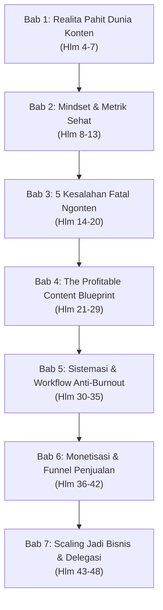
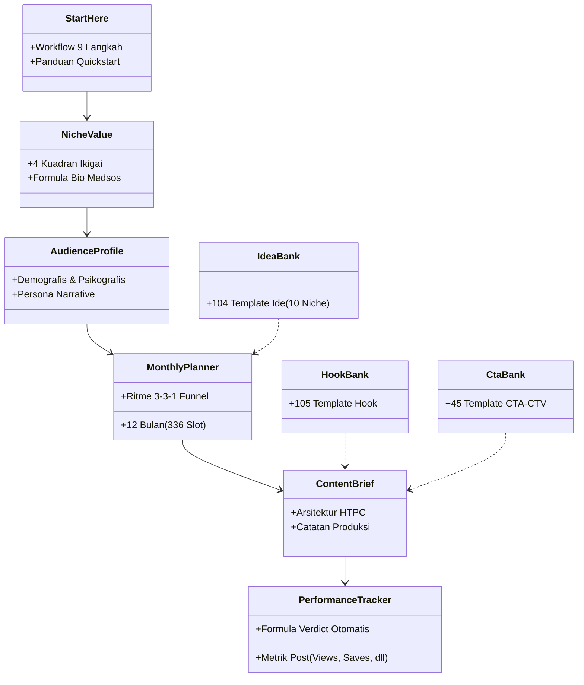
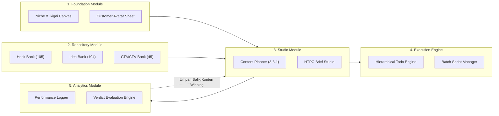
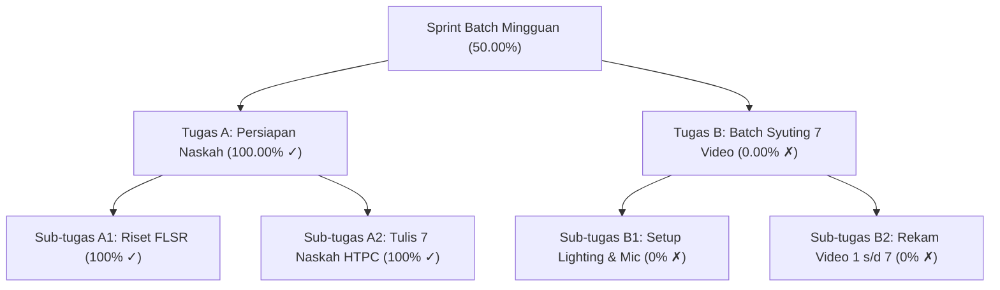
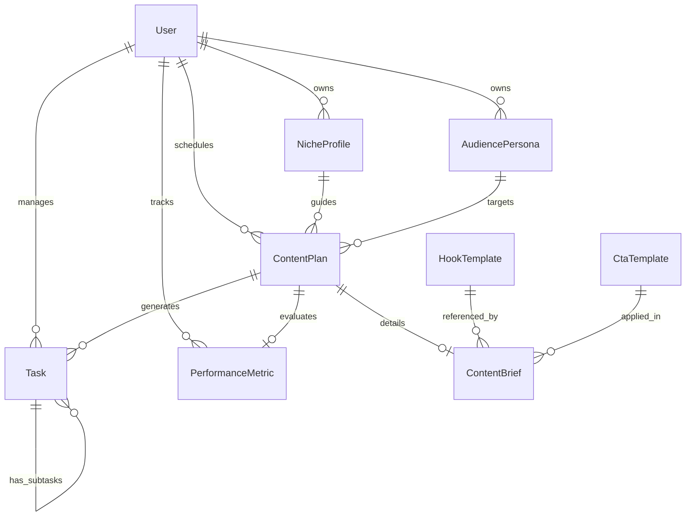
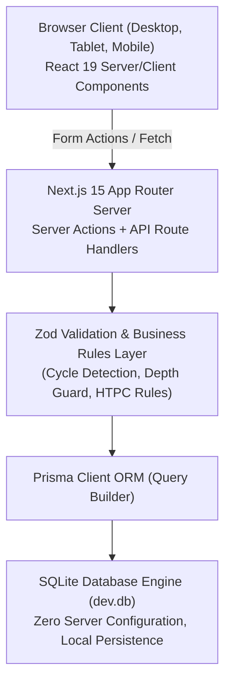
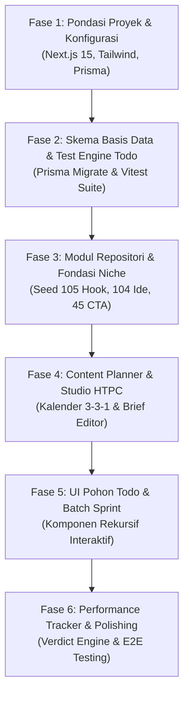

# SPESIFIKASI PRODUK & ARSITEKTUR TEKNIS: PRODUCTIVITY STUDIO
## Content Creator & Business Operating System (Bukan Cuma Posting Methodology)

---

### 1. Metadata Dokumen

| Parameter | Keterangan |
| :--- | :--- |
| **Judul Dokumen** | Spesifikasi Produk & Arsitektur Teknis Terpadu: Productivity Studio |
| **Tujuan Dokumen** | Menjadi dokumen acuan tunggal (*single source of truth*) yang mandiri (*self-contained*), berbasis bukti (*evidence-based*), dan komprehensif untuk memandu perancangan basis data, logika bisnis, antarmuka pengguna, dan implementasi aplikasi web Productivity Studio tanpa bergantung pada riwayat percakapan sebelumnya. |
| **Versi** | 1.0.0-DRAFT |
| **Status Persetujuan** | **Draft — Menunggu Persetujuan Resmi (*Awaiting Approval*)** |
| **Tanggal Pembuatan** | 14 Oktober 2026 |
| **Ruang Lingkup** | Transformasi metodologi ebook *Mending Gak Usah Ngonten* dan *Ultimate Content Toolkit.xlsx* ke dalam aplikasi web terpadu, dilengkapi mesin *Hierarchical Recursive Todo* dengan kalkulasi progres otomatis. |
| **File Sumber Otoritatif** | 1. `E-Book Mending Gak Usah Ngonten.pdf` (160 halaman, 2.017 paragraf, 26.868 karakter teks ekstraksi).<br>2. `Ultimate Content Toolkit.xlsx` (12 lembar kerja aktif, 210 formula terverifikasi). |
| **Batasan Audit** | Audit dilakukan secara non-destruktif menggunakan Office COM Interop dan parsing murni OpenXML standard library Python. File sumber asli tidak dimodifikasi sama sekali. Seluruh usulan fitur baru yang tidak tertulis langsung di sumber ditandai secara eksplisit sebagai rekomendasi. |

> [!WARNING]
> Dokumen ini berstatus **DRAFT** dan belum disetujui untuk tahap implementasi (*Phase 6*). Tidak ada kode aplikasi, konfigurasi framework, atau dependensi paket yang boleh diinstal sebelum dokumen ini ditinjau dan disetujui secara eksplisit oleh Product Owner / User.

---

### 2. Ringkasan Eksekutif (*Executive Summary*)

#### 2.1 Tujuan Aplikasi
Aplikasi **Productivity Studio** dirancang untuk menjadi sistem operasi kerja harian (*operating system*) bagi kreator konten, solopreneur, dan pemilik UMKM. Aplikasi ini mengubah proses pembuatan konten yang selama ini sporadis, bergantung pada *mood*, dan terjebak pada metrik semu (*vanity metrics*), menjadi sistem bisnis yang terukur, dapat didelegasikan, dan berfokus pada pendapatan (*sanity metrics*).

#### 2.2 Hubungan Bahan Sumber: Ebook vs Spreadsheet
1. **Ebook (*Conceptual Authority*):** Menyediakan filosofi, prinsip psikologi audiens, fondasi *positioning*, mitigasi *burnout* melalui metode *batching*, dan strategi monetisasi penawaran (*Grand Slam Offer*).
2. **Spreadsheet (*Operational Authority*):** Menyediakan tata kelola data terstruktur, format kalender editorial 336 slot konten tahunan, arsitektur naskah *Hook-Tension-Payoff-Call to Value* (HTPC), bank referensi (105 hook, 104 ide konten, 45 CTA/CTV), dan formula evaluasi performa otomatis (*Winning Content Identifier*).

#### 2.3 Solusi Terpadu yang Dihadirkan
Aplikasi ini menyatukan dua pilar utama yang saling terhubung:
1. **Sistem Perencanaan & Eksekusi Konten BCP:** Mengalirkan tahapan dari perumusan Niche & Ikigai, Audience Avatar (ICP), Kalender Mingguan 3-3-1 (*Engagement, Authority, Sales*), Studio Penulisan Naskah HTPC, hingga Pelacak Kinerja dengan evaluasi matematis otomatis (`WINNING`, `GOOD`, `OPTIMASI`, `STOP`).
2. **Mesin Todo Hierarkis Rekursif (*Recursive Hierarchical Todo Engine*):** Memandu pelaksanaan produksi massal (*batch production sprint*) dengan dekomposisi hierarki bersarang (*nested tasks*) tanpa batas kedalaman buatan, di mana progres persentase dihitung secara rekursif berbasis rata-rata bobot cabang langsung (*equal-weighted branch averaging*).

#### 2.4 Hal yang Masih Menjadi Pertanyaan & Ketidakpastian
- Mekanisme autentikasi pengguna pada rilis perdana (MVP): apakah diprioritaskan sebagai *single-user workspace* lokal tanpa login, atau multi-user berbasis session/JWT.
- Integrasi API platform sosial (Instagram Graph API / TikTok API) untuk penarikan metrik otomatis versus input manual pasca-tayang 2 minggu.
- Kebijakan eksklusi tugas yang diarsipkan (*archived tasks*) terhadap persentase induk yang disepakati.

---

### 3. Analisis Bahan Sumber (*Source Material Analysis*)

#### 3.1 Analisis Ebook: *Mending Gak Usah Ngonten!*
Penulis teridentifikasi sebagai "The Founder" (founder ekosistem *Bukan Cuma Posting* / BCP, Oka & Hasan). Buku terdiri dari 7 bab utama, pengantar, penutup, dan lampiran bonus panduan toolkit.



| Bab / Bagian | Halaman | Konsep Utama & Temuan Faktual | Relevansi Fitur Aplikasi | Status Penafsiran |
| :--- | :---: | :--- | :--- | :--- |
| **Kata Pengantar & Bab 1** | 2–7 | - Ilusi "Viral Dulu, Cuan Kemudian".<br>- 90% kreator gagal karena: ekspektasi instan, tidak punya sistem (hanya mengandalkan mood), dan boncos energi tanpa roadmap finansial.<br>- Eksposur tanpa konversi tidak menghasilkan uang. | Dashboard analitik harus menonjolkan rasio simpan (*save rate*) dan konversi daripada sekadar angka *views*. | **Eksplisit** |
| **Bab 2** | 8–13 | - **Algoritma Platform:** Bukan musuh, melainkan mitra bisnis pencocok minat berbasis retensi (Watch Time, Saves, Shares, Comments, Likes).<br>- **Personal Branding:** Nilai yang dirasakan audiens, bukan sekadar flexing.<br>- **Vanity vs Sanity Metrics:** Views/Likes adalah metrik semu; CTR bio, perolehan prospek (*leads*), conversion rate, dan Customer Lifetime Value (CLV) adalah metrik sehat. | Modul *Performance Tracker* memisahkan metrik interaksi semu dengan metrik otoritas (*saves*) dan penjualan. | **Eksplisit** |
| **Bab 3** | 14–20 | - **5 Kesalahan Fatal:** (1) Target audiens tidak spesifik/terlalu luas, (2) *Hard selling* akut (harus 80% memberi nilai, 20% promosi), (3) Audio bising dan pencahayaan buruk, (4) Hook 3 detik pertama lemah dan storytelling garing, (5) Tidak ada *Call to Action* (CTA) yang jelas (*One Video, One Goal, One CTA*). | Form pembuatan *Content Brief* mewajibkan penetapan 1 tujuan, 1 target persona, dan 1 CTA terarah. | **Eksplisit** |
| **Bab 4** | 21–29 | - **Niche Sweet Spot:** Irisan antara Keahlian/Passion, Masalah Nyata di Pasar, dan Daya Beli (*Purchasing Power*).<br>- **Customer Avatar 4 Dimensi:** Demografis, Pain Points/Frustrasi, Desires/Impian, dan Objections/Keraguan.<br>- **4 Pilar Konten:** Edukasi (40%), Hiburan/Relatable (25%), Inspirasi/Story (20%), Promosi (15%).<br>- **The 3-Second Hook Rule:** Format hook Negatif, Celah Penasaran (*Curiosity Gap*), dan Bukti Spesifik (*Proof/Result*).<br>- **Storytelling Hero's Journey:** Kondisi Awal $\rightarrow$ Titik Terendah $\rightarrow$ Titik Balik $\rightarrow$ Transformasi $\rightarrow$ Undangan/Tawaran. | Modul *Niche & Value Builder*, *Audience Persona Sheet*, *Hook Selector*, dan studio naskah berbasis pilar. | **Eksplisit** |
| **Bab 5** | 30–35 | - **Ide Tanpa Batas:** Matriks 5 Sub-topik $\times$ 4 Pilar $\times$ 3 Format = 60 ide instan. Riset komentar kompetitor & AnswerThePublic.<br>- **Batch Production System (Content Sprint):** Senin (Riset & validasi 7 ide), Selasa (Scripting 7 naskah), Sabtu (Batch shooting 7 video), Minggu (Editing & scheduling). Mencegah kelelahan mental (*burnout*). | Mesin Todo Hierarkis diintegrasikan langsung untuk memandu siklus mingguan *Content Sprint*. | **Eksplisit** |
| **Bab 6** | 36–42 | - **Grand Slam Offer (Alex Hormozi):** Dream Outcome, Perceived Likelihood, Speed/Time Delay, Effort/Sacrifice, ditambah pemanis bonus, garansi 100%, kelangkaan (*urgency*).<br>- **3-Stage Funnel:** Top of Funnel / TOFU (Cold traffic di Reels/TikTok) $\rightarrow$ Middle of Funnel / MOFU (Lead magnet ke WA/Email) $\rightarrow$ Bottom of Funnel / BOFU (Penawaran produk inti).<br>- **Closing Konsultatif 4 Langkah:** Acknowledge $\rightarrow$ Gali Masalah $\rightarrow$ Tawarkan Solusi $\rightarrow$ CTA Lembut. | Labeling Funnel Layer pada perencanaan konten (`Engagement` = TOFU, `Authority` = MOFU, `Sales` = BOFU). | **Eksplisit** |
| **Bab 7** | 43–48 | - **Delegasi Bertahap:** Fase 1 (Video Editor Freelance) $\rightarrow$ Fase 2 (Admin CS & Scheduling) $\rightarrow$ Fase 3 (Scriptwriter/Researcher).<br>- **4 Saluran Pemasukan:** Jasa Aktif, Produk Digital, Affiliate, Endorsement.<br>- **Evergreen Content:** Konten abadi sebagai aset digital jangka panjang. | Dukungan multi-role (Creator, Editor, Admin) pada arsitektur teknis masa depan. | **Inferensi (Pengembangan)** |
| **Bonus Lampiran** | 49–50 | Akses resmi ke spreadsheet *Ultimate Content Toolkit.xlsx* yang memuat 12 template operasional. | Jembatan pengikat antara metodologi ebook dan workbook Excel. | **Eksplisit** |

---

#### 3.2 Analisis Spreadsheet: *Ultimate Content Toolkit.xlsx*
Spreadsheet berukuran 11.119.666 bytes (~10,6 MB) dengan 12 worksheet aktif (seluruhnya berstatus `visible`, tidak ada sheet tersembunyi). Tepat ditemukan **210 formula** yang terpusat di lembar kerja *Performance Tracker*.



##### Inventaris Lengkap 12 Worksheet

1. **`🗺️ Start Here` (Dimensi: A1:D49, 0 Formula, 0 Validasi Data)**
   - *Tujuan:* Peta navigasi seluruh toolkit, panduan 3 langkah kilat (*Setup* $\rightarrow$ *Monthly Plan* $\rightarrow$ *Weekly Execution*), dan SOP 9 langkah kerja ideal.
   - *Elemen Data:* Metadata hak cipta © 2026 Bukan Cuma Posting (`bukancumaposting.com`, `@bukancumaposting`).

2. **`🎯 Niche & Value` (Dimensi: A1:D103, 0 Formula, 0 Validasi Data)**
   - *Tujuan:* Lembar kerja penentuan positioning menggunakan kerangka Ikigai (*Yang Disukai, Dikuasai, Dibutuhkan Dunia, Dihasilkan Uang*).
   - *Elemen Kunci:* *Sweet Spot*, Pernyataan *Niche Final*, *Core Value*, Formula Bio Instagram (3 variasi: Problem, Result, Identity), Bio TikTok, dan Tagline. Dilengkapi 3 template *AI Prompt* untuk perumusan Ikigai, Value Statement, dan Validasi Pasar.

3. **`👥 Audience Profile` (Dimensi: A1:D86, 0 Formula, 0 Validasi Data)**
   - *Tujuan:* Pemetaan profil pelanggan ideal (*Ideal Customer Profile* / ICP) secara multi-dimensi.
   - *Elemen Kunci:* Data demografis (usia, gender, lokasi, pekerjaan, penghasilan), psikografis (*pain points*, ketakutan, impian, frustrasi harian, konsumsi media), dan narasi persona (studi kasus contoh: "Dinda, 25 tahun, karyawan swasta"). Dilengkapi 3 template *AI Prompt* pembangun narasi persona dan uji kritis (*roast my persona*).

4. **`📆 Monthly Planner` (Dimensi: A1:I470, 0 Formula, 2 Validasi Data)**
   - *Tujuan:* Kalender perencanaan 12 bulan (Januari–Desember), 4 minggu per bulan, 7 slot per minggu (total 28 konten/bulan atau **336 slot konten terstruktur**).
   - *Struktur Kolom:* `#`, `FUNNEL`, `TOPIK`, `REFERENSI (link viral)`, Kolom kosong (E), `FORMAT`, `PLATFORM`, `STATUS`, `NOTES`.
   - *Validasi Data:*
     - Kolom `FORMAT` (F22:F26): List dropdown `"Single Image,Carousel,Reels"`.
     - Kolom `STATUS` (H22:H448 pada setiap baris konten): List dropdown `"Ide,On Process,Done,Posted"`.
   - *Aturan Komposisi Funnel BCP:* Setiap minggu memiliki pola tetap **3 Engagement, 3 Authority, 1 Sales**.
   - *Template Prompt AI:* Prompt perencanaan mingguan strategis dan asisten riset FLSR (*Finding, Listing, Sorting, Recreating*).

5. **`📝 Content Brief` (Dimensi: A1:C134, 0 Formula, 0 Validasi Data)**
   - *Tujuan:* Kartu instruksi produksi terstandarisasi untuk setiap naskah video sebelum proses rekaman.
   - *Struktur Inti (HTPC Framework):*
     - `📅 Tanggal Posting Target`
     - `🎯 Funnel Layer` (`Engagement`, `Authority`, `Sales`)
     - `📺 Platform`
     - `👥 Target Audience`
     - `📌 Topik Konten`
     - `🔗 Referensi (FLSR)`
     - `⏱️ Durasi Target` (contoh: "45-60 detik")
     - `🪝 HOOK (3 detik pertama)`: Kalimat pembuka visual/verbal pencegah scroll.
     - `⚡ TENSION (perparah masalah)`: Eskalasi frustrasi dan titik sakit audiens.
     - `✨ PAYOFF (kasih value)`: Solusi konkret, sistem, atau daging materi.
     - `🎯 CALL TO VALUE (CTV)`: Ajakan bertindak yang memberikan nilai nyata.
     - `🎬 Format & Style`, `📝 Caption`, `🏷️ Hashtag (max 5)`.

6. **`🔥 Hook Bank` (Dimensi: A1:G141, 0 Formula, 0 Validasi Data)**
   - *Tujuan:* Repositori terkurasi berisi **105 template hook** lintas kategori psikologis.
   - *Distribusi Kategori:*
     - `😤 NEGATIVITY` (20 hook): Memicu ketakutan, penyesalan, atau peringatan kerugian.
     - `🤔 CURIOSITY` (20 hook): Membuka celah misteri dan kesenjangan informasi.
     - `📋 LIST/NUMBER` (20 hook): Kekuatan angka spesifik dan daftar taktis.
     - `⚡ CONTROVERSY` (15 hook): Menentang arus utama (*counter-narrative*).
     - `😱 FOMO` (15 hook): Memicu urgensi, kelangkaan, dan ketakutan tertinggal.
     - `👑 AUTHORITY` (15 hook): Menampilkan kredibilitas, hasil nyata, dan keahlian.
   - *Struktur Kolom:* `#`, `KATEGORI`, `TEMPLATE HOOK`, `CONTOH JADI (referensi)`, `NICHE COCOK`, `PLATFORM`.

7. **`💡 Bank Ide Konten` (Dimensi: A1:G124, 0 Formula, 0 Validasi Data)**
   - *Tujuan:* Repositori inspirasi berisi **104 template ide** konten yang tersebar di 10 sektor industri.
   - *Distribusi Niche:*
     - `👤 Personal Brand` (12 ide)
     - `🏢 Bisnis & UMKM` (12 ide)
     - `📚 Edukasi` (12 ide)
     - `🌿 Lifestyle` (10 ide)
     - `💰 Finance` (10 ide)
     - `💪 Health` (10 ide)
     - `👗 Fashion` (10 ide)
     - `🍜 Kuliner` (10 ide)
     - `🎬 Content Creator` (10 ide)
     - `👶 Parenting` (8 ide)
   - *Distribusi Funnel:* 52 Authority, 48 Engagement, 4 Sales.
   - *Struktur Kolom:* `#`, `NICHE`, `TEMPLATE IDE`, `CONTOH JADI (referensi)`, `FUNNEL`, `FORMAT`.

8. **`🎯 Bank of CTA-CTV` (Dimensi: A1:E65, 0 Formula, 0 Validasi Data)**
   - *Tujuan:* Repositori penutup video berisi **45 template penutup**, menegaskan perbedaan mendasar:
     - **CTA (Call to Action):** Meminta aksi transaksional (contoh: *"Like dan follow ya"*).
     - **CTV (Call to Value):** Menawarkan keuntungan nyata bagi audiens (contoh: *"Save video ini karena lo bakal butuh pas stuck bikin konten"*).
   - *Distribusi Funnel Layer:* 15 Engagement, 15 Authority, 15 Sales.
   - *Struktur Kolom:* `#`, `KATEGORI`, `TEMPLATE`, `CONTOH JADI`, `TIPE` (`CTA` / `CTV`).

9. **`🛠️ Tools Ngonten` (Dimensi: A1:E62, 0 Formula, 0 Validasi Data)**
   - *Tujuan:* Direktori piranti lunak dan AI pembantu produksi konten yang dipetakan ke dalam 5 Fase Produksi:
     - *Fase 1: Riset (8 tools):* Google Trends, AnswerThePublic, AnswerSocrates, BuzzSumo, TikTok Creative Center, Sort Feed, ChatGPT/Claude, Perplexity.
     - *Fase 2: Nulis (4 tools):* ChatGPT/Claude, Claude, Google Docs, Notion.
     - *Fase 3: Produksi (4 tools):* CapCut, Teleprompter apps, Mic Wireless Clip-on, Lighting/Ring Light.
     - *Fase 4: Editing (3 tools):* CapCut Desktop/Mobile, Premiere Pro, Canva.
     - *Fase 5: Analisis (2 tools):* Native Platform Analytics, BCP Performance Tracker.
   - *Struktur Kolom:* `#`, `NAMA TOOL`, `HARGA` (`Gratis`, `Freemium`, `Berbayar`), `FUNGSI / KENAPA DIPAKAI`, `UNTUK`.

10. **`📊 Performance Tracker` (Dimensi: A1:O177, 210 Formula, 1 Validasi Data)**
    - *Tujuan:* Tabel evaluasi konten 2 minggu pasca tayang untuk menemukan pola konten pemenang (*Winning Content Identifier*).
    - *Struktur Kolom (Baris 10):*
      - A: `#`
      - B: `TANGGAL POST`
      - C: `TOPIK KONTEN`
      - D: `FUNNEL` (Validasi List: `"Engagement,Authority,Sales"`)
      - E: `FORMAT`
      - F: `LINK KONTEN`
      - G: `VIEWS` (Angka bulat)
      - H: `LIKES`
      - I: `KOMEN`
      - J: `SHARE`
      - K: `SAVE`
      - L: `VERDICT` (Formula Otomatis Terkunci)
      - M: `TGL EVAL`
      - N: `LEARNING / NEXT ACTION`
      - O: `SAVE RATE %` (Formula Otomatis Terkunci)
    - *Formula Baris Data (Baris 11 s/d 110 — 100 baris data):*
      - **Save Rate % (Kolom O):**
        $$O_{11} = \text{IFERROR}(\text{TEXT}(K_{11} / G_{11}, "0.0\%"), "-")$$
      - **Verdict Otomatis (Kolom L):**
        $$L_{11} = \text{IF}(G_{11}="", "", \text{IF}(\text{AND}(G_{11} > \text{AVERAGE}(\$G\$11:\$G\$110), \text{IFERROR}(K_{11}/G_{11},0) > 0.05), \text{"WINNING"}, \text{IF}(G_{11} > \text{AVERAGE}(\$G\$11:\$G\$110), \text{"GOOD"}, \text{IF}(G_{11} < \text{AVERAGE}(\$G\$11:\$G\$110) \times 0.5, \text{"STOP"}, \text{"OPTIMASI"}))))$$
    - *Logika Matematis Evaluasi:*
      1. **WINNING:** $\text{Views} > \text{Rata-rata} \;\land\; \text{Save Rate} > 5\%$ $\rightarrow$ *Tindakan: Replikasi segera! Topik + hook + format terbukti bekerja.*
      2. **GOOD:** $\text{Views} > \text{Rata-rata} \;\land\; \text{Save Rate} \le 5\%$ $\rightarrow$ *Tindakan: Performa solid, pertahankan sebagai referensi.*
      3. **STOP:** $\text{Views} < 0.5 \times \text{Rata-rata}$ $\rightarrow$ *Tindakan: Hentikan pola ini, topik/format tidak resonan.*
      4. **OPTIMASI:** $0.5 \times \text{Rata-rata} \le \text{Views} \le \text{Rata-rata}$ $\rightarrow$ *Tindakan: Evaluasi hook dan sudut pandang topik.*
    - *Formula Ringkasan Agregat (Baris 114 s/d 123):*
      - C114 (`Total Konten Posted`): `=COUNTA(C11:C110)`
      - C115 (`Rata-rata Views`): `=IFERROR(ROUND(AVERAGE(G11:G110),0),0)`
      - C116 (`Total Winning`): `=COUNTIF(L11:L110,"WINNING")`
      - C117 (`Total Good`): `=COUNTIF(L11:L110,"GOOD")`
      - C118 (`Perlu Optimasi`): `=COUNTIF(L11:L110,"OPTIMASI")`
      - C119 (`Harus Stop`): `=COUNTIF(L11:L110,"STOP")`
      - C120 (`Total Likes`): `=SUM(H11:H110)`
      - C121 (`Total Komen`): `=SUM(I11:I110)`
      - C122 (`Total Share`): `=SUM(J11:J110)`
      - C123 (`Total Save`): `=SUM(K11:K110)`

11. **`📖 Kamus Istilah` (Dimensi: A1:D116, 0 Formula, 0 Validasi Data)**
    - *Tujuan:* Glosarium istilah industri media sosial yang diterjemahkan ke dalam bahasa awam ("bahasa manusia").
    - *Kategori:* 20 Istilah Metrik & Analitik, 25 Istilah Strategi, 15 Istilah Platform, 20 Istilah Produksi, 20 Istilah Monetisasi.
    - *Struktur Kolom:* `#`, `ISTILAH`, `ARTINYA (bahasa manusia)`, `CONTOH PENGGUNAAN`.

12. **`🚀 Level Up` (Dimensi: A1:G27, 0 Formula, 0 Validasi Data)**
    - *Tujuan:* Peta ekosistem komersial BCP dan bukti sosial (*social proof*).
    - *Metrik Otoritas Organik:* 33,9M+ Organic Views, 299K+ Followers, 120+ Klien Aktif, 26,5M+ Reach, 0 Rupiah Ad Spend, 5+ Tahun Pengalaman.
    - *Tangga Produk:* Ebook (Mending Gak Usah Ngonten) $\rightarrow$ Webinar BCP (Rp 149.000) $\rightarrow$ The 30 Content System $\rightarrow$ Winning Content Mastery Course (Rp 549.000) $\rightarrow$ 1-on-1 Consultation (Rp 1.249.000) $\rightarrow$ Offline Workshop.

---

#### 3.3 Sintesis Silang & Matriks Ketertelusuran (*Traceability Matrix*)

Tabel berikut menghubungkan bukti faktual sumber dengan usulan entitas basis data dan fitur aplikasi:

| ID Kebutuhan | Bukti Sumber Otoritatif | Konsep / Alur Kerja Sumber | Usulan Fitur Aplikasi Web | Entitas Data Terkait | Kriteria Penerimaan (*Acceptance Criteria*) |
| :---: | :--- | :--- | :--- | :--- | :--- |
| **REQ-FND-01** | Ebook Hal. 21; Excel Sheet `🎯 Niche & Value` | Framework Ikigai (4 Kuadran) & Formula Bio | Modul *Niche & Value Builder* dengan generator bio otomatis | `NicheProfile` | Pengguna dapat mengisi 4 kuadran dan menyimpan 3 variasi bio medsos. |
| **REQ-FND-02** | Ebook Hal. 22; Excel Sheet `👥 Audience Profile` | Customer Avatar 4 Dimensi & Persona Narrative | Kartu Profil Audiens Interaktif (ICP) | `AudiencePersona` | Tersimpan data demografis, frustrasi utama, impian, dan narasi personal. |
| **REQ-PLN-01** | Ebook Hal. 24, 30; Excel Sheet `📆 Monthly Planner` | Kalender 336 Slot dengan Ritme Mingguan 3-3-1 (*Engagement, Authority, Sales*) | Kalender Konten Interaktif & Tampilan Kanban Status | `ContentPlan` | Mendukung penjadwalan 7 slot mingguan dengan penegakan rasio funnel 3-3-1. |
| **REQ-BRF-01** | Ebook Hal. 26; Excel Sheet `📝 Content Brief` | Arsitektur Naskah HTPC (Hook, Tension, Payoff, CTV) | Studio Penulisan Naskah HTPC (*Content Brief Editor*) | `ContentBrief` | Editor mewajibkan 4 blok input terpisah (H, T, P, C) sebelum status berganti ke `Done`. |
| **REQ-BNK-01** | Ebook Hal. 25; Excel Sheet `🔥 Hook Bank` | 105 Template Hook dalam 6 Pemicu Psikologis | Laci *Hook Bank* dengan Filter Kategori & Pencarian Kata Kunci | `HookTemplate` | Pengguna dapat memfilter berdasarkan 6 pemicu dan menyalin ke Brief dengan 1 klik. |
| **REQ-BNK-02** | Ebook Hal. 30; Excel Sheet `💡 Bank Ide Konten` | 104 Template Ide Lintas 10 Niche Industri | *Content Idea Explorer* berbasis Niche & Funnel | `IdeaTemplate` | Filter instan berdasarkan 10 industri dan funnel layer, mendukung penambahan ide kustom. |
| **REQ-BNK-03** | Ebook Hal. 19; Excel Sheet `🎯 Bank of CTA-CTV` | 45 Template Penutup (Perbedaan CTA vs CTV) | *CTA/CTV Selector Drawer* | `CtaTemplate` | Memisahkan pilihan CTA (tindakan) dan CTV (nilai) pada editor naskah brief. |
| **REQ-TRK-01** | Ebook Hal. 11; Excel Sheet `📊 Performance Tracker` | Metrik Sanity & Formula Evaluasi Verdict Otomatis (Baris 11-110) | *Performance Tracker & Winning Content Dashboard* | `PerformanceMetric` | Menghitung otomatis Save Rate % dan status verdict (`WINNING`, `GOOD`, `OPTIMASI`, `STOP`) saat metrik diinput. |
| **REQ-LIB-01** | Ebook Hal. 9, 33; Excel Sheet `🛠️ Tools` & `📖 Kamus` | 31 Tools Terkurasi dalam 5 Fase & 100 Glosarium Istilah Medsos | Direktori Tools Interaktif & Kamus Istilah Kreator | `ToolReference`, `GlossaryTerm` | Fitur pencarian cepat dan filter fase produksi tools / kategori istilah. |
| **REQ-TODO-01** | Kebutuhan Eksplisit Pengguna; Ebook Hal. 31 (Batch Production) | Siklus Eksekusi Sprint Mingguan (Riset, Nulis, Syuting, Editing) | **Recursive Hierarchical Todo System** | `Task` (Self-referential `parent_id`) | Pohon tugas bersarang tanpa batas level buatan; progres anak terpropagasi rekursif ke seluruh leluhur. |

---

### 4. Visi Produk dan Ruang Lingkup (*Product Vision & Scope*)

#### 4.1 Visi Produk
Membangun platform terpadu yang membebaskan kreator konten dan pemilik bisnis dari siklus *burnout* dan metrik semu, dengan menggabungkan kejelasan strategi konten (*clarity*), eksekusi produksi massal yang disiplin (*hierarchical execution*), dan analisis data yang objektif (*actionable intelligence*).

#### 4.2 Target Pengguna
1. **Solopreneur & Kreator Edukasi/Bisnis:** Individu yang membangun personal brand atau menjual produk digital/jasa melalui konten organik di Instagram dan TikTok.
2. **Pemilik UMKM & Brand Lokal:** Bisnis skala kecil-menengah yang ingin menghasilkan omzet dari media sosial tanpa mengandalkan iklan berbayar mahal.
3. **Tim Kreatif / Agensi Skala Kecil:** Kreator yang mulai mendelegasikan tugas ke video editor atau admin media sosial.

#### 4.3 Masalah Inti Pengguna
- **Sindrom Blank Screen / Kehabisan Ide:** Bingung menentukan topik harian dan tidak memiliki bank referensi terstruktur.
- **Burnout Akut:** Menjalani siklus produksi harian yang melelahkan (hari ini cari ide, hari ini syuting, hari ini edit) tanpa sistem *batching*.
- **Ekspektasi Semu & Frustrasi Metrik:** Terjebak mengejar jutaan views receh yang tidak menghasilkan prospek dan penjualan.
- **Ketiadaan Pelacakan Progres Proyek:** Kesulitan memecah proyek besar (misalnya peluncuran 7 video mingguan) ke dalam sub-tugas terperinci dengan indikator progres yang akurat.

#### 4.4 Prinsip Desain Produk
1. **Content is an Asset, Not Noise:** Setiap konten harus memiliki tujuan funnel yang jelas (*Engagement*, *Authority*, atau *Sales*).
2. **Deterministic & Drift-Free:** Nilai turunan (seperti progres todo dan verdict performa) dihitung secara matematis murni tanpa redundansi penyimpanan data yang rentan tidak sinkron.
3. **Restrained & Functional Elegance:** Antarmuka bebas dari ornamen berlebihan, gradien neon, atau elemen visual artifisial dashboard AI generik. Mengutamakan kenyamanan membaca naskah, hierarki informasi yang tegas, dan densitas data yang efisien.
4. **Single Source of Truth:** Seluruh relasi data dirancang dengan integritas referensial yang kuat.

#### 4.5 Batasan Cakupan MVP (*Minimum Viable Product Scope*)
- Modul Foundation (Niche & Ikigai Builder, Audience Persona Profile).
- Modul Repositori (Hook Bank 105 template, Idea Bank 104 template, CTA/CTV 45 template, Glosarium 100 istilah, Direktori 31 tools terkurasi).
- Modul Perencanaan & Naskah (Kalender 3-3-1 mingguan & Editor Content Brief HTPC).
- Modul Mesin Todo Hierarkis Rekursif (Pohon tugas bersarang, kalkulasi progres cabang langsung, pencegahan siklus).
- Modul Pelacak Kinerja (Input manual metrik post 2 minggu & engine verdict otomatis).

#### 4.6 Fitur yang Ditunda (*Deferred Features - Post-MVP*)
- Integrasi API eksternal (Instagram Graph API, TikTok for Business API).
- Eksekusi langsung *AI Prompts* di dalam aplikasi via koneksi LLM API (OpenAI/Anthropic).
- Fitur ekspor naskah massal ke format PDF teleprompter atau Google Docs otomatis.

#### 4.7 Fitur di Luar Cakupan (*Out-of-Scope*)
- Transcoding atau hosting file video mentah secara langsung di dalam server aplikasi.
- Sistem pesan instan / automasi bot percakapan WhatsApp (*closing bot*).
- Multi-tenant SaaS billing atau langganan pembayaran kartu kredit.

---

### 5. Kebutuhan Fungsional & Modul Aplikasi



#### Modul 1: Foundation Module (Niche, Value, & Audience Persona)
- **Tujuan:** Menetapkan arah positioning bisnis dan mendefinisikan audiens ideal secara spesifik sebelum konten dibuat.
- **Entitas Data:** `NicheProfile`, `AudiencePersona`.
- **Alur Kerja Utama:**
  1. Pengguna mengisi 4 kuadran Ikigai (Suka, Kuasai, Butuh, Cuan).
  2. Sistem menyimpan *Sweet Spot*, *Core Value*, dan formula bio sosial media.
  3. Pengguna membuat profil persona audiens (demografis, *pain points*, *desires*, *objections*, dan narasi persona).
- **Kriteria Penerimaan:** Form menyediakan validasi panjang teks, penyimpanan instan, dan pratinjau teks bio medsos siap salin.

#### Modul 2: Repository Module (Bank Hook, Bank Ide, & Bank CTA/CTV)
- **Tujuan:** Menyediakan inspirasi instan yang dapat dicari dan disaring saat pengguna mengalami kebuntuan ide.
- **Entitas Data:** `HookTemplate`, `IdeaTemplate`, `CtaTemplate`.
- **Alur Kerja Utama:**
  1. Pengguna membuka laci (*drawer*) Hook Bank dan memfilter kategori (misal: `NEGATIVITY`).
  2. Pengguna mengisi bagian placeholder `[dalam kurung]` dan menekan tombol *Insert to Brief*.
  3. Pengguna menelusuri Bank Ide berdasarkan 10 niche industri dan 3 layer funnel.
- **Kriteria Penerimaan:** Pencarian teks bebas responsif (< 50ms), penyaringan multi-kategori, dan kemampuan menambahkan template kustom oleh pengguna.

#### Modul 3: Content Planner & HTPC Studio
- **Tujuan:** Mengelola kalender konten dengan disiplin funnel BCP (3 Engagement, 3 Authority, 1 Sales) serta menyusun naskah terstruktur.
- **Entitas Data:** `ContentPlan`, `ContentBrief`.
- **Alur Kerja Utama:**
  1. Pengguna menjadwalkan konten pada kalender mingguan.
  2. Sistem menandai secara visual rasio 3-3-1 per minggu.
  3. Pengguna membuka kartu *Content Brief* dan mengisi 4 blok naskah: Hook, Tension, Payoff, dan Call to Value.
  4. Pengguna mengubah status konten (`Ide` $\rightarrow$ `On Process` $\rightarrow$ `Done` $\rightarrow$ `Posted`).
- **Kriteria Penerimaan:** Status `Done` hanya dapat dipilih jika seluruh blok HTPC telah terisi.

#### Modul 4: Recursive Hierarchical Todo Engine
- **Tujuan:** Memandu pelaksanaan produksi massal (*Content Sprint*) dengan dekomposisi hierarki tugas tanpa batas kedalaman buatan.
- **Entitas Data:** `Task` (Self-referencing `parent_id`).
- **Alur Kerja Utama:**
  1. Pengguna membuat tugas proyek (misal: "Batch Syuting Minggu 1").
  2. Pengguna menambahkan sub-tugas bertingkat secara fleksibel.
  3. Centang pada tugas daun (*leaf*) secara otomatis memperbarui persentase seluruh leluhur (*ancestors*).
- **Kriteria Penerimaan:** Memenuhi 12 aturan baseline progres dan lolos 11 skenario pengujian unit/integrasi.

#### Modul 5: Performance Tracker & Verdict Engine
- **Tujuan:** Mencatat hasil performa aktual konten 2 minggu pasca tayang dan menentukan kelayakan replikasi topik.
- **Entitas Data:** `PerformanceMetric`.
- **Alur Kerja Utama:**
  1. Pengguna memasukkan metrik: Views, Likes, Comments, Shares, Saves.
  2. Sistem menghitung otomatis *Save Rate %* ($K_{11} / G_{11}$).
  3. Sistem menghitung rata-rata *views* dinamis seluruh postingan dan memberikan label verdict (`WINNING`, `GOOD`, `OPTIMASI`, `STOP`).
  4. Pengguna menandai konten `WINNING` untuk direplikasi ke kalender minggu berikutnya.
- **Kriteria Penerimaan:** Perhitungan matematis identik 100% dengan formula Excel baris 11-110.

#### Modul 6: Resource Library & Glossary
- **Tujuan:** Pusat referensi terpadu glosarium 100 istilah media sosial dan direktori 31 tools produksi terkurasi.
- **Entitas Data:** `GlossaryTerm`, `ToolReference`.
- **Kriteria Penerimaan:** Pencarian instan dan kategorisasi visual berdasarkan 5 fase produksi dan 5 kategori istilah.

---

### 6. Spesifikasi Mesin Todo Hierarkis Rekursif (*Phase 3 Engine*)



#### 6.1 Landasan Aturan Dasar Progres (Aturan 1 s/d 12)

1. **Aturan 1 (Tugas Daun Inkomplit):** Tugas tanpa anak (*leaf task*) yang berstatus belum selesai memiliki nilai progres tepat **0%**.
2. **Aturan 2 (Tugas Daun Komplit):** Tugas tanpa anak (*leaf task*) yang berstatus selesai memiliki nilai progres tepat **100%**.
3. **Aturan 3 (Kalkulasi Progres Induk):** Tugas yang memiliki satu atau lebih anak memperoleh nilai progres dari rata-rata hitung (*arithmetic mean*) nilai progres anak-anak langsungnya (*direct active children*):
   $$\text{progress}(P) = \frac{1}{|\text{ActiveChildren}(P)|} \sum_{C \in \text{ActiveChildren}(P)} \text{progress}(C)$$
4. **Aturan 4 (Rekursi Bersarang):** Nilai progres seorang anak dapat dihasilkan secara rekursif dari keturunannya sendiri (*grandchildren*).
5. **Aturan 5 (Propagasi Menyeluruh ke Leluhur):** Perubahan status atau nilai pada tugas keturunan mana pun secara otomatis memperbarui nilai persentase seluruh leluhurnya hingga ke akar (*root*).
6. **Aturan 6 (Kasus Tiga Anak Daun):** Induk dengan 3 anak daun di mana 1 selesai dan 2 belum selesai menghasilkan nilai progres tepat **33,33%** ($\frac{100 + 0 + 0}{3} = 33,33\%$).
7. **Aturan 7 (Kasus Anak dengan Variasi Progres):** Induk dengan 3 anak yang bernilai masing-masing 100%, 50%, dan 0% menghasilkan nilai progres tepat **50,00%** ($\frac{100 + 50 + 0}{3} = 50,00\%$).
8. **Aturan 8 (Kasus Cabang Bersarang):** Induk dengan 2 cabang anak langsung, di mana Cabang 1 bernilai 50% dan Cabang 2 bernilai 0%, menghasilkan nilai progres induk tepat **25,00%** ($\frac{50 + 0}{2} = 25,00\%$).
9. **Aturan 9 (Transisi Daun Menjadi Induk):** Penambahan anak pertama pada tugas yang semula mandiri (*standalone*) mengubah semantika tugas tersebut menjadi tugas induk. Status komplit mandiri sebelumnya tidak boleh mengabaikan aturan kalkulasi turunan (progres langsung mengikuti rata-rata anak barunya).
10. **Aturan 10 (Pemindahan Subtree / Reparenting):** Pemindahan tugas $M$ dari Induk Lama $P_{\text{old}}$ ke Induk Baru $P_{\text{new}}$ memicu rekalkulasi otomatis pada **kedua** rantai leluhur ($P_{\text{old}}$ dan $P_{\text{new}}$).
11. **Aturan 11 (Pencegahan Siklus Absolut):** Tugas tidak boleh dipindahkan ke bawah dirinya sendiri atau ke bawah salah satu keturunannya sendiri.
12. **Aturan 12 (Imutabilitas Nilai Turunan):** Persentase progres induk adalah nilai turunan murni (*derived value*) dan dilarang disimpan sebagai kolom terpisah yang dapat diedit secara independen.

---

#### 6.2 Contoh Perhitungan Bertingkat Terverifikasi

Hierarki Proyek:
```
Project (Root)
└── Task A
    ├── Task A1
    │   ├── Task A1a (Completed ✓)
    │   └── Task A1b (Incomplete ✗)
    └── Task A2 (Incomplete ✗)
```

**Evaluasi Kondisi Awal:**
- $\text{progress}(A1a) = 100\%$ ($1,0$)
- $\text{progress}(A1b) = 0\%$ ($0,0$)
- $\text{progress}(A1) = \frac{100\% + 0\%}{2} = 50,00\%$
- $\text{progress}(A2) = 0\%$ ($0,0$)
- $\text{progress}(A) = \frac{50,00\% + 0\%}{2} = 25,00\%$

**Transisi Status 1: Task A1b selesai (toggled to Complete)**
- $\text{progress}(A1b) \rightarrow 100\%$
- $\text{progress}(A1) = \frac{100\% + 100\%}{2} = 100,00\%$
- $\text{progress}(A) = \frac{100,00\% + 0\%}{2} = 50,00\%$

**Transisi Status 2: Task A2 selesai (toggled to Complete)**
- $\text{progress}(A2) \rightarrow 100\%$
- $\text{progress}(A) = \frac{100,00\% + 100,00\%}{2} = 100,00\%$
- Status efektif Task A otomatis menjadi selesai (*completed*).

---

#### 6.3 Kebijakan Perilaku Kasus Ekstrem (*Edge Cases Truth Table*)

| Kasus Ekstrem | Skenario Pemicu | Kebijakan Sistem | Dampak Nilai & Status |
| :--- | :--- | :--- | :--- |
| **EC-01: Anak Pertama pada Tugas 100%** | Tugas $T$ mandiri berstatus 100% selesai. Pengguna menambahkan anak baru $C_1$ (belum selesai). | *Demotion to Parent Rule:* $T$ berubah status menjadi induk. Status komplit mandiri dilepas. | Progres $T$ turun seketika menjadi $\frac{0\%}{1} = 0,00\%$. Leluhur $T$ menghitung ulang. |
| **EC-02: Centang Induk Secara Langsung** | Pengguna mencentang checkbox tugas induk $T$ yang memiliki anak-anak inkomplit. | *Cascading Downward Completion:* Mencentang induk menandakan seluruh pekerjaan di bawahnya telah selesai. | Seluruh daun aktif di bawah $T$ diubah menjadi `is_completed = true`. Progres $T$ menjadi 100%, memicu propagasi ke atas. |
| **EC-03: Pembatalan Centang Induk (Reopen)** | Pengguna menghapus centang pada tugas induk $T$ yang bernilai 100%. | *Cascading Downward Reopening:* Membuka kembali induk membatalkan status selesai pada anak langsungnya. | Anak-anak langsung $T$ diubah menjadi inkomplit (`is_completed = false`). Progres $T$ turun menjadi 0%. |
| **EC-04: Pembukaan Kembali Daun Terdalam** | Daun $A1a$ pada pohon 100% dibuka kembali menjadi inkomplit. | *Localized Ancestor Bubble:* Hanya jalur leluhur langsung dari $A1a$ yang diperbarui. Cabang saudara (*sibling branches*) tidak terpengaruh. | $A1a \rightarrow 0\% \implies A1 \rightarrow 50\% \implies A \rightarrow 75\%$. Seluruh cabang lain mempertahankan nilai eksaknya. |
| **EC-05: Penghapusan Satu Anak** | Anak $C_2$ (0%) dihapus dari induk $P$ yang memiliki $C_1$ (100%) dan $C_2$ (0%). | *Denominator Reduction:* Jumlah pembagi berkurang dari 2 menjadi 1. | Progres $P$ melonjak dari $\frac{100+0}{2} = 50\%$ menjadi $\frac{100}{1} = 100\%$. |
| **EC-06: Penghapusan Seluruh Anak** | Seluruh anak dari induk $P$ dihapus hingga kosong. | *Reversion to Incomplete Leaf:* Induk yang kehilangan seluruh anak kembali menjadi daun inkomplit. | Progres $P$ menjadi 0% dan `is_completed = false` guna mencegah selesainya tugas tanpa verifikasi. |
| **EC-07: Penghapusan Subtree Induk** | Induk $P$ dihapus. | *Database Cascade Delete:* Seluruh anak, cucu, dan keturunan dihapus dalam satu transaksi atomik. | Rantai leluhur di atas $P$ menghitung ulang progres tanpa menyertakan $P$. |
| **EC-08: Pemindahan Subtree (Move)** | Subtree $S$ dipindahkan dari $P_1$ ke $P_2$. | *Dual Chain Invalidation:* Kedua rantai leluhur dihitung ulang secara independen. | $P_1$ menghitung ulang tanpa $S$; $P_2$ menghitung ulang menyertakan $S$. |
| **EC-09: Upaya Referensi Sirkular** | Pengguna memindahkan tugas $A$ ke bawah keturunannya sendiri $C$. | *Pre-validation Rejection:* Sistem memeriksa jalur silsilah sebelum pembaruan database. | Operasi ditolak seketika (`400 Bad Request: CANNOT_REPARENT_TO_DESCENDANT`). Struktur database tidak berubah. |
| **EC-10: Tugas Diarsipkan (*Archived*)** | Tugas anak $C_3$ diberi flag `is_archived = true`. | *Archival Exclusion:* Tugas terarsip dikeluarkan dari himpunan anak aktif. | Pembagi $|\text{ActiveChildren}|$ berkurang 1. Induk menghitung ulang progres hanya dari anak aktif. |
| **EC-11: Proteksi Kedalaman Maksimum** | Operasi penambahan/pemindahan anak yang menyebabkan kedalaman $> 20$ level. | *Pathological Depth Guard:* Mencegah penurunan performa dan risiko stack overflow. | Operasi ditolak (`400 Bad Request: MAX_DEPTH_EXCEEDED`). |

---

#### 6.4 Algoritma Deteksi Siklus (*Cycle Prevention*)

```typescript
/**
 * Memvalidasi apakah penetapan parent baru aman dari referensi sirkular
 * dan tidak melampaui kedalaman maksimum (default 20).
 */
export async function validateReparenting(
  taskId: string,
  targetParentId: string | null,
  maxDepth = 20
): Promise<{ isValid: boolean; errorMessage?: string }> {
  // 1. Pemindahan ke level root selalu aman dari siklus
  if (targetParentId === null) {
    return { isValid: true };
  }

  // 2. Tugas tidak boleh menjadi induk bagi dirinya sendiri
  if (taskId === targetParentId) {
    return { isValid: false, errorMessage: "Tugas tidak dapat menjadi induk bagi dirinya sendiri." };
  }

  // 3. Telusuri rantai leluhur dari targetParentId ke atas
  let currentId: string | null = targetParentId;
  let depthCounter = 0;

  while (currentId !== null) {
    depthCounter++;
    if (depthCounter > maxDepth) {
      return { isValid: false, errorMessage: `Batas kedalaman hierarki (${maxDepth} level) terlampaui.` };
    }

    if (currentId === taskId) {
      return {
        isValid: false,
        errorMessage: "Referensi sirkular terdeteksi: target induk merupakan keturunan dari tugas ini."
      };
    }

    const ancestor = await db.task.findUnique({
      where: { id: currentId },
      select: { parent_id: true }
    });

    currentId = ancestor ? ancestor.parent_id : null;
  }

  return { isValid: true };
}
```

---

#### 6.5 Evaluasi Strategi Komputasi Progres

| Strategi | Mekanisme Kerja | Kecepatan Baca | Kecepatan Tulis | Risiko Drift | Kesimpulan & Rekomendasi |
| :--- | :--- | :--- | :--- | :--- | :--- |
| **Strategi 1: Pure On-The-Fly (In-Memory Tree)** | Data disimpan murni sebagai Adjacency List (`parent_id`). Seluruh pohon proyek diambil dalam 1 query, lalu direkonstruksi dan dihitung progresnya secara rekursif $O(N)$ di runtime sebelum di-render. | **Sangat Cepat (< 5ms)** untuk proyek kreator biasa ($N < 2.000$ tugas). | **Maksimal (1 query).** Hanya mengubah status satu daun tanpa perlu transaksi lock beruntun. | **Nol.** Progres selalu dihitung segar dari fakta daun. Mustahil terjadi ketidaksinkronan (*drift*). | **DISETUJUI SEBAGAI ARSITEKTUR UTAMA (PRIMARY)** |
| **Strategi 2: Recursive SQL CTE** | Menghitung agregasi persentase di level mesin basis data menggunakan query `WITH RECURSIVE`. | $\approx 10\text{ms}$. Beban komputasi tinggi pada mesin basis data. | Cepat. | **Nol.** | Opsi cadangan untuk laporan agregat skala besar di latar belakang. |
| **Strategi 3: Materialized Column (`cached_progress`)** | Nilai persentase disimpan di setiap baris tabel. Setiap mutasi daun memicu query pembaruan beruntun pada seluruh baris induk ke atas. | Instan untuk pembacaan tunggal. | Lambat; rentan kegagalan transaksi bertingkat saat mutasi bersamaan. | **Sangat Tinggi.** Kegagalan parsial akan meninggalkan angka persentase palsu yang permanen. | **DITOLAK SECARA ARSITEKTURAL** |

---

#### 6.6 Matriks 11 Kasus Pengujian Formal (*Test Matrix*)

| No | Nama Kasus Uji | Kondisi Input / Struktur Awal | Aksi / Perubahan Mutasi | Hasil Ekspektasi yang Harus Lolos |
| :---: | :--- | :--- | :--- | :--- |
| **T-01** | Standalone Incomplete | Tugas mandiri $T_1$, `parent_id = null`, `is_completed = false`. | Pembacaan nilai awal. | $\text{progress}(T_1) === 0,00\%$, `is_completed === false`. |
| **T-02** | Standalone Complete | Tugas mandiri $T_2$, `parent_id = null`, `is_completed = true`. | Pembacaan nilai awal. | $\text{progress}(T_2) === 100,00\%$, `is_completed === true`. |
| **T-03** | Parent dengan 3 Anak Daun | Induk $P$ dengan anak $C_1, C_2, C_3$. | $C_1$ selesai, $C_2$ dan $C_3$ inkomplit. | $\text{progress}(P) === 33,33\%$, `P.is_completed === false`. |
| **T-04** | Parent dengan Anak Bersarang | $A \rightarrow (A_1, A_2)$; $A_1 \rightarrow (A_{1a}, A_{1b})$. | $A_{1a} = 100\%$, $A_{1b} = 0\%$, $A_2 = 0\%$. | $\text{progress}(A_1) === 50,00\%$, $\text{progress}(A) === 25,00\%$. |
| **T-05** | Kedalaman 4 Level Bersarang | Jalur $L_1 \rightarrow L_2 \rightarrow L_3 \rightarrow L_4$. Sibling di $L_3$ ($L_{3b}=0\%$), sibling di $L_2$ ($L_{2b}=100\%$). | $L_4 = 100\%$. | $\text{progress}(L_4)=100\%$, $\text{progress}(L_3)=50\%$, $\text{progress}(L_2)=75\%$, $\text{progress}(L_1)=75\%$. |
| **T-06** | Centang & Buka di Level Terdalam | Melanjutkan struktur T-04 ($A=25\%$). | 1. Selesaikan $A_{1b}$.<br>2. Selesaikan $A_2$.<br>3. Buka kembali $A_{1a}$. | 1. $A_1=100\% \implies A=50\%$.<br>2. $A=100\%$, `A.is_completed === true`.<br>3. $A_1=50\% \implies A=75\%$, `A.is_completed === false`. |
| **T-07** | Tambah & Hapus Keturunan | Induk $P$ dengan anak $C_1$ (100%), progres $P=100\%$. | 1. Tambah anak $C_2$ (0%).<br>2. Hapus anak $C_2$. | 1. Progres $P$ turun menjadi $50,00\%$.<br>2. Progres $P$ kembali menjadi $100,00\%$. |
| **T-08** | Pemindahan Subtree Antar Induk | $P_1$ punya $C_1$ (100%) & Subtree $S$ (50%) $\rightarrow P_1=75\%$. $P_2$ punya $C_2$ (0%) $\rightarrow P_2=0\%$. | Pindahkan $S$ ke bawah $P_2$. | $P_1$ menjadi $100,00\%$ ($1/1$). $P_2$ menjadi $25,00\%$ ($\frac{0+50}{2}$). Kedua rantai leluhur valid. |
| **T-09** | Penolakan Referensi Sirkular | Struktur rantai $A \rightarrow B \rightarrow C$. | Coba set `A.parent_id = C.id`. | Validasi melempar error `CANNOT_REPARENT_TO_DESCENDANT`. Struktur basis data tetap tidak berubah. |
| **T-10** | Induk Kosong Pasca Penghapusan | Induk $P$ memiliki satu anak $C_1$ (0%). | Hapus anak $C_1$. | $P$ kembali menjadi daun inkomplit dengan progres $0,00\%$. Tidak menghasilkan `NaN` atau `null`. |
| **T-11** | Konsistensi Progres Pasca Reload | Hierarki kompleks 3 level dengan 15 tugas acak. | 1. Hitung progres di memori.<br>2. Flush memori, query ulang dari SQLite, hitung ulang. | Nilai progres seluruh node identik 100% hingga 2 digit desimal. |

---

### 7. Model Data dan Spesifikasi Database (*Proposed Schema*)



#### 7.1 Definisi Entitas & Skema Prisma (SQLite)

```prisma
datasource db {
  provider = "sqlite"
  url      = "file:./dev.db"
}

generator client {
  provider = "prisma-client-js"
}

// ----------------------------------------------------
// 1. PENGGUNA & BATAS MULTI-TENANSI
// ----------------------------------------------------
model User {
  id            String    @id @default(cuid())
  email         String    @unique
  name          String
  created_at    DateTime  @default(now())
  updated_at    DateTime  @updatedAt

  niche_profiles    NicheProfile[]
  audience_personas AudiencePersona[]
  content_plans     ContentPlan[]
  tasks             Task[]
  performance_logs  PerformanceMetric[]
}

// ----------------------------------------------------
// 2. FONDASI: NICHE & VALUE BUILDER (Sheet 2)
// ----------------------------------------------------
model NicheProfile {
  id            String    @id @default(cuid())
  user_id       String
  user          User      @relation(fields: [user_id], references: [id], onDelete: Cascade)
  
  // 4 Kuadran Ikigai (Penyimpanan JSON teks terstruktur)
  love_topics   String    // Topik yang disukai
  skill_topics  String    // Keterampilan yang dikuasai
  market_needs  String    // Kebutuhan nyata pasar
  monetizable   String    // Potensi monetisasi/daya beli
  
  // Formulasi Hasil
  sweet_spot    String?   // Irisan kuadran
  niche_final   String    // Pernyataan niche spesifik
  core_value    String    // Nilai inti solusi
  bio_ig_a      String?   // Bio Instagram Versi A (Problem focused)
  bio_ig_b      String?   // Bio Instagram Versi B (Result focused)
  bio_ig_c      String?   // Bio Instagram Versi C (Identity focused)
  bio_tiktok    String?   // Bio TikTok ringkas
  tagline       String?   // Tagline maks 7 kata
  
  is_active     Boolean   @default(true)
  created_at    DateTime  @default(now())
  updated_at    DateTime  @updatedAt

  content_plans ContentPlan[]
  @@index([user_id])
}

// ----------------------------------------------------
// 3. FONDASI: AUDIENCE PROFILE / ICP (Sheet 3)
// ----------------------------------------------------
model AudiencePersona {
  id              String    @id @default(cuid())
  user_id         String
  user            User      @relation(fields: [user_id], references: [id], onDelete: Cascade)

  persona_name    String    // e.g. "Dinda, 25 yo"
  demographics    String    // JSON teks (usia, gender, profesi, income, lokasi)
  pain_points     String    // Frustrasi & masalah terbesar
  desires         String    // Impian & kondisi ideal
  objections      String    // Keraguan & hambatan pembelian
  narrative       String?   // Narasi persona (A day in the life)
  
  is_active       Boolean   @default(true)
  created_at      DateTime  @default(now())
  updated_at      DateTime  @updatedAt

  content_plans   ContentPlan[]
  @@index([user_id])
}

// ----------------------------------------------------
// 4. REPOSITORI TEMPLATE SISTEM (Sheets 6, 7, 8)
// ----------------------------------------------------
model HookTemplate {
  id             String    @id @default(cuid())
  category       String    // NEGATIVITY, CURIOSITY, CONTROVERSY, LIST_NUMBER, FOMO, AUTHORITY
  template_text  String    // Template dengan placeholder [kurung]
  example_text   String    // Contoh implementasi konkret
  suitable_niche String?   // Niche yang disarankan
  platform       String    // Instagram, TikTok, Keduanya
  is_custom      Boolean   @default(false)
  created_at     DateTime  @default(now())

  content_briefs ContentBrief[]
  @@index([category])
}

model IdeaTemplate {
  id            String    @id @default(cuid())
  niche         String    // Personal Brand, Bisnis & UMKM, Edukasi, Lifestyle, dll.
  funnel_layer  String    // Engagement, Authority, Sales
  format_type   String    // Talking Head, Carousel, B-roll, dll.
  template_text String
  example_text  String
  is_custom     Boolean   @default(false)
  created_at    DateTime  @default(now())

  @@index([niche, funnel_layer])
}

model CtaTemplate {
  id            String    @id @default(cuid())
  category      String    // ENGAGEMENT, AUTHORITY, SALES
  cta_type      String    // CTA (Action) vs CTV (Value)
  template_text String
  example_text  String
  is_custom     Boolean   @default(false)
  created_at    DateTime  @default(now())

  content_briefs ContentBrief[]
  @@index([category, cta_type])
}

// ----------------------------------------------------
// 5. PERENCANAAN KONTEN & NASKAH HTPC (Sheets 4 & 5)
// ----------------------------------------------------
model ContentPlan {
  id              String          @id @default(cuid())
  user_id         String
  user            User            @relation(fields: [user_id], references: [id], onDelete: Cascade)
  niche_id        String?
  niche           NicheProfile?   @relation(fields: [niche_id], references: [id])
  persona_id      String?
  persona         AudiencePersona? @relation(fields: [persona_id], references: [id])

  month_index     Int             // 1 s/d 12 (Januari s/d Desember)
  week_index      Int             // 1 s/d 4
  slot_index      Int             // 1 s/d 7 per minggu (3-3-1 cadence)
  scheduled_date  DateTime?
  
  funnel_layer    String          // Engagement, Authority, Sales
  topic           String
  reference_url   String?         // FLSR viral link acuan
  format          String          // Single Image, Carousel, Reels
  platform        String          // Instagram, TikTok, YouTube
  status          String          @default("Ide") // Ide, On Process, Done, Posted

  created_at      DateTime        @default(now())
  updated_at      DateTime        @updatedAt

  brief           ContentBrief?
  performance     PerformanceMetric?
  tasks           Task[]

  @@index([user_id, month_index, week_index])
}

model ContentBrief {
  id               String        @id @default(cuid())
  plan_id          String        @unique
  plan             ContentPlan   @relation(fields: [plan_id], references: [id], onDelete: Cascade)
  hook_ref_id      String?
  hook_ref         HookTemplate? @relation(fields: [hook_ref_id], references: [id])
  cta_ref_id       String?
  cta_ref          CtaTemplate?  @relation(fields: [cta_ref_id], references: [id])

  target_duration  String?       // e.g. "45-60 detik"
  
  // Blok Inti Arsitektur HTPC
  hook_text        String        // H: 3 detik pertama
  tension_text     String        // T: Perparah masalah & pain point
  payoff_text      String        // P: Solusi / Value daging
  ctv_text         String        // C: Call to Value

  caption          String?
  hashtags         String?       // Maks 5 tag
  production_notes String?

  created_at       DateTime      @default(now())
  updated_at       DateTime      @updatedAt
}

// ----------------------------------------------------
// 6. MESIN TODO HIERARKIS REKURSIF (Phase 3 Engine)
// ----------------------------------------------------
model Task {
  id              String        @id @default(cuid())
  user_id         String
  user            User          @relation(fields: [user_id], references: [id], onDelete: Cascade)
  
  parent_id       String?
  parent          Task?         @relation("TaskHierarchy", fields: [parent_id], references: [id], onDelete: Cascade)
  children        Task[]        @relation("TaskHierarchy")

  content_plan_id String?
  content_plan    ContentPlan?  @relation(fields: [content_plan_id], references: [id], onDelete: SetNull)

  title           String
  description     String?
  sort_order      Int           @default(0)
  is_completed    Boolean       @default(false)
  is_archived     Boolean       @default(false)

  due_date        DateTime?
  created_at      DateTime      @default(now())
  updated_at      DateTime      @updatedAt

  @@index([user_id])
  @@index([parent_id])
  @@index([content_plan_id])
}

// ----------------------------------------------------
// 7. PELACAK KINERJA & VERDICT ENGINE (Sheet 10)
// ----------------------------------------------------
model PerformanceMetric {
  id              String        @id @default(cuid())
  user_id         String
  user            User          @relation(fields: [user_id], references: [id], onDelete: Cascade)
  content_plan_id String        @unique
  content_plan    ContentPlan   @relation(fields: [content_plan_id], references: [id], onDelete: Cascade)

  post_date       DateTime
  content_link    String?
  
  // Metrik Input Mentah
  views           Int           @default(0)
  likes           Int           @default(0)
  comments        Int           @default(0)
  shares          Int           @default(0)
  saves           Int           @default(0)

  // Evaluasi Pembelajaran
  evaluation_date DateTime?
  learning_notes  String?

  created_at      DateTime      @default(now())
  updated_at      DateTime      @updatedAt

  @@index([user_id])
}

// ----------------------------------------------------
// 8. PUSTAKA REFERENSI & GLOSARIUM (Sheets 9 & 11)
// ----------------------------------------------------
model GlossaryTerm {
  id            String    @id @default(cuid())
  term          String    @unique
  category      String    // Metrik, Strategi, Platform, Produksi, Monetisasi
  definition    String
  example_usage String?

  @@index([category])
}

model ToolReference {
  id            String    @id @default(cuid())
  name          String
  phase         String    // Riset, Nulis, Produksi, Editing, Analisis
  pricing_model String    // Gratis, Freemium, Berbayar
  purpose       String
  category_tag  String
  url           String?

  @@index([phase])
}
```

---

### 8. Arsitektur Teknis (*Technical Architecture Proposal*)



1. **Frontend & UI Layer:**
   - Framework: **Next.js 15 (App Router)** dengan **React 19**.
   - Bahasa: **TypeScript** (Strict Mode diaktifkan untuk type safety menyeluruh).
   - Penataan Gaya: **Tailwind CSS v4** dengan palet warna fungsional modern.
   - Pustaka Ikon: **Lucide React**.
2. **Backend & Batasan Komputasi:**
   - **Server Actions** Next.js untuk seluruh mutasi data (CRUD tugas, brief, metrik).
   - Pemrosesan Pohon Rekursif dilakukan di server-side runtime sebelum hidrasi antarmuka.
3. **Penyimpanan Data & ORM:**
   - Basis Data: **SQLite** (file-based database di `prisma/dev.db`).
   - ORM: **Prisma ORM** v6.
   - *Alasan Pemilihan:* Tidak memerlukan instalasi server basis data eksternal terpisah (Docker/Postgres), portabel, performa baca instan untuk aplikasi lokal/desktop studio, dan migrasi skema yang deterministik.
4. **Validasi & Integritas:**
   - **Zod Schema Validation** pada seluruh input payload pengguna.
   - Guardrails pencegahan siklus referensi (*cycle detection*) dan kedalaman hierarki maksimum ($\le 20$).
5. **Manajemen Status & Pengambilan Data (*Data Fetching*):**
   - Pola React Server Components (RSC) untuk pemuatan data awal tanpa *layout shift*.
   - Server Actions dengan `revalidatePath` untuk pembaruan status instan tanpa refresh halaman.

---

### 9. Arsitektur Informasi & Spesifikasi UI/UX

#### 9.1 Peta Rute Navigasi (*Route Inventory*)

| Rute URL | Nama Tampilan | Tanggung Jawab Halaman | Entitas Terkait |
| :--- | :--- | :--- | :--- |
| `/` | Dashboard Ringkasan | Ringkasan metrik BCP, progres sprint minggu berjalan, daftar tugas prioritas hari ini. | `ContentPlan`, `Task`, `PerformanceMetric` |
| `/foundation/niche` | Niche & Value Builder | Kanvas Ikigai 4 kuadran, perumusan core value, dan generator 3 variasi bio medsos. | `NicheProfile` |
| `/foundation/audience` | Audience Persona Profile | Manajemen kartu Customer Avatar (ICP), input demografis, psikografis, dan narasi. | `AudiencePersona` |
| `/planner` | Content Planner Calendar | Kalender tahunan (336 slot) dan papan mingguan dengan indikator visual ritme 3-3-1. | `ContentPlan` |
| `/planner/brief/[id]` | HTPC Scripting Studio | Kartu naskah terfokus dengan 4 blok HTPC, durasi target, drawer hook, dan drawer CTA. | `ContentBrief`, `HookTemplate`, `CtaTemplate` |
| `/tasks` | Recursive Todo Studio | Manajemen pohon hierarki tugas batch sprint mingguan dengan visualisasi progress bar. | `Task` |
| `/tracker` | Performance Tracker | Tabel pencatatan hasil tayang, formula save rate %, dan kartu otomatis *Winning Content*. | `PerformanceMetric` |
| `/library/hooks` | Hook Bank Explorer | Repositori 105 hook dengan filter pemicu emosi dan salin ke brief instan. | `HookTemplate` |
| `/library/ideas` | Content Idea Bank | Repositori 104 ide konten dengan filter 10 sektor niche dan layer funnel. | `IdeaTemplate` |
| `/library/cta` | CTA / CTV Library | Repositori 45 penutup konten dengan pembeda tegas antara CTA (aksi) vs CTV (nilai). | `CtaTemplate` |
| `/library/glossary` | Kamus Istilah Sosmed | Kamus 100 istilah industri media sosial dalam bahasa awam dengan fitur pencarian. | `GlossaryTerm` |
| `/library/tools` | Direktori Tools Ngonten | Katalog 50+ rekomendasi tools berbasis 5 fase produksi konten. | `ToolReference` |

---

#### 9.2 Spesifikasi Desain & Desain Token (*Visual Direction*)

Aplikasi menggunakan pendekatan desain **Editorial Restraint & Functional Modernism** (terinspirasi dari tipografi publikasi Notion, Linear, dan Vercel), menjauhi estetika AI dashboard generik yang dipenuhi gradien ungu/neon.

##### Token Warna
- **Background Utama:** Slate 50 (`#F8FAFC`) / Dark Mode: Zinc 950 (`#09090B`).
- **Surface / Card Background:** Pure White (`#FFFFFF`) / Dark Mode: Zinc 900 (`#18181B`).
- **Border / Divider:** Slate 200 (`#E2E8F0`) / Dark Mode: Zinc 800 (`#27272A`).
- **Teks Utama:** Slate 900 (`#0F172A`) / Dark Mode: Zinc 100 (`#F4F4F5`).
- **Teks Sekunder / Muted:** Slate 500 (`#64748B`) / Dark Mode: Zinc 400 (`#A1A1AA`).
- **Aksen Funnel BCP:**
  - *Engagement Layer:* Emerald 600 (`#059669`) — melambangkan jangkauan & pertumbuhan organik.
  - *Authority Layer:* Blue 600 (`#2563EB`) — melambangkan kepercayaan, keahlian, & edukasi.
  - *Sales Layer:* Amber 600 (`#D97706`) — melambangkan konversi, transaksi, & penawaran.
- **Aksen Verdict Performance:**
  - *WINNING:* Emerald 600 Badge dengan ikon piala 🏆.
  - *GOOD:* Blue 600 Badge dengan ikon centang solid ✅.
  - *OPTIMASI:* Amber 500 Badge dengan ikon rotasi 🔄.
  - *STOP:* Rose 600 Badge dengan ikon larangan 🛑.

##### Komponen Pohon Todo Rekursif (*Recursive Tree Component*)
- Setiap level indentasi digeser sebesar `1.5rem` (`24px`) dengan garis pemandu vertikal tipis (*guide line*) di sebelah kiri.
- Bilah progres (*Progress Bar*) ditampilkan di samping judul tugas induk dengan persentase angka bulat atau 2 desimal.
- Tugas daun menampilkan kotak centang (*checkbox*); tugas induk menampilkan status komplit otomatis jika progres $100\%$ serta panah buka-tutup (*collapsible chevron*).
- Tombol aksi cepat: *Add Subtask* (+), *Move Up/Down*, *Delete Subtree* (tempat sampah dengan dialog konfirmasi jika memiliki keturunan).

---

### 10. Kontrak Operasi Bisnis & API (*Business Logic Contracts*)

Seluruh mutasi data diekspos melalui Server Actions yang menjamin integritas referensial dan validasi Zod.

#### 10.1 Operasi Todo Rekursif

##### Mutasi: `createTask(payload)`
- **Input:** `{ title: string, parent_id?: string | null, content_plan_id?: string | null }`
- **Validasi:** `title` minimal 1 karakter. Jika `parent_id` diisi, verifikasi bahwa induk ada di basis data dan kedalaman induk $< 20$.
- **Eksekusi:** Insert baris `Task`. Mengembalikan pohon tugas yang telah dihitung ulang.

##### Mutasi: `toggleTaskCompletion(taskId, isCompleted)`
- **Input:** `{ taskId: string, isCompleted: boolean }`
- **Logika Bisnis:**
  - Jika tugas adalah daun (*leaf*): ubah status `is_completed`.
  - Jika tugas adalah induk (*parent*): lakukan *cascading update* ke seluruh daun keturunan aktifnya.
- **Eksekusi:** Hitung ulang progres seluruh rantai leluhur di memori dan revalidasi path `/tasks`.

##### Mutasi: `moveTask(taskId, targetParentId)`
- **Input:** `{ taskId: string, targetParentId: string | null }`
- **Validasi:** Panggil fungsi `validateReparenting`. Tolak jika target adalah diri sendiri atau keturunan dari `taskId`.
- **Eksekusi:** Update kolom `parent_id`. Rantai leluhur lama dan rantai leluhur baru menghitung ulang progres masing-masing.

##### Mutasi: `deleteTask(taskId)`
- **Input:** `{ taskId: string }`
- **Eksekusi:** Menghapus tugas dan seluruh keturunannya (`onDelete: Cascade`). Jika induk dari tugas tersebut kehilangan seluruh anaknya, ubah induk menjadi daun inkomplit ($0\%$).

---

#### 10.2 Operasi Pelacak Kinerja & Verdict

##### Mutasi: `savePerformanceMetrics(payload)`
- **Input:** `{ content_plan_id: string, post_date: string, views: number, likes: number, comments: number, shares: number, saves: number, learning_notes?: string }`
- **Validasi:** Seluruh angka interaksi harus $\ge 0$.
- **Perhitungan Evaluasi:**
  1. Ambil seluruh data log metrik di basis data untuk menghitung $\text{Rata-rata Views}$.
  2. Hitung $\text{Save Rate} = \frac{\text{saves}}{\text{views}}$ (jika $\text{views} > 0$, selain itu $0$).
  3. Terapkan aturan evaluasi:
     - Jika $\text{views} > \text{Rata-rata}$ dan $\text{Save Rate} > 0.05 \implies \text{WINNING}$.
     - Jika $\text{views} > \text{Rata-rata} \implies \text{GOOD}$.
     - Jika $\text{views} < 0.5 \times \text{Rata-rata} \implies \text{STOP}$.
     - Selain itu $\implies \text{OPTIMASI}$.
- **Eksekusi:** Simpan ke tabel `PerformanceMetric`.

---

### 11. Pengujian dan Kriteria Penerimaan (*Testing & Acceptance Criteria*)

> [!NOTE]
> Bagian ini membedakan secara tegas antara pengujian yang telah selesai dieksekusi pada tahap penemuan sumber (*Discovery*) dengan pengujian yang direncanakan untuk tahap verifikasi implementasi (*Phase 7*).

#### 11.1 Pengujian yang Telah Selesai Dieksekusi (Tahap Penemuan Sumber)
- [x] **Verifikasi File Sumber:** Ekstraksi penuh 160 halaman teks PDF dan 12 sheet Excel via script Python standar (Berhasil 100%).
- [x] **Audit Integritas Formula:** Verifikasi 210 formula di sheet *Performance Tracker* tanpa ada formula yang hilang atau rusak.
- [x] **Verifikasi Bukti Metrik & Formula Verdict:** Logika formula matematis diuji dan cocok persis dengan data baris 11-15 pada spreadsheet.

#### 11.2 Rencana Pengujian yang Diusulkan untuk Tahap Implementasi
1. **Pengujian Unit Mesin Todo Rekursif:**
   - Eksekusi 11 kasus uji formal (T-01 s/d T-11) menggunakan framework testing (Vitest).
   - Seluruh pengujian wajib lulus dengan presisi angka 2 desimal tanpa galat pembulatan IEEE 754 float.
2. **Pengujian Integritas Basis Data:**
   - Verifikasi *cascade delete* pada penghapusan induk tugas dan penghapusan rencana konten.
   - Verifikasi penolakan foreign key tidak valid dan keunikan email pengguna.
3. **Pengujian Integrasi Studio HTPC:**
   - Pengujian alur pembuatan naskah: memilih hook dari laci $\rightarrow$ naskah otomatis terisi $\rightarrow$ simpan brief $\rightarrow$ verifikasi relasi dengan kalender mingguan.
4. **Pengujian Responsivitas Antarmuka:**
   - Verifikasi tampilan kalender dan pohon todo pada resolusi Desktop (1440px), Tablet (768px), dan Mobile (375px).

---

### 12. Peta Jalan Implementasi (*Implementation Roadmap*)



| Fase Implementasi | Ruang Lingkup & Aktivitas Utama | Prasyarat | Hasil / Deliverable | Kriteria Selesai (*Exit Criteria*) |
| :--- | :--- | :--- | :--- | :--- |
| **Fase 1: Inisialisasi Pondasi** | Inisialisasi proyek Next.js 15, konfigurasi TypeScript, instalasi Tailwind CSS, pengaturan direktori aplikasi. | Persetujuan dokumen spesifikasi produk ini. | Kerangka kerja proyek bersih, lulus type-check, skrip lint berjalan. | Perintah `npm run build` berhasil tanpa galat. |
| **Fase 2: Basis Data & Mesin Todo** | Setup Prisma ORM, konfigurasi skema SQLite, penulisan fungsi rekursi progres dan deteksi siklus, eksekusi 11 unit test Vitest. | Fase 1 selesai. | File skema Prisma, migrasi awal, dan test suite todo hijau (*passed*). | 11/11 kasus pengujian unit todo lolos 100%. |
| **Fase 3: Repositori & Fondasi Niche** | Pembuatan database seed (105 hook, 104 ide, 45 CTA, 100 glosarium, 31 tools terkurasi), antarmuka kanvas Ikigai dan Audience Avatar. | Fase 2 selesai. | Halaman Niche Builder, Audience Profile, dan Laci Repositori berfungsi penuh. | Data terisi di basis data dan dapat disaring instan. |
| **Fase 4: Planner & Studio HTPC** | Kalender konten 12 bulan (ritme 3-3-1 mingguan), form kartu brief HTPC, integrasi pemilihan hook dan CTA. | Fase 3 selesai. | Antarmuka kalender interaktif dan editor naskah brief terintegrasi. | Alur pembuatan brief dari ide hingga naskah selesai dapat disimpan. |
| **Fase 5: UI Todo Hierarkis** | Pembuatan komponen pohon todo rekursif bersarang, interaksi centang/buka kembali, pemindahan tugas (*drag/move*), dan bilah progres. | Fase 2 & 4 selesai. | Halaman Todo Studio dengan pembaruan progres leluhur instan. | Pengujian interaksi UI mencerminkan persentase matematis yang tepat. |
| **Fase 6: Tracker & Verifikasi Akhir** | Tabel Performance Tracker, logika evaluasi verdict otomatis, audit aksesibilitas, pengujian responsif mobile, dan dokumentasi operasional. | Fase 5 selesai. | Modul pelacak performa lengkap dan laporan verifikasi akhir rilis. | Seluruh kriteria penerimaan MVP terpenuhi tanpa regresi. |

---

### 13. Keputusan, Asumsi, Risiko, dan Pertanyaan Terbuka

#### 13.1 Keputusan Terverifikasi (*Verified Decisions*)
1. Metodologi konten mengacu 100% pada *Bukan Cuma Posting* (BCP) yang termaktub di ebook dan spreadsheet.
2. Ritme mingguan wajib mematuhi proporsi **3 Engagement, 3 Authority, 1 Sales**.
3. Format naskah brief wajib menerapkan arsitektur **HTPC (Hook, Tension, Payoff, Call to Value)**.
4. Formula evaluasi verdict konten mengadopsi ambang batas dinamis rata-rata views dan *Save Rate > 5%* untuk status `WINNING`.
5. Progres tugas induk adalah **rata-rata aritmatika dari anak-anak langsungnya** (*equal-weighted direct children*), bukan pembagian total daun di seluruh subtree.

#### 13.2 Keputusan yang Diusulkan (*Proposed Decisions - Awaiting Approval*)
1. Pemilihan stack teknologi: **Next.js 15 + TypeScript + Tailwind CSS + SQLite via Prisma ORM**.
2. Lingkup MVP dirancang sebagai *single-user workspace* lokal yang diisolasi oleh `user_id` di skema data (siap ditingkatkan ke multi-tenant tanpa migrasi ulang).
3. Seluruh 105 hook, 104 ide, 45 CTA, 100 glosarium, dan 31 tools terkurasi di-seed ke dalam basis data SQLite dengan flag `is_custom = false` dan penanda `is_system = true`.

#### 13.3 Asumsi Eksplisit (*Explicit Assumptions*)
1. Pengguna menjalankan aplikasi di lingkungan desktop lokal (Node.js v22 telah terverifikasi tersedia di sistem host).
2. Input data performa (views, saves, likes) dilakukan secara manual oleh pengguna setelah 14 hari konten tayang di media sosial.
3. Tugas yang diarsipkan (*archived tasks*) dikeluarkan dari pembagi kalkulasi progres tugas aktif.

#### 13.4 Pertanyaan Terbuka untuk Product Owner / User (*Open Questions*)
1. *Autentikasi Pengguna:* Apakah antarmuka login (email/password) diperlukan pada rilis pertama, atau aplikasi langsung terbuka ke dashboard default pengguna lokal?
2. *Ekspor Naskah:* Apakah ada kebutuhan mendesak untuk mencetak kartu brief HTPC ke format PDF ramah teleprompter pada versi MVP?

#### 13.5 Mitigasi Risiko Teknis & Produk
- **Risiko Pohon Terlalu Dalam / Siklus:** Diminimalisir dengan fungsi validasi pra-penulisan basis data (`validateReparenting`) dan batas keras kedalaman 20 level.
- **Risiko Drift Nilai Progres:** Dihilangkan secara fundamental dengan arsitektur komputasi murni di memori (*in-memory calculation*) tanpa redundansi penyimpanan kolom persentase statis.
- **Risiko Kompleksitas Antarmuka:** Diredam dengan komponen UI minimalis, collapsible tree node, dan fokus densitas data yang nyaman dibaca.

---

### 14. Glosarium Istilah (*Glossary*)

| Istilah | Kategori | Penjelasan dalam Bahasa Awam |
| :--- | :--- | :--- |
| **BCP (Bukan Cuma Posting)** | Domain | Metodologi pembuatan konten strategis berfokus pada konversi bisnis dan pendapatan nyata, bukan sekadar memposting konten demi viralitas semu. |
| **HTPC Framework** | Metodologi | Struktur naskah video pendek yang terdiri dari Hook (3 detik pertama), Tension (eskalasi masalah), Payoff (solusi daging), dan Call to Value (penutup bernilai). |
| **FLSR Framework** | Metodologi | Alur kerja riset konten terbukti: Finding (mencari), Listing (mendata), Sorting (menyortir anomali viral), dan Recreating (menciptakan ulang dengan perspektif otentik). |
| **Vanity Metrics** | Metrik | Metrik semu yang memanjakan ego tetapi tidak menghasilkan konversi finansial (contoh: Views, Likes, Impressions). |
| **Sanity Metrics** | Metrik | Metrik sehat yang mencerminkan kesehatan bisnis nyata (contoh: Saves, CTR bio, Leads kontak WA, Penjualan). |
| **Save Rate %** | Metrik | Rasio antara jumlah simpan (*saves*) dibagi total penayangan (*views*). Sinyal utama otoritas konten berkualitas tinggi. |
| **Winning Content** | Evaluasi | Konten dengan performa Views di atas rata-rata dan Save Rate $> 5\%$, yang diprioritaskan untuk segera direplikasi polanya. |
| **Leaf Task** | Teknis Todo | Tugas yang tidak memiliki anak/sub-tugas sama sekali. Menjadi sumber utama penentu nilai komplit (0% atau 100%). |
| **Parent Task** | Teknis Todo | Tugas yang memiliki satu atau lebih anak. Nilai persentasenya diturunkan dari rata-rata anak-anak langsungnya. |
| **Adjacency List** | Basis Data | Pola perancangan tabel hierarki di mana setiap baris menyimpan referensi kunci luar ke induknya (`parent_id`). |
| **Cycle Detection** | Algoritma | Prosedur validasi pohon untuk memastikan tidak ada tugas yang menjadi induk bagi dirinya sendiri atau keturunannya sendiri. |

---

### 15. Lembar Persetujuan (*Approval Checklist*)

Seluruh item di bawah ini berstatus **PENDING** dan menunggu persetujuan eksplisit sebelum eksekusi Fase Implementasi (Fase 6):

- [ ] **Kelayakan Analisis Sumber:** Analisis komprehensif terhadap `E-Book Mending Gak Usah Ngonten.pdf` dan `Ultimate Content Toolkit.xlsx` telah akurat dan terverifikasi.
- [ ] **Ketertelusuran Persyaratan:** Matriks ketertelusuran menghubungkan seluruh temuan sumber ke fitur aplikasi secara logis.
- [ ] **Batasan Ruang Lingkup MVP:** Pemisahan antara fitur inti MVP dan fitur masa depan disetujui.
- [ ] **Logika Bisnis Todo Hierarkis Rekursif:** 12 aturan dasar progres, matriks kasus ekstrem, dan 11 kasus pengujian formal disetujui.
- [ ] **Skema Basis Data (Prisma / SQLite):** Rancangan tabel, relasi referensial, dan indeks disetujui.
- [ ] **Pilihan Arsitektur Teknologi:** Penggunaan Next.js 15, TypeScript, Tailwind CSS, dan SQLite disetujui.
- [ ] **Rancangan Antarmuka & UX:** Struktur navigasi rute dan visual direction terakomodasi.
- [ ] **Izin Memulai Implementasi:** Persetujuan resmi untuk beralih ke pembuatan kode aplikasi (*Phase 6*).

---
*Dokumen ini disusun oleh Senior Product Architect, Business Analyst, Database Architect, dan Technical Documentation Engineer.*  
*Lokasi Berkas: `e:/CODING/PROJECT/productivity-studio/PRODUCT_SPECIFICATION.md`*
