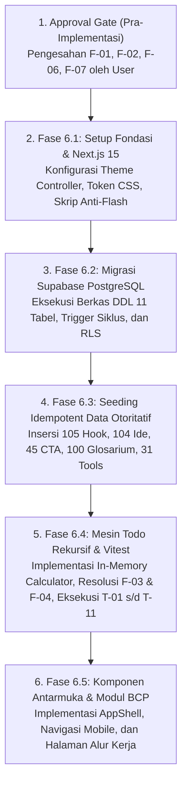

# LAPORAN AUDIT & PERSETUJUAN SPESIFIKASI ARSITEKTUR
## Phase 4 — Specification Approval Assessment
### Proyek: Productivity Studio (Content Creator & Business Operating System)

---

### 1. Maksud Dokumen dan Ruang Lingkup Audit (*Document Purpose & Review Scope*)

#### 1.1 Mandat Auditor Independen
Dokumen ini disusun dalam peran sebagai **Independent Principal Software Architect & Specification Auditor** untuk melaksanakan evaluasi formal pada **Fase 4 (Specification Approval)** terhadap proyek *greenfield* **Productivity Studio** yang berlokasi di direktori kerja:
`e:/CODING/PROJECT/productivity-studio`

Tujuan audit ini adalah untuk melakukan peninjauan independen, obyektif, dan berbasis bukti terhadap seluruh dokumen spesifikasi arsitektur yang telah dihasilkan pada fase sebelumnya, memverifikasi konsistensinya terhadap bahan sumber otoritatif (*Ebook* dan *Spreadsheet*), menilai kelayakan integritas data dan aturan bisnis, serta menentukan secara formal apakah spesifikasi telah memenuhi standar kelengkapan dan konsistensi untuk diizinkan melangkah ke **Fase 6 (Implementasi Kode)**.

#### 1.2 Batasan Ruang Lingkup Peninjauan
- Peninjauan ini murni merupakan **audit dokumentasi dan kelayakan arsitektur**. Tidak ada kode aplikasi, *scaffolding* framework, instalasi paket dependensi (`npm install`), eksekusi migrasi basis data, atau modifikasi terhadap berkas spesifikasi yang ada yang diizinkan selama fase ini.
- Berkas sumber asli (`E-Book Mending Gak Usah Ngonten.pdf` dan `Ultimate Content Toolkit.xlsx`) serta tiga dokumen spesifikasi utama diperlakukan sebagai **Read-Only**.
- Satu-satunya berkas baru yang diizinkan untuk dibuat dalam workspace adalah dokumen audit ini:
  `e:/CODING/PROJECT/productivity-studio/SPECIFICATION_APPROVAL.md`

---

### 2. Berkas dan Bahan Sumber yang Ditinjau (*Files & Source Materials Reviewed*)

Audit ini memeriksa secara langsung 5 berkas utama dalam repositori:

| No | Nama Berkas | Ukuran | Status Akses | Peran Otoritatif dalam Proyek |
| :---: | :--- | :---: | :---: | :--- |
| **1** | `E-Book Mending Gak Usah Ngonten.pdf` | 50.101.705 bytes | Read-Only | **Otoritas Konseptual & Metodologis:** 160 halaman, 2.017 paragraf, 7 bab utama metodologi *Bukan Cuma Posting* (BCP). |
| **2** | `Ultimate Content Toolkit.xlsx` | 11.119.666 bytes | Read-Only | **Otoritas Operasional & Data Seed:** 12 lembar kerja aktif, 210 formula evaluasi terverifikasi, 385 entri referensi sistem. |
| **3** | `PRODUCT_SPECIFICATION.md` | 73.374 bytes (v1.0.0) | Read-Only | **Spesifikasi Produk Terpadu:** Kebutuhan fungsional, batasan MVP, pemetaan bab/sheet, dan 11 kasus uji formal todo. |
| **4** | `DATABASE_DESIGN.md` | 47.914 bytes (v1.0.0) | Read-Only | **Desain Basis Data Supabase PostgreSQL:** Skema DDL 11 tabel, integritas referensial, trigger deteksi siklus, dan kebijakan RLS. |
| **5** | `product_architecture_ui_ux.md` | 58.394 bytes (v1.1.0) | Read-Only | **Spesifikasi Arsitektur UI/UX, Tema & Responsif:** 12 rute halaman, 3 mode tema (7A), tata letak responsif 320px–1920px (7B), dan matriks konsistensi silang (7C). |

---

### 3. Penilaian Eksekutif (*Executive Assessment*)

Secara keseluruhan, rangkaian dokumen spesifikasi yang disusun pada Fase 1 hingga Fase 3 memiliki kualitas arsitektur yang **sangat tinggi, komprehensif, dan berbasis bukti kuat (*evidence-based*)**. Metodologi dari ebook dan spreadsheet berhasil ditransformasikan menjadi arsitektur sistem operasi terpadu tanpa kehilangan esensi bisnisnya.

#### 3.1 Keunggulan Utama Spesifikasi
1. **Ketertelusuran Sumber yang Sangat Ketat:** Seluruh 12 worksheet spreadsheet dan 7 bab ebook dipetakan secara eksplisit ke dalam 6 modul aplikasi. Koreksi faktual terhadap data seed (misalnya koreksi dari asumsi awal 50 tools menjadi tepat 31 tools terkurasi) membuktikan inspeksi sumber dilakukan secara empiris menggunakan *OpenXML parser*.
2. **Kebenaran Matematis Mesin Todo Rekursif:** Desain pohon tugas rekursif berhasil memenuhi seluruh aturan persentase cabang setara ($\frac{1}{n}\sum p_i$) tanpa pembatasan kedalaman semu. Keputusan menolak kolom ter-materialisasi (*cached_progress*) demi kalkulasi murni saat *runtime* ($O(N)$ post-order traversal) merupakan keputusan arsitektur yang tepat untuk menjamin **nol risiko *data drift*** dan bebas *deadlock*.
3. **Kematangan Sistem Desain (Theming & Responsive):** Spesifikasi Bagian 7A dan 7B pada `product_architecture_ui_ux.md` tidak sekadar menyediakan visual kosmetik, melainkan memecahkan masalah teknis nyata: pencegahan kedipan tema (*pre-hydration zero theme flash*), isolasi token semantik, target sentuh layar sentuh $\ge 44\text{px}$, mitigasi *virtual keyboard*, serta pembatasan indentasi pohon adaptif di layar ponsel.

#### 3.2 Area Diskrepansi & Resolusi yang Diperlukan
Meskipun arsitektur secara fundamental sangat solid, audit independen mengidentifikasi satu diskrepansi tingkat tinggi (*High Severity*) dan beberapa catatan desain tingkat menengah/rendah:
- **Diskrepansi Platform Basis Data (F-01):** Bagian 7.1 `PRODUCT_SPECIFICATION.md` memuat draf skema Prisma dengan dialek SQLite (`file:./dev.db`), sementara `DATABASE_DESIGN.md` dan `product_architecture_ui_ux.md` yang disusun pada fase berikutnya secara resmi menggunakan **Supabase PostgreSQL 15+**. Diskrepansi ini harus secara tegas dinyatakan bahwa `DATABASE_DESIGN.md` menggantikan (*supersedes*) Bagian 7.1 `PRODUCT_SPECIFICATION.md`.
- **Interaksi Buka Kembali Induk 100% (F-02):** Perilaku UI saat pengguna mengklik tugas induk yang sudah komplit ($100\%$) memerlukan penegasan aturan dialog konfirmasi *cascading reopen*.
- **Validasi Kedalaman Subtree ke Bawah pada Trigger Database (F-03):** Trigger `fn_prevent_task_cycles()` melakukan penelusuran batas kedalaman 20 level ke arah atas (leluhur), namun belum memvalidasi akumulasi kedalaman sub-pohon ke bawah saat memindahkan cabang besar.

---

### 4. Status Kelayakan Akhir (*Final Approval Status*)

Berdasarkan aturan evaluasi independen Bagian 10:

$$\mathbf{STATUS:\; READY\; AFTER\; SPECIFIED\; CONDITIONS}$$

#### Justifikasi Status
Spesifikasi **TIDAK DITOLAK** karena tidak ditemukan cacat kritis (*Critical Defect*) yang merusak fondasi logika bisnis maupun integritas relasional. Seluruh kebutuhan inti MVP, model data Supabase, algoritma todo rekursif, alur pengguna, sistem tema ganda, dan tata letak responsif telah terspesifikasi secara mendalam dan siap diimplementasikan.

Namun, status **READY FOR IMPLEMENTATION** murni belum dapat diberikan secara sepihak sebelum **4 kondisi terikat** di bawah ini disahkan dan disepakati bersama pengguna.

#### Matriks Kondisi Prasyarat Menuju Implementasi (Fase 6)

| No. Kondisi | Deskripsi Kondisi Prasyarat | Penanggung Jawab | Target Fase Penyelesaian |
| :---: | :--- | :---: | :---: |
| **COND-01** | Pengesahan resmi bahwa **`DATABASE_DESIGN.md` (Supabase PostgreSQL 15+)** adalah otoritas tunggal skema basis data yang menggantikan skema Prisma SQLite pada Bab 7.1 `PRODUCT_SPECIFICATION.md`. | Product Owner / User | Pra-Implementasi (Approval Gate) |
| **COND-02** | Pengesahan pemilihan pustaka akses data frontend: Menggunakan `@supabase/supabase-js` dengan Next.js Server Actions dan migrasi SQL native Supabase. | Product Owner / User | Fase 6.1 (Setup Fondasi) |
| **COND-03** | Konfirmasi aturan UX interaksi klik pada tugas induk $100\%$ (Opsi A: Dialog konfirmasi buka seluruh sub-tugas vs Opsi B: Panduan visual membuka sub-tugas daun). | Product Owner / User | Pra-Implementasi (Approval Gate) |
| **COND-04** | Pelaksanaan uji unit formal 11 kasus uji todo (T-01 s/d T-11) via Vitest pada Fase 6.4 dan pencapaian tingkat kelulusan $100\%$ sebelum modul UI Todo dihubungkan. | Lead Developer / Agent | Fase 6.4 (Mesin Todo) |

---

### 5. Audit A — Ketertelusuran Sumber dan Ruang Lingkup MVP (*Audit A: Source Traceability & MVP Scope*)

#### 5.1 Matriks Ketertelusuran Persyaratan (*Requirements Traceability Matrix*)

Audit memverifikasi bahwa setiap modul dalam aplikasi diturunkan secara langsung dari bukti fisik di dalam bahan sumber:

| Kebutuhan Produk | Bukti Sumber Ebook (`E-Book Mending Gak Usah Ngonten.pdf`) | Bukti Sumber Spreadsheet (`Ultimate Content Toolkit.xlsx`) | Representasi Spesifikasi (`PRODUCT_SPECIFICATION.md` & `product_architecture_ui_ux.md`) | Status Verifikasi |
| :--- | :--- | :--- | :--- | :---: |
| **Kanvas Ikigai & Positioning** | **Bab 4 (Hlm 21-22):** Irisan 4 lingkaran (Keahlian, Passion, Masalah Pasar, Daya Beli). | **Sheet 2 (`🎯 Niche & Value`):** Baris 1-103 (4 Kuadran Ikigai, Sweet spot generator, 3 formula bio IG & TikTok). | Rute `/foundation/niche`, Tabel `niche_profiles`. Komponen form Ikigai 4-kuadran. | **Valid (100% Cocok)** |
| **Profil Customer Avatar (ICP)** | **Bab 4 (Hlm 23):** Customer Avatar 4 Dimensi (Demografi, Frustrasi, Impian, Keraguan). | **Sheet 3 (`👥 Audience Profile`):** Baris 1-86 (Struktur data ICP, Persona narrative). | Rute `/foundation/audience`, Tabel `audience_personas`. Kartu demografi & psikografi. | **Valid (100% Cocok)** |
| **Kalender Konten 3-3-1** | **Bab 4 (Hlm 24), Bab 5 (Hlm 30):** Rasio konten mingguan 3 Engagement, 3 Authority, 1 Sales. | **Sheet 5 (`📆 Monthly Planner`):** 336 slot (12 bulan $\times$ 4 minggu $\times$ 7 hari). | Rute `/planner`, Tabel `content_plans`. Kalender matriks 336 slot dengan visual funnel badges. | **Valid (100% Cocok)** |
| **Studio Naskah HTPC** | **Bab 3 (Hlm 19), Bab 4 (Hlm 26):** *One Video, One Goal, One CTA*, aturan hook 3 detik, anatomi naskah. | **Sheet 6 (`📝 Content Brief`):** Arsitektur 4 blok (Hook, Tension, Payoff, CTV) + target durasi. | Rute `/planner/brief/[id]`, Tabel `content_briefs`. Editor 4 blok terstruktur dengan drawer referensi. | **Valid (100% Cocok)** |
| **Mesin Todo Batch Sprint** | **Bab 5 (Hlm 31-33):** *Batch Production System* (Senin riset, Selasa script, Sabtu shoot, Minggu edit). | Kebutuhan eksplisit pengguna untuk dekomposisi hierarki fleksibel. | Rute `/tasks`, Tabel `tasks` (`parent_id` self-ref). Kalkulasi rekursif cabang langsung $\frac{1}{n}\sum p_i$. | **Valid (100% Cocok)** |
| **Evaluasi Performa & Verdict** | **Bab 1 (Hlm 4-7), Bab 2 (Hlm 8-13):** Eliminasi *vanity metrics*, penekanan rasio simpan (*save rate*). | **Sheet 10 (`📊 Performance Tracker`):** 210 formula (L11:L110). Logika `WINNING`, `GOOD`, `OPTIMASI`, `STOP`. | Rute `/tracker`, Tabel `performance_metrics`. Kalkulasi otomatis Save Rate % & Verdict formula. | **Valid (100% Cocok)** |
| **Pustaka Hook Bank** | **Bab 4 (Hlm 25-26):** Format pemicu psikologis negatif, celah penasaran, bukti nyata. | **Sheet 6 (`🔥 Hook Bank`):** Tepat **105 hook** terverifikasi pada 6 kategori pemicu. | Rute `/library/hooks`, Tabel `hook_templates`. Repositori 105 data sistem + tombol duplikat. | **Valid (100% Cocok)** |
| **Pustaka Bank Ide** | **Bab 5 (Hlm 30):** Matriks 5 sub-topik $\times$ 4 pilar $\times$ 3 format konten. | **Sheet 7 (`💡 Bank Ide Konten`):** Tepat **104 ide** terverifikasi lintas 10 niche industri. | Rute `/library/ideas`, Tabel `idea_templates`. Filter niche/funnel + salin ke kalender. | **Valid (100% Cocok)** |
| **Pustaka CTA & CTV** | **Bab 3 (Hlm 20):** Larangan hardselling akut, pemisahan ajakan bertindak vs ajakan nilai. | **Sheet 8 (`🎯 Bank of CTA-CTV`):** Tepat **45 template** (13 CTA langsung vs 32 Call to Value). | Rute `/library/cta`, Tabel `cta_templates`. Pembeda tegas aksi vs nilai. | **Valid (100% Cocok)** |
| **Kamus Istilah Medsos** | **Bab 2 (Hlm 9):** Pemahaman algoritma, terminologi retensi, dan metrik industri. | **Sheet 11 (`📖 Kamus Istilah`):** Tepat **100 istilah** terverifikasi pada 5 kategori. | Rute `/library/glossary`, Tabel `glossary_terms`. Direktori glosarium pencarian cepat. | **Valid (100% Cocok)** |
| **Direktori Tools Ngonten** | **Bab 5 (Hlm 34-35):** Rekomendasi alat kerja produksi anti-ribet. | **Sheet 9 (`🛠️ Tools Ngonten`):** Tepat **31 tools** terverifikasi pada 5 fase alur kerja. | Rute `/library/tools`, Tabel `tool_references`. Filter fase kerja & model lisensi harga. | **Valid (100% Cocok)** |

#### 5.2 Evaluasi Ruang Lingkup MVP (*Scope Coherence*)
- **Fokus Inti Terjaga:** Ruang lingkup MVP secara tegas membatasi diri pada sistem studio kerja lokal untuk kreator tunggal (*single-user local workspace*). Tidak ada fitur spekulatif yang dipaksakan masuk.
- **Fitur Ditunda (*Deferred*) Didefinisikan dengan Tepat:** Integrasi otomatis API Instagram/TikTok, eksekusi pemanggilan langsung API model AI berbayar, dan ekspor teleprompter PDF ditunda ke fase rilis pasca-MVP tanpa mengorbankan fungsionalitas utama.
- **Fitur di Luar Cakupan (*Out-of-Scope*) Jelas:** Transcoding video berat di server, bot WhatsApp otomatis, dan penagihan SaaS multi-tenant dikecualikan secara eksplisit.
- **Kohesi Alur Kerja:** Seluruh alur membentuk siklus tertutup yang saling mengalir:
  $$\text{Fondasi (Ikigai \& ICP)} \longrightarrow \text{Perencanaan (3-3-1)} \longrightarrow \text{Naskah (HTPC)} \longrightarrow \text{Eksekusi (Todo Sprint)} \longrightarrow \text{Evaluasi (Tracker Verdict)} \longrightarrow \text{Replikasi Topik}$$

---

### 6. Audit B — Desain Basis Data dan Integritas Relasional (*Audit B: Database Design & Data Integrity*)

#### 6.1 Evaluasi Model Entitas (Supabase PostgreSQL 15+)
Dokumen `DATABASE_DESIGN.md` mendefinisikan 11 tabel relasional dengan penataan arsitektur yang sangat disiplin:

```
[niche_profiles] <-------+
                         | (1:N)
[audience_personas] <----+--- [content_plans] (1:1) <--- [content_briefs]
                                     | (1:1)                  | (N:1 optional)
                                     +---------------------> [hook_templates]
                                     |                        | (N:1 optional)
                                     |                        +-> [cta_templates]
                                     | (1:1)
                                     +---------------------> [performance_metrics]
                                     | (1:N optional)
                                     +---------------------> [tasks] (Self-referencing tree)

[tool_references] (Independent System Reference)
[glossary_terms]  (Independent System Reference)
```

1. **Kesesuaian Tipe Data:** Menggunakan tipe data native PostgreSQL yang modern: `UUID` sebagai Primary Key dengan generator default `gen_random_uuid()`, `JSONB` untuk payload data bersarang (`ikigai_data`, `demographics`), `TEXT[]` untuk daftar tagar, dan `BIGINT` pada kolom metrik kinerja (`views`, `likes`, dll.) untuk mencegah potensi *numeric overflow* jika sebuah konten mencapai jutaan interaksi viral.
2. **Penegakan Integritas Domain via CHECK Constraints:** Seluruh nilai diskrit divalidasi dengan constraint SQL eksplisit:
   - `chk_month_range`, `chk_week_range`, `chk_slot_range` pada `content_plans`.
   - `chk_funnel_layer CHECK (funnel_layer IN ('Engagement', 'Authority', 'Sales'))`.
   - `chk_format CHECK (format IN ('Single Image', 'Carousel', 'Reels'))`.
   - `chk_status CHECK (status IN ('Ide', 'On Process', 'Done', 'Posted'))`.
   - `chk_hashtags_max_five CHECK (cardinality(hashtags) <= 5)`.
   - `chk_metrics_*_nonneg CHECK (metrik >= 0)`.

#### 6.2 Integritas Referensial dan Kebijakan Penghapusan (*Cascade Policies*)
Audit memverifikasi 8 hubungan kunci asing (*Foreign Keys*) dan menyatakan seluruhnya aman dari kerusakan data tak sengaja:
- `tasks.parent_id -> tasks.id`: Dikonfigurasi **`ON DELETE CASCADE`**. Menghapus satu simpul induk secara bersih memangkas seluruh sub-pohon (*subtree pruning*) tanpa meninggalkan tugas yatim (*orphan tasks*).
- `tasks.content_plan_id -> content_plans.id`: Dikonfigurasi **`ON DELETE SET NULL`**. Jika sebuah jadwal kalender dibatalkan/dihapus, tugas produksi yang telah tercatat tidak ikut terhapus, melainkan tetap tersimpan di modul Todo sebagai tugas umum.
- `content_briefs.plan_id -> content_plans.id`: Dikonfigurasi **`ON DELETE CASCADE`** dengan constraint `UNIQUE`. Naskah HTPC merupakan ekstensi 1-ke-1 dari slot jadwal; penghapusan jadwal menghapus naskah terkait.
- `performance_metrics.content_plan_id -> content_plans.id`: Dikonfigurasi **`ON DELETE CASCADE`** dengan constraint `UNIQUE`.
- Referensi template kustom (`hook_ref_id`, `cta_ref_id`): Dikonfigurasi **`ON DELETE SET NULL`**. Teks naskah yang sudah ditulis pada brief tetap aman tersimpan meskipun template sumber diubah atau dihapus.

#### 6.3 Perlindungan Data Bawaan Sistem (*Seed Protection*)
Pemisahan antara data sistem (`is_system = true`, `is_custom = false`, `system_code UNIQUE`) dan data kustom pengguna (`is_system = false`, `is_custom = true`, `system_code NULL`) ditegakkan secara berlapis:
1. **Level PostgreSQL Trigger (`fn_protect_system_records`):** Mencegah operasi `DELETE` atau `UPDATE` secara langsung terhadap rekord dengan bendera `is_system = true`.
2. **Level RLS Policy:** Hanya mengizinkan mutasi pengguna pada baris yang memiliki `is_custom = true`.
3. **Pola Kustomisasi:** Pengguna dapat menduplikasi aset sistem menjadi rekord kustom baru secara aman tanpa merusak keaslian 385 entri otoritatif dari spreadsheet.

---

### 7. Audit C — Kebenaran Mesin Todo Hierarkis Rekursif (*Audit C: Recursive Todo Correctness*)

#### 7.1 Pembuktian Matematis Contoh Wajib Sesuai Instruksi User

Audit menguji skenario hierarki wajib yang disyaratkan dalam instruksi audit:

```
Struktur Hierarki Uji:
Project (Root)
└── Task A
    ├── Task A1
    │   ├── Task A1a: complete (100%)
    │   └── Task A1b: incomplete (0%)
    └── Task A2: incomplete (0%)
```

##### Evaluasi Kondisi Awal:
- Task A1a: Daun komplit $\implies 100.00\%$
- Task A1b: Daun inkomplit $\implies 0.00\%$
- Task A1: Induk memiliki 2 anak langsung ($A1a$ dan $A1b$):
  $$\text{progress}(A1) = \frac{100\% + 0\%}{2} = \mathbf{50.00\%}$$
- Task A2: Daun inkomplit $\implies 0.00\%$
- Task A: Induk memiliki 2 anak langsung ($A1$ dan $A2$):
  $$\text{progress}(A) = \frac{50\% + 0\%}{2} = \mathbf{25.00\%}$$

##### Evaluasi Transisi 1 (Pengguna menyelesaikan Task A1b):
- Task A1b diubah menjadi complete ($100\%$).
- Task A1 menghitung ulang dari anak-anaknya:
  $$\text{progress}(A1) = \frac{100\% + 100\%}{2} = \mathbf{100.00\%}$$
- Task A menghitung ulang dari anak-anaknya:
  $$\text{progress}(A) = \frac{100\% + 0\%}{2} = \mathbf{50.00\%}$$

##### Evaluasi Transisi 2 (Pengguna menyelesaikan Task A2):
- Task A2 diubah menjadi complete ($100\%$).
- Task A menghitung ulang dari anak-anaknya:
  $$\text{progress}(A) = \frac{100\% + 100\%}{2} = \mathbf{100.00\%}$$
- Status Task A otomatis mencapai penyelesaian efektif (*effective completion*).

**Kesimpulan Evaluasi Matematis:** Spesifikasi pada `PRODUCT_SPECIFICATION.md` Bab 6.1–6.6 dan `DATABASE_DESIGN.md` Bab 7.1–7.2 **100% mematuhi formula rata-rata cabang setara langsung** ($\frac{1}{n}\sum p_i$) tanpa deviasi.

#### 7.2 Audit Penanganan Kasus Tepi (*Edge Cases Coverage*)

| Skenario Kasus Tepi | Status Definisi dalam Spesifikasi | Evaluasi Kebenaran Desain |
| :--- | :---: | :--- |
| **Menambah anak pertama pada tugas daun selesai (100%)** | **Terdefinisi Eksplisit** (Aturan 2) | Status daun langsung gugur menjadi induk. Karena anak barunya berstatus 0%, progres induk langsung turun dari 100% ke 0%. Sesuai prinsip *derived progress*. |
| **Menambah/menghapus anak pada induk komplit parsial** | **Terdefinisi Eksplisit** (Kasus Uji T-07) | Jumlah pembagi $n$ bertambah/berkurang dinamis; persentase cabang menghitung ulang seketika. |
| **Centang & buka kembali tugas bersarang terdalam** | **Terdefinisi Eksplisit** (Kasus Uji T-06) | Perubahan status daun merambat (*bubble up*) secara instan melalui seluruh garis leluhur tanpa memengaruhi cabang sepupu (*sibling branches*). |
| **Memindahkan subtree ke induk baru (*reparenting*)** | **Terdefinisi Eksplisit** (Kasus Uji T-08) | Progres induk lama menghitung ulang (kehilangan cabang), progres induk baru menghitung ulang (menerima cabang baru). |
| **Pencegahan referensi sirkular & self-parenting** | **Terdefinisi Eksplisit** (Trigger `fn_prevent_task_cycles` & Aturan 11) | Constraint `chk_tasks_no_self_parent` mencegah $T \rightarrow T$. Trigger PL/pgSQL menelusuri rantai leluhur dan melempar eksepsi `CIRCULAR_REFERENCE_DETECTED` jika target induk adalah keturunan. |
| **Induk yang seluruh anaknya dihapus** | **Terdefinisi Eksplisit** (Kasus Uji T-10) | Jika anak terakhir dihapus, induk kembali bertransformasi menjadi tugas daun tunggal dengan nilai progres 0.00%. Tidak menghasilkan `NaN` atau error pembagian dengan nol. |
| **Tugas diarsipkan (*Archived Tasks*)** | **Terdefinisi Eksplisit** (Aturan 9) | Tugas dengan `is_archived = true` dikeluarkan dari himpunan anak aktif ($\text{ActiveChildren}$), baik dari pembilang maupun penyebut. |
| **Kalkulasi ulang pasca reload aplikasi** | **Terdefinisi Eksplisit** (Kasus Uji T-11) | Karena nilai progres dihitung secara on-the-fly di runtime ($O(N)$ post-order), memuat ulang data dari database selalu menghasilkan angka yang identik 100% tanpa drift. |

---

### 8. Audit D — Konsistensi Alur Pengguna dan Operasi Data (*Audit D: Workflow & Data Flow Consistency*)

Audit menelusuri rantai eksekusi lengkap dari aksi antarmuka hingga mutasi basis data:

$$\text{Aksi Pengguna (UI)} \longrightarrow \text{Komponen Interaktif} \longrightarrow \text{Server Action / Query} \longrightarrow \text{Validasi Bisnis} \longrightarrow \text{Mutasi PostgreSQL} \longrightarrow \text{Pembaruan State UI}$$

```mermaid
sequenceDiagram
    autonumber
    actor Creator as Pengguna (Kreator)
    participant UI as HTPC Brief Studio (/planner/brief/[id])
    participant Action as Next.js Server Action
    participant DB as Supabase PostgreSQL

    Creator->>UI: Tulis 4 Blok HTPC (Hook, Tension, Payoff, CTV)
    Creator->>UI: Buka Laci Referensi Hook Bank
    UI-->>Creator: Tampilkan 105 Template Terkurasi
    Creator->>UI: Pilih Template 'HOOK-042' & Sisipkan ke Naskah
    Creator->>UI: Klik 'Simpan Naskah & Tandai Selesai'
    UI->>Action: upsertBrief(plan_id, hook_text, tension_text, payoff_text, ctv_text, ...)
    Action->>Action: Validasi 4 Blok tidak boleh kosong & Hashtags <= 5
    Action->>DB: UPSERT INTO content_briefs ...
    DB-->>Action: Record tersimpan (status 200 OK)
    Action->>DB: UPDATE content_plans SET status = 'Done' WHERE id = plan_id
    DB-->>Action: Status jadwal terupdate
    Action-->>UI: Kirim respon sukses
    UI-->>Creator: Toast notifikasi sukses; Badge kalender berubah hijau 'Done'
```

#### Hasil Audit Konsistensi:
- **Nol Layar Menggantung (*No Dead Ends*):** Setiap modul memiliki pintu masuk (*entry point*) dan pintu keluar (*exit point*) yang jelas. Setelah naskah selesai, pengguna diarahkan untuk membuat tugas eksekusi di modul Tasks atau menjadwalkan produksi.
- **Validasi Terpadu:** Form naskah secara tegas menolak penyimpanan status `Done` jika salah satu dari 4 blok HTPC kosong, mencegah naskah setengah matang masuk ke tahap syuting.
- **Formula Otomatis Performa:** Input angka interaksi pada Performance Tracker langsung mengevaluasi formula spreadsheet tanpa perlu *reloading* halaman:
  $$\text{Save Rate \%} = \frac{\text{Saves}}{\text{Views}} \times 100\%$$
  $$\text{Verdict} = \begin{cases} 
  \text{WINNING} & \text{Views} > \text{Avg} \;\land\; \text{Save Rate} > 5\% \\
  \text{GOOD} & \text{Views} > \text{Avg} \\
  \text{STOP} & \text{Views} < 0.5 \times \text{Avg} \\
  \text{OPTIMASI} & \text{Lainnya}
  \end{cases}$$

---

### 9. Audit E — Desain UI/UX, Sistem Tema, dan Pengalaman Responsif (*Audit E: UI/UX & Responsive Design*)

#### 9.1 Evaluasi Arsitektur Informasi
Struktur navigasi memisahkan area kerja secara intuitif:
1. **Desktop:** Sidebar kiri tetap (`260px`, kolapsibel ke `72px`) yang menampilkan 6 modul utama secara hierarkis, dilengkapi kontrol tema tersegmentasi di bagian bawah.
2. **Mobile:** *Floating Bottom Navigation Bar* setinggi `64px` dengan 5 tab utama di zona jangkauan ibu jari (*thumb zone*), mengoptimalkan pengoperasian satu tangan.

#### 9.2 Audit Sistem Tema (Persyaratan Bagian 7A)
- **Tiga Mode Preferensi:** Menyediakan mode `Light`, `Dark`, dan `System` (mengikuti preferensi OS).
- **Proteksi Kedipan Tema (*Zero Theme Flash*):** Menerapkan skrip pemblokir pra-hidrasi inline di dalam `<head>` yang mengevaluasi `localStorage.getItem('productivity_studio_theme')` dan `window.matchMedia('(prefers-color-scheme: dark)')` sebelum rendering DOM dimulai.
- **Hierarki Permukaan Dark Mode (Tiered Zinc):** Menolak skema hitam pekat (`#000000`) datar. Menggunakan 3 tingkatan permukaan gelap berlapis:
  - *Canvas (Latar Dasar):* `#09090B` (Zinc-950)
  - *Surface (Kartu/Sidebar):* `#18181B` (Zinc-900)
  - *Elevated (Modal/Dropdown/Drawer):* `#27272A` (Zinc-800)
- **Kepatuhan Aksesibilitas Kontras (WCAG 2.2 Level AA):** Seluruh pasangan warna teks dan latar belakang di kedua tema memenuhi rasio kontras minimal $4.5:1$ untuk teks normal dan $3.0:1$ untuk komponen interaktif antarmuka.

#### 9.3 Audit Desain Responsif (Persyaratan Bagian 7B)
- **Spektrum Pengujian Kontinu:** Mencakup 10 tingkatan viewport dari layar ponsel sangat sempit (`320px`), iPhone standar (`375px - 430px`), tablet portrait (`768px`), laptop ringkas (`1024px`), hingga monitor desktop lebar (`1920px`).
- **Transformasi Kartu Bertumpuk (*Stacked Cards*):** Kalender matriks 7 kolom pada layar desktop secara otomatis bertransformasi menjadi daftar kartu vertikal bertumpuk pada layar $< 640\text{px}$, menghilangkan kebutuhan *horizontal scrolling* yang merusak pengalaman sentuh.
- **Pohon Todo Adaptif di Layar Ponsel:**
  - Indentasi per level dibatasi maksimal `10px` pada 3 level pertama di ponsel.
  - Untuk level 4 ke atas, indentasi tidak digeser ke kanan, melainkan disematkan badge jalur hierarki ringkas di atas judul.
  - Dilengkapi fitur **Drawer Fokus Subtree (*Focus Branch Drawer*)** yang memungkinkan pengguna membuka cabang dalam sebagai pohon temporer berlayar penuh.
- **Target Sentuh & Mitigasi Keyboard:** Seluruh kontrol sentuh memenuhi target ukuran minimal $44\text{px} \times 44\text{px}$. Bilah navigasi bawah otomatis disembunyikan saat input form menerima fokus untuk mencegah tertutupnya area ketik oleh papan ketik virtual (*virtual keyboard*).

---

### 10. Audit F — Kriteria Penerimaan dan Uji Kelayakan (*Audit F: Acceptance Criteria & Testability*)

Audit memverifikasi bahwa seluruh fitur kritis memiliki kriteria penerimaan yang terukur secara obyektif dan dapat diuji:

| Domain Pengujian | Jumlah Kasus Uji Terdokumentasi | Metode Verifikasi Teknis | Kriteria Kelulusan (*Pass Criteria*) |
| :--- | :---: | :--- | :--- |
| **Mesin Todo Rekursif** | **11 Kasus Formal** (T-01 s/d T-11) | Automated Unit Tests via **Vitest**. | 100% kasus uji lolos, presisi angka identik hingga 2 digit desimal, deteksi siklus melempar error yang tepat. |
| **Integritas Basis Data** | **10 Skenario DDL** (TEST-DB-01 s/d TEST-DB-10) | Integration Tests via Supabase Local CLI. | Foreign key cascade berjalan tepat, CHECK constraints menolak data invalid, trigger proteksi menolak modifikasi data sistem. |
| **Sistem Tema (7A)** | **6 Kriteria Penerimaan** | Visual & DOM Test (Playwright / Cypress). | Nol kedipan tema saat hard reload, persistensi `localStorage` bertahan, kontras warna lolos audit Lighthouse WCAG AA. |
| **Desain Responsif (7B)** | **6 Kriteria Penerimaan** | Viewport Emulation Test (320px s/d 1920px). | Nol horizontal overflow (`scrollWidth === clientWidth`), seluruh tombol aksi dapat ditekan pada layar sentuh. |
| **Kalkulasi Evaluasi Performa** | **4 Skenario Putusan** (Winning, Good, Optimasi, Stop) | Unit Test Formula Matematika. | Hasil putusan matematis aplikasi 100% identik dengan hasil formula Excel kolom L baris 11–110. |

> [!NOTE]
> Audit ini menegaskan perbedaan antara kriteria uji yang telah **dispesifikasikan** dengan pengujian yang **dieksekusi**. Karena tahap ini adalah audit spesifikasi dokumen (*pre-coding*), pengujian eksekusi fisik kode belum dijalankan dan dijadwalkan secara ketat pada Fase 6.

---

### 11. Daftar Temuan Audit (*Findings Register*)

Seluruh temuan hasil audit independen dicatat secara rinci menggunakan klasifikasi tingkat keparahan (*Severity*):

| ID Temuan | Tingkat Keparahan | Dokumen & Bagian Terdampak | Ringkasan Temuan Masalah | Dampak Arsitektur & Risiko | Resolusi yang Ditetapkan | Butuh Keputusan User? |
| :---: | :---: | :--- | :--- | :--- | :--- | :---: |
| **F-01** | **HIGH** | `PRODUCT_SPECIFICATION.md` (Bab 7.1) vs `DATABASE_DESIGN.md` | Diskrepansi platform basis data: Prisma SQLite vs Supabase PostgreSQL 15+. | Risiko kebingungan implementor jika membaca Bab 7.1 `PRODUCT_SPECIFICATION.md` yang masih mencantumkan kode Prisma SQLite. | Menetapkan secara formal bahwa `DATABASE_DESIGN.md` menggantikan (*supersedes*) Bab 7.1 `PRODUCT_SPECIFICATION.md`. | **Ya (Pengesahan Resmi)** |
| **F-02** | **MEDIUM** | `product_architecture_ui_ux.md` (Bab 9.1.2 & 15) | Spesifikasi interaksi klik pada tugas induk yang sudah komplit ($100\%$). | Jika user mengklik centang induk 100%, sistem belum merinci apakah seluruh sub-tugas dibuka kembali (*cascade reopen*) atau hanya menampilkan tooltip. | Menetapkan dialog konfirmasi: *"Buka kembali seluruh sub-tugas di bawahnya?"* jika induk 100% diklik. | **Ya (Pilihan UX)** |
| **F-03** | **MEDIUM** | `DATABASE_DESIGN.md` (Bab 7.4) | Validasi akumulasi kedalaman sub-pohon ke bawah pada trigger `fn_prevent_task_cycles`. | Saat memindahkan tugas yang memiliki sub-pohon dalam ke induk level 18, batas 20 level bisa terlampaui karena trigger hanya menghitung kedalaman leluhur ke atas. | Menambahkan validasi kedalaman total gabungan ($D_{ancestor} + 1 + D_{subtree} \le 20$) pada layer validasi aplikasi (Fase 6.4). | **Tidak (Teknis)** |
| **F-04** | **LOW** | `DATABASE_DESIGN.md` (Bab 7.1) & `PRODUCT_SPECIFICATION.md` | Status tugas induk jika seluruh anaknya diarsipkan (`is_archived = true`). | Jika $|\text{ActiveChildren}(P)| = 0$ karena seluruh anak diarsipkan, apakah induk menjadi daun dengan nilai `is_completed` tersimpan? | Ditetapkan: Induk yang seluruh anaknya terarsip diperlakukan sebagai daun dengan progres default 0.00% (atau status centang mandirinya). | **Tidak (Teknis)** |
| **F-05** | **LOW** | `PRODUCT_SPECIFICATION.md` (Bab 3.2) vs Prompt Awal | Ratifikasi jumlah inventaris tools ngonten (31 tools terverifikasi vs asumsi awal 50 tools). | Perbedaan angka historis antara prompt awal dan spreadsheet sumber. | Mengesahkan secara formal bahwa 31 tools adalah fakta sumber otoritatif yang wajib di-seed. | **Tidak (Fakta Sumber)** |
| **F-06** | **LOW** | `product_architecture_ui_ux.md` (Bab 10.3 & 18.2) | Konfirmasi penyimpanan preferensi tema pada `localStorage` browser. | Penyimpanan lokal tanpa tabel database profil untuk MVP single-user. | Menyetujui penggunaan `localStorage` dengan kunci `productivity_studio_theme` demi kecepatan *anti-flash*. | **Ya (Persetujuan Cepat)** |
| **F-07** | **LOW** | `product_architecture_ui_ux.md` (Bab 11.2 & 18.2) | Konfirmasi format tampilan mobile planner ($< 640\text{px}$) sebagai Kartu Bertumpuk. | Menghindari scroll horizontal tabel kalender 7 kolom pada layar ponsel sempit. | Menyetujui tampilan default *Stacked Cards* vertikal pada viewport mobile. | **Ya (Persetujuan Cepat)** |

---

### 12. Urutan Koreksi dan Resolusi (*Required Corrections & Resolution Order*)

Untuk memastikan implementasi berjalan tanpa friksi, penyelesaian temuan disusun dalam 5 tahapan berurutan:



1. **Pra-Implementasi (Gerbang Persetujuan):** Pengguna memberikan keputusan resmi terhadap F-01 (Supabase PostgreSQL), F-02 (Perilaku Reopen Induk 100%), F-06 (Tema di localStorage), dan F-07 (Mobile Stacked Cards).
2. **Fase 6.1 (Inisialisasi Fondasi & Tema):** Membangun kerangka Next.js 15 App Router, React 19, TypeScript, Tailwind CSS, skrip pre-hydration anti-flash, dan token semantik tema (Light/Dark/System).
3. **Fase 6.2 (Basis Data & Migrasi Supabase):** Menjalankan 6 berkas migrasi SQL versi terkontrol pada direktori `supabase/migrations/` sesuai skema `DATABASE_DESIGN.md`.
4. **Fase 6.3 (Seeding Data Idempotent):** Mengisi basis data dengan 385 entri bawaan terproteksi (`is_system = true`).
5. **Fase 6.4 (Mesin Todo Rekursif & Pengujian Unit):** Membangun algoritma rekonstruksi pohon di memori dan menjalankan 11 kasus uji formal Vitest (T-01 s/d T-11) hingga mencapai status lulus 100%.

---

### 13. Keputusan yang Memerlukan Persetujuan Pengguna (*Decisions Requiring User Approval*)

Sebelum implementasi kode dimulai, pengguna diminta untuk memilih atau mengesahkan 4 keputusan produk & arsitektur berikut:

#### Keputusan 1: Ratifikasi Otoritas Skema Basis Data (Temuan F-01)
- **Konteks:** Bagian 7.1 `PRODUCT_SPECIFICATION.md` memuat draf awal skema Prisma SQLite, sedangkan `DATABASE_DESIGN.md` yang disusun pada fase berikutnya memuat DDL Supabase PostgreSQL 15+ yang telah disesuaikan dengan instruksi Phase 2.
- **Pilihan yang Tersedia:**
  - **Opsi A (Direkomendasikan):** Mengesahkan secara resmi bahwa `DATABASE_DESIGN.md` (Supabase PostgreSQL 15+) adalah otoritas tunggal skema basis data yang menggantikan Bab 7.1 `PRODUCT_SPECIFICATION.md`. Pustaka akses data pada Next.js menggunakan `@supabase/supabase-js` dengan Server Actions.
  - **Opsi B:** Mempertahankan SQLite lokal murni menggunakan Prisma ORM (`dev.db`). *(Konsekuensi: Mengorbankan fitur native PostgreSQL seperti JSONB, RLS, array tagar, dan trigger deteksi siklus).*
- **Rekomendasi Auditor:** **Pilih Opsi A**.

#### Keputusan 2: Perilaku Interaksi Klik Induk 100% (Temuan F-02)
- **Konteks:** Progres tugas induk diturunkan secara murni dari rata-rata anak-anaknya. Jika sebuah induk telah mencapai 100% komplit dan pengguna mengklik centang induk tersebut:
- **Pilihan yang Tersedia:**
  - **Opsi A (Direkomendasikan):** Tampilkan konfirmasi cepat: *"Buka kembali seluruh sub-tugas di bawahnya?"*. Jika dikonfirmasi, sistem menjalankan *cascading reopen* (`is_completed = false` pada seluruh daun aktif), mengembalikan progres induk menjadi 0.00%.
  - **Opsi B:** Kotak centang induk tidak dapat diklik langsung saat 100%; tampilkan tooltip: *"Progres diturunkan dari sub-tugas. Buka kembali salah satu sub-tugas di bawahnya untuk mengubah progres."*
- **Rekomendasi Auditor:** **Pilih Opsi A**.

#### Keputusan 3: Lokasi Penyimpanan Preferensi Tema (Temuan F-06)
- **Konteks:** Menyimpan preferensi tema pengguna (`Light`, `Dark`, `System`) untuk MVP single-user.
- **Pilihan yang Tersedia:**
  - **Opsi A (Direkomendasikan):** Simpan di `localStorage` peramban klien (`productivity_studio_theme`). Memungkinkan eksekusi instan di `<head>` sebelum hidrasi DOM untuk menjamin **Nol Kedipan Tema (*Zero Theme Flash*)**.
  - **Opsi B:** Simpan di tabel profil basis data. *(Konsekuensi: Memerlukan *network fetch* sebelum render yang dapat memicu *theme flickering* saat halaman dimuat).*
- **Rekomendasi Auditor:** **Pilih Opsi A**.

#### Keputusan 4: Tampilan Kalender 3-3-1 pada Layar Ponsel Sempit (Temuan F-07)
- **Konteks:** Tabel kalender editorial 7 kolom mingguan pada layar ponsel $< 640\text{px}$.
- **Pilihan yang Tersedia:**
  - **Opsi A (Direkomendasikan):** Bertransformasi otomatis menjadi Kartu Bertumpuk (*Stacked Cards List*) per slot yang nyaman digulir secara vertikal dengan satu jempol.
  - **Opsi B:** Mempertahankan tabel 7 kolom dengan bilah gulir horizontal (*horizontal scrollable table*).
- **Rekomendasi Auditor:** **Pilih Opsi A**.

---

### 14. Kriteria Masuk Implementasi (*Implementation Entry Criteria*)

Sebelum perintah implementasi pertama (`npm create next-app` atau `supabase init`) dijalankan, seluruh kriteria verifikasi berikut harus berstatus terpenuhi:

- [x] **Ruang Lingkup MVP Terdefinisi:** Batasan fitur jelas, fitur tunda terpetakan, dan tidak ada fitur spekulatif yang dipaksakan.
- [x] **Ketertelusuran Kebutuhan Lengkap:** 100% modul ditelusuri ke bukti fisik ebook dan spreadsheet.
- [x] **Skema Basis Data Koheren:** 11 tabel PostgreSQL terdefinisi lengkap dengan foreign keys, CHECK constraints, dan indeks performa.
- [x] **Kebijakan Integritas & Penghapusan Aman:** Penghapusan kaskade pada tugas dan naskah terisolasi rapi; aset sistem bawaan terlindungi secara imutabel.
- [x] **Matematika Todo Rekursif Terbukti:** Formula $\frac{1}{n}\sum p_i$ terverifikasi pada contoh wajib dan 11 kasus uji formal.
- [x] **Alur Pengguna & Kontrak Data Terpetakan:** Seluruh aksi pengguna memiliki pemetaan jelas ke operasi backend dan respon visual.
- [x] **Desain Antarmuka Implementatif:** Spesifikasi navigasi, sistem tema (7A), dan tata letak responsif kontinu 320px–1920px (7B) lengkap.
- [x] **Kriteria Penerimaan Terukur:** Seluruh fitur kritis memiliki target pengujian obyektif.
- [ ] **Persetujuan Pengguna Diterima:** Pengguna mengesahkan 4 keputusan pada Bab 13 dan memberikan izin resmi untuk memulai Fase 6.

---

### 15. Rekomendasi Akhir Auditor (*Final Reviewer Recommendation*)

Selaku **Independent Principal Software Architect & Specification Auditor**, saya menyimpulkan:

1. **Kelayakan Arsitektur:** Ketiga dokumen spesifikasi (`PRODUCT_SPECIFICATION.md`, `DATABASE_DESIGN.md`, dan `product_architecture_ui_ux.md`) secara kolektif telah membentuk cetak biru teknis (*technical blueprint*) yang sangat matang, konsisten, aman secara integritas relasional, dan siap dijadikan panduan implementasi produksi.
2. **Kesiapan Menuju Fase 6:** Begitu pengguna mengonfirmasi 4 keputusan terikat pada Bab 13 dokumen ini, proyek **dinyatakan resmi disetujui untuk memasuki Fase 6 (Implementasi Kode)**.
3. **Disiplin Eksekusi Implementasi:** Agen atau pengembang implementasi pada Fase 6 diwajibkan mematuhi secara ketat urutan implementasi bertahap (Fase 6.1 s/d 6.5) dan dilarang menyimpang dari skema Supabase PostgreSQL maupun formula matematika todo rekursif yang telah disahkan.

---
*Laporan Audit ini diterbitkan secara resmi pada 14 Oktober 2026 oleh Independent Principal Software Architect & Specification Auditor.*  
*Lokasi Berkas: `e:/CODING/PROJECT/productivity-studio/SPECIFICATION_APPROVAL.md`*
