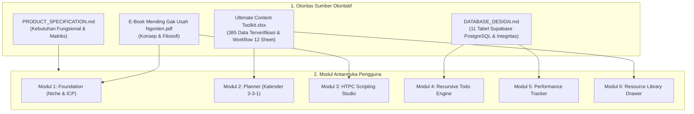
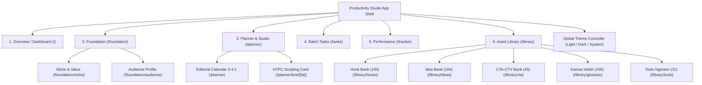
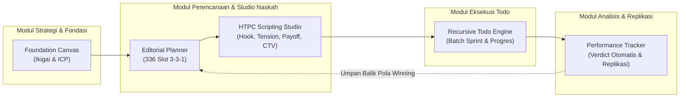
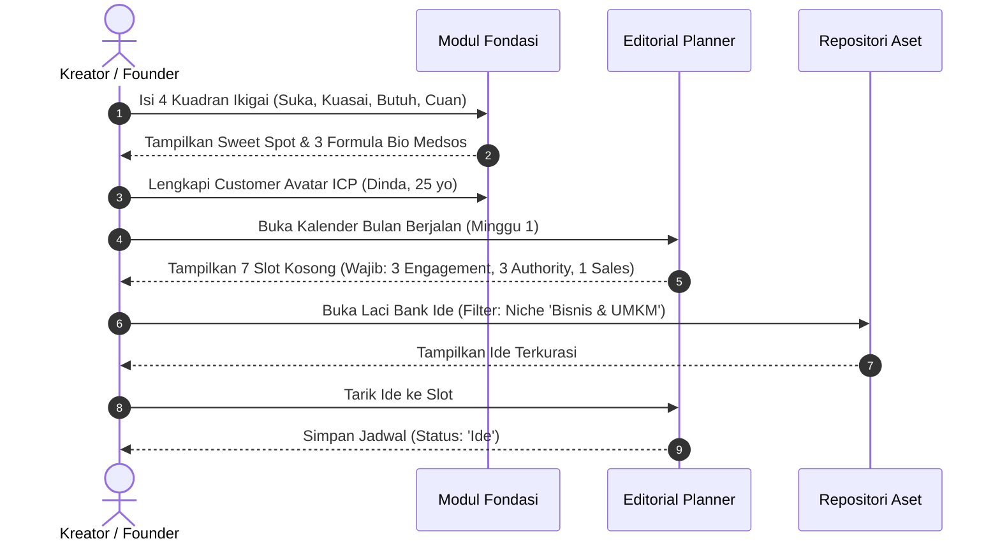
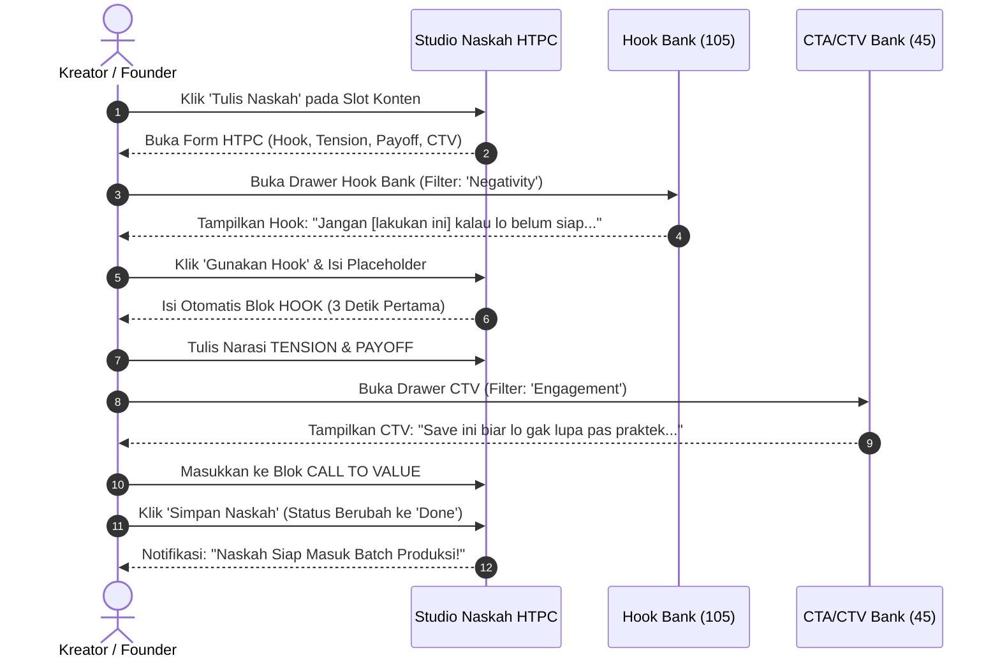
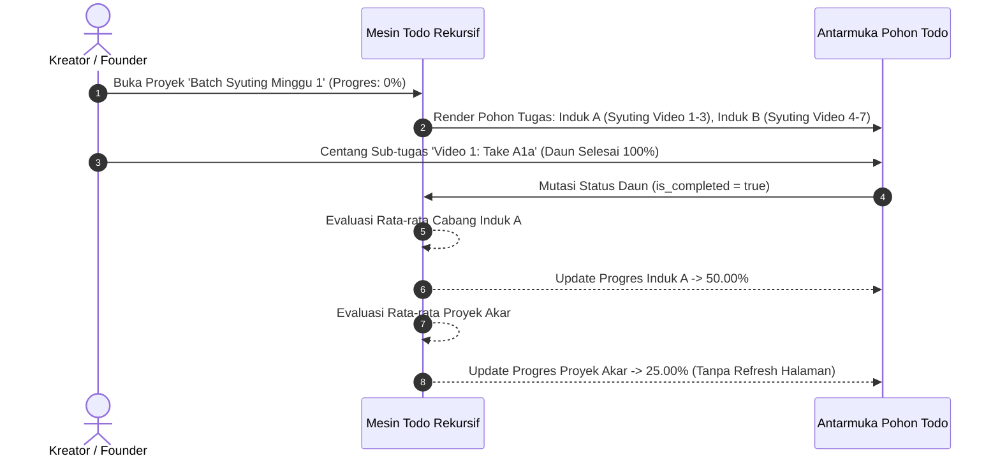
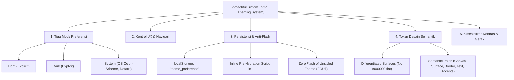
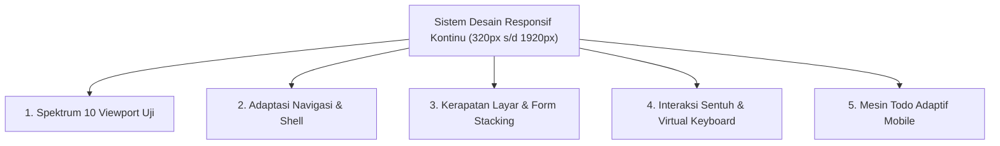

# SPESIFIKASI ARSITEKTUR PRODUK, DESAIN UI/UX, SISTEM TEMA & DESAIN RESPONSIF TERPADU
## Productivity Studio: Content Creator & Business Operating System

---

### 1. Metadata Dokumen dan Status Persetujuan

| Parameter | Keterangan |
| :--- | :--- |
| **Judul Dokumen** | Spesifikasi Arsitektur Produk, Sistem Desain UI/UX, Theming System (Light/Dark/System), dan Desain Responsif Komprehensif |
| **Proyek** | Productivity Studio (`e:/CODING/PROJECT/productivity-studio`) |
| **Penulis / Peran** | Senior Product Architect, Information Architect, Lead UI/UX Designer & Accessibility Engineer |
| **Versi Dokumen** | 1.1.0-PROPOSED (Revisi Komprehensif Sistem Tema 7A & Responsif 7B) |
| **Status Persetujuan** | **Draft Arsitektur — Menunggu Persetujuan Resmi (*Awaiting Approval*)** |
| **Tanggal Pembuatan** | 14 Oktober 2026 |
| **Dokumen Acuan Otoritatif** | 1. `PRODUCT_SPECIFICATION.md` (Spesifikasi Kebutuhan Produk & Logika Bisnis)<br>2. `DATABASE_DESIGN.md` (Model Data Supabase PostgreSQL & Batasan Integritas Relasional)<br>3. `E-Book Mending Gak Usah Ngonten.pdf` (Fondasi Konseptual & Filosofis BCP)<br>4. `Ultimate Content Toolkit.xlsx` (Inventaris Praktis 12 Worksheet, 385 Entri Sistem) |
| **Batasan Implementasi** | Tahap ini murni perancangan arsitektur antarmuka dan spesifikasi pengalaman pengguna (*design-only*). Tidak ada kode aplikasi, konfigurasi framework, komponen visual, atau dependensi paket yang diinstal. |

> [!WARNING]
> Dokumen ini berstatus **DRAFT** dan merupakan spesifikasi resmi yang mengikat implementasi frontend pada Fase 6. Tidak ada kode aplikasi, konfigurasi framework, atau pembuatan komponen yang diizinkan sebelum seluruh arsitektur navigasi, hierarki interaksi todo, sistem tema ganda, dan tata letak responsif di bawah ini disetujui secara eksplisit oleh Product Owner / User.

---

### 2. Ringkasan Eksekutif (*Executive Summary*)

#### 2.1 Tujuan & Solusi Produk
Aplikasi **Productivity Studio** dirancang untuk mentransformasikan metodologi *Bukan Cuma Posting* (BCP) dari ebook *Mending Gak Usah Ngonten!* dan spreadsheet operasional *Ultimate Content Toolkit.xlsx* menjadi sebuah sistem operasi kerja digital (*Content Operating System*) yang elegan, terstruktur, dan berfokus pada hasil finansial nyata (*sanity metrics*).

Aplikasi ini menyatukan tiga pilar utama:
1. **Kejelasan Strategis (Fondasi Positioning):** Mengunci keunikan pasar melalui Kanvas Ikigai 4-Kuadran dan profil Customer Avatar (ICP) sebelum naskah dibuat.
2. **Disiplin Eksekusi Produksi Massal (Batch Sprint):** Mengelola produksi konten mingguan ritme 3-3-1 (3 Engagement, 3 Authority, 1 Sales) menggunakan **Mesin Todo Hierarkis Rekursif** (*Recursive Hierarchical Todo Engine*) yang menghitung progres matematis secara otomatis tanpa batas kedalaman bersarang.
3. **Evaluasi Berbasis Data (Actionable Intelligence):** Mengeliminasi jebakan metrik semu (*vanity metrics*) dengan formula putusan otomatis (`WINNING`, `GOOD`, `OPTIMASI`, `STOP`) berdasarkan rasio simpan (*Save Rate %*) 14 hari pasca-publikasi.

#### 2.2 Sinergi Antara Basis Data, Sistem Tema, dan Pengalaman Responsif
- **Kepatuhan Model Data:** Mematuhi secara mutlak 11 tabel PostgreSQL pada `DATABASE_DESIGN.md`. Seluruh progres todo dihitung secara dinamis saat runtime (*in-memory*) berbasis rata-rata bobot cabang langsung ($\frac{1}{n} \sum p_i$) guna menjamin **100% bebas *data drift***.
- **Sistem Tema Kelas Satu (First-Class Theming):** Mendukung mode **Light**, **Dark**, dan **System** dengan token semantik terpisah. Dark mode dirancang menggunakan tingkatan permukaan abu-abu gelap berlapis (bukan warna hitam pekat `#000000` datar), sedangkan Light mode menjaga kontras permukaan yang menenangkan mata. Dilengkapi inisialisasi pra-hidrasi instan untuk mencegah kedipan tema (*zero theme flash*).
- **Desain Responsif Kontinu:** Menjamin pengalaman mobile sebagai warga kelas satu (*first-class experience*), bukan sekadar desktop yang diperkecil. Menerapkan target sentuh $\ge 44\text{px} \times 44\text{px}$, indentasi pohon adaptif, transformasi tabel matriks menjadi kartu bertumpuk, dan penanganan cerdas terhadap papan ketik virtual (*virtual keyboard*).

---

### 3. Inventaris Bahan Sumber & Ketertelusuran (*Source Traceability*)



| Modul Antarmuka | Rute UI | Entitas Database Terkait (`DATABASE_DESIGN.md`) | Bukti Sumber Otoritatif |
| :--- | :--- | :--- | :--- |
| **Foundation Studio** | `/foundation/niche`<br>`/foundation/audience` | `niche_profiles`<br>`audience_personas` | Ebook Bab 4 (hlm 21–22); Excel Sheet `🎯 Niche & Value` (baris 1–103) & Sheet `👥 Audience Profile` (baris 1–86). |
| **Content Planner** | `/planner` | `content_plans` | Ebook Bab 4 (hlm 24), Bab 5 (hlm 30); Excel Sheet `📆 Monthly Planner` (336 slot terstruktur ritme 3-3-1). |
| **HTPC Brief Studio** | `/planner/brief/[id]` | `content_briefs`<br>`hook_templates`<br>`cta_templates` | Ebook Bab 3 (hlm 19), Bab 4 (hlm 26); Excel Sheet `📝 Content Brief` (HTPC Framework) & Sheet `🔥 Hook Bank`. |
| **Recursive Todo Studio** | `/tasks` | `tasks` (Self-referencing `parent_id`) | Kebutuhan Eksplisit Pengguna; Ebook Bab 5 (hlm 31: Batch Production Sprint). Aturan Progres 1–12. |
| **Performance Tracker** | `/tracker` | `performance_metrics` | Ebook Bab 2 (hlm 11); Excel Sheet `📊 Performance Tracker` (210 formula evaluasi L11:L110). |
| **Resource Library** | `/library/hooks`<br>`/library/ideas`<br>`/library/cta`<br>`/library/tools`<br>`/library/glossary` | `hook_templates` (105)<br>`idea_templates` (104)<br>`cta_templates` (45)<br>`tool_references` (31)<br>`glossary_terms` (100) | Excel Sheets: `🔥 Hook Bank`, `💡 Bank Ide Konten`, `🎯 Bank of CTA-CTV`, `🛠️ Tools Ngonten`, `📖 Kamus Istilah`. |

---

### 4. Definisi Produk dan Batasan Ruang Lingkup (*Product Vision & Scope*)

#### 4.1 Definisi Produk & Nilai Tambah
**Productivity Studio** adalah ruang kerja pribadi (*single-user local workspace*) yang mengintegrasikan seluruh daur hidup pembuatan konten:
$$\text{Fondasi Positioning} \longrightarrow \text{Perencanaan 3-3-1} \longrightarrow \text{Naskah HTPC} \longrightarrow \text{Eksekusi Batch Todo} \longrightarrow \text{Evaluasi Verdict}$$

Aplikasi ini secara tegas mengabaikan metrik semu (*vanity metrics*) seperti jumlah views tanpa konversi, dan berfokus pada pembangunan aset jangka panjang (*evergreen digital assets*) dengan rasio simpan (*save rate*) tinggi.

#### 4.2 Batasan Ruang Lingkup MVP (*Minimum Viable Product Scope*)
Fitur yang **wajib hadir** dalam implementasi MVP:
1. **Foundation Canvas:** Form interaktif 4-kuadran Ikigai, penyusunan Core Value, dan generator 3 variasi bio medsos.
2. **Customer Avatar Profile (ICP):** Pemetaan demografis, psikografis, ketakutan, impian, dan narasi persona harian.
3. **Kalender Konten 3-3-1:** Tampilan kalender 12 bulan / 52 minggu (336 slot) dengan penandaan visual tetap: 3 Engagement, 3 Authority, 1 Sales per minggu.
4. **HTPC Scripting Studio:** Editor naskah terstruktur berbasis Hook, Tension, Payoff, dan Call to Value, dilengkapi drawer integrasi Hook Bank dan CTA Bank.
5. **Mesin Todo Hierarkis Rekursif:** Pohon tugas bersarang tanpa batas level buatan, kalkulasi otomatis persentase cabang langsung, deteksi siklus, dan dukungan penuh layar sentuh mobile.
6. **Performance Logger & Winning Content Identifier:** Input metrik pasca-tayang dan evaluasi matematis otomatis (`WINNING`, `GOOD`, `OPTIMASI`, `STOP`).
7. **Pustaka Referensi Terpadu:** Modul pencarian dan filter untuk 105 Hook, 104 Ide, 45 CTA/CTV, 100 Istilah, dan 31 Tools, lengkap dengan fitur duplikasi kustom.
8. **Sistem Tema Lengkap:** Pengalih tema instan (*Light*, *Dark*, *System*) dengan persistensi lokal dan proteksi kedipan tema (*zero theme flash*).

#### 4.3 Fitur yang Ditunda (*Deferred Features - Post-MVP*)
- Integrasi otomatis penarikan analitik via Instagram Graph API & TikTok API.
- Eksekusi AI Prompt langsung di aplikasi menggunakan API key OpenAI / Anthropic.
- Fitur ekspor naskah massal ke format PDF ramah teleprompter.

#### 4.4 Fitur di Luar Cakupan (*Out-of-Scope*)
- Transcoding atau hosting file video mentah di server aplikasi.
- Sistem pesan instan / automasi bot closing WhatsApp.
- Sistem pembayaran atau langganan multi-tenant SaaS berbayar.

---

### 5. Arsitektur Informasi (*Information Architecture*)



#### 5.1 Struktur Navigasi Utama & Sekunder
1. **Sidebar Navigasi Desktop (Lebar: `260px`, Kolapsibel ke `72px`):**
   - Menampilkan 6 kelompok navigasi utama secara hierarkis.
   - Di bagian bawah sidebar, disematkan kontrol pemilih tema (*Theme Segmented Control*) yang menampilkan ikon Matahari, Bulan, dan Laptop.
   - Posisi tetap (*fixed*) di sisi kiri layar dengan garis pemisah tipis (`border-subtle`).
2. **Bottom Navigation Bar Mobile (Tinggi: `64px`):**
   - Mengelompokkan 5 rute paling sering diakses saat eksekusi: Dashboard, Planner, Tasks, Tracker, dan Library (More).
   - Mengoptimalkan jangkauan ibu jari (*thumb zone*) dengan bantalan aman bawah (*safe-area-inset-bottom*).
3. **Header Global & Kontekstual (Tinggi: `56px`):**
   - Menampilkan *Breadcrumbs* hierarki rute aktif.
   - Tombol aksi global cepat: *Quick Add Task* (+), *Filter Drawer*, dan *Theme Toggle Button* mandiri dengan tooltip pendukung.

---

### 6. Peta Rute Navigasi (*Route Map*)

| Rute URL | Nama Tampilan | Tujuan Halaman | Entitas Data Utama | Aksi Utama Pengguna | Prioritas MVP |
| :--- | :--- | :--- | :--- | :--- | :---: |
| `/` | **Studio Overview** | Ringkasan ekosistem BCP: metrik performa ringkas, progres sprint minggu ini, dan konten siap rekam. | `content_plans`<br>`tasks`<br>`performance_metrics` | Navigasi cepat, checklist tugas harian, tombol mulai batch syuting. | **P0 (Kritis)** |
| `/foundation/niche` | **Niche & Value Builder** | Kanvas interaktif 4 kuadran Ikigai, perumusan Core Value, dan salin bio medsos. | `niche_profiles` | Edit kuadran Ikigai, generate sweet spot, salin 3 variasi bio medsos. | **P0 (Kritis)** |
| `/foundation/audience` | **Audience Persona (ICP)** | Kartu profil audiens mendalam: demografis, psikografis, ketakutan, impian, dan narasi personal. | `audience_personas` | Tambah/edit persona, pratinjau kartu ICP, salin prompt AI periset. | **P0 (Kritis)** |
| `/planner` | **Editorial Planner (3-3-1)** | Kalender 336 slot tahunan dan papan mingguan dengan penegakan visual ritme 3-3-1. | `content_plans` | Jadwalkan slot, filter bulan/minggu, ubah status (`Ide` $\rightarrow$ `Posted`), buka brief. | **P0 (Kritis)** |
| `/planner/brief/[id]` | **HTPC Scripting Studio** | Kartu penulisan naskah video terstruktur: Hook 3 detik, Tension, Payoff, dan Call to Value. | `content_briefs`<br>`hook_templates`<br>`cta_templates` | Tulis 4 blok HTPC, buka laci Hook/CTA Bank, simpan draf naskah, tandai `Done`. | **P0 (Kritis)** |
| `/tasks` | **Recursive Todo Studio** | Manajemen pohon tugas hierarkis bersarang untuk eksekusi batch production sprint. | `tasks` (Self-referencing) | Buat akar tugas, tambah sub-tugas rekursif, centang/buka kembali, geser urutan. | **P0 (Kritis)** |
| `/tracker` | **Performance Tracker** | Pencatatan analitik pasca-tayang 14 hari dengan kalkulasi otomatis Save Rate & Verdict. | `performance_metrics`<br>`content_plans` | Input views/likes/saves, tinjau kartu *Winning Content*, salin pola pemenang. | **P0 (Kritis)** |
| `/library/hooks` | **Hook Bank Explorer** | Repositori 105 hook pemicu psikologis dengan pencarian dan penggantian placeholder. | `hook_templates` | Filter 6 pemicu, ganti kata placeholder, duplikasi kustom, insert ke brief. | **P1 (Penting)** |
| `/library/ideas` | **Content Idea Bank** | Penjelajah 104 ide konten terbukti lintas 10 niche industri dan 3 layer funnel. | `idea_templates` | Filter niche & funnel, duplikasi ide ke slot kalender, buat ide kustom. | **P1 (Penting)** |
| `/library/cta` | **CTA & CTV Selector** | Repositori 45 template penutup konten dengan pembeda tegas antara aksi vs nilai. | `cta_templates` | Filter kategori funnel, bedakan CTA vs CTV, salin template kustom. | **P1 (Penting)** |
| `/library/tools` | **Direktori Tools Ngonten** | Katalog 31 tools produksi terkurasi yang dikelompokkan ke dalam 5 fase produksi. | `tool_references` | Filter 5 fase produksi, filter model lisensi (Gratis/Freemium/Berbayar). | **P2 (Dukungan)** |
| `/library/glossary` | **Kamus Istilah Medsos** | Glosarium 100 istilah industri media sosial yang diterjemahkan ke dalam bahasa awam. | `glossary_terms` | Pencarian instan istilah, filter 5 kategori strategi/metrik. | **P2 (Dukungan)** |

---

### 7. Batasan Modul Fungsional (*Functional Module Boundaries*)



1. **Modul 1: Strategi & Fondasi (Mandiri / Inisialisasi)**
   - *Input:* Refleksi keahlian, passion, riset pasar, dan data audiens pengguna.
   - *Output:* Pernyataan positioning, formula bio medsos, dan profil Customer Avatar.
   - *Ketergantungan:* Tidak bergantung pada modul lain (dijalankan 1x saat setup awal).
2. **Modul 2: Perencanaan Kalender 3-3-1 (Sekuensial / Bulanan)**
   - *Input:* Profil niche, target bulanan, dan ide dari Bank Ide Konten.
   - *Output:* 28 slot konten terencana per bulan dengan rasio ketat (3 Engagement, 3 Authority, 1 Sales per minggu).
   - *Ketergantungan:* Mengambil referensi dari Modul Fondasi dan Modul Repositori.
3. **Modul 3: HTPC Scripting Studio (Sekuensial / Per Konten)**
   - *Input:* Slot jadwal kalender, template hook, dan template CTA/CTV.
   - *Output:* Naskah video matang berisi 4 blok: Hook 3 detik, Tension masalah, Payoff daging, dan Call to Value bernilai.
   - *Ketergantungan:* Terikat 1-ke-1 dengan entitas `content_plans`.
4. **Modul 4: Mesin Todo Hierarkis Rekursif (Eksekusi Operasional / Mingguan)**
   - *Input:* Daftar naskah yang siap diproduksi dalam satu batch sprint mingguan.
   - *Output:* Pelacakan pohon tugas produksi (Riset $\rightarrow$ Script $\rightarrow$ Shoot $\rightarrow$ Edit $\rightarrow$ Post) dengan visualisasi progres akurat.
   - *Ketergantungan:* Dapat berdiri mandiri atau ditautkan ke `content_plans` via foreign key `content_plan_id`.
5. **Modul 5: Performance Tracker & Verdict Engine (Evaluasi / Siklus 14 Hari)**
   - *Input:* Data penayangan dan interaksi riil setelah konten beredar 2 minggu.
   - *Output:* Rasio simpan (*Save Rate %*), skor putusan matematis (`WINNING`, `GOOD`, `OPTIMASI`, `STOP`), dan rekomendasi topik replikasi ke kalender berikutnya.
   - *Ketergantungan:* Membaca record dari `content_plans`.

---

### 8. Alur Pengguna dan Diagram Perjalanan (*User Journeys & Flows*)

#### Alur Kritis 1: Dari Perumusan Niche Menuju Penjadwalan Konten 3-3-1


#### Alur Kritis 2: Penulisan Naskah HTPC Terpadu


#### Alur Kritis 3: Pelaksanaan Batch Sprint & Propagasi Todo Rekursif


---

### 9. Spesifikasi UI/UX Mesin Todo Hierarkis Rekursif (*Phase 3 Engine*)

#### 9.1 Hirarki Interaksi & Representasi Pohon Bersarang
Aplikasi menolak implementasi bersarang statis (*fixed-level* seperti tabel terpisah untuk parent/child/grandchild). Struktur tugas menggunakan satu komponen rekursif seragam:

```
[Chevron] [Checkbox / Progress Indicator] [Judul Tugas] [Badge Progres %] [Aksi Cepat (+, ..., 🗑️)]
```

##### 1. Tugas Daun (*Leaf Task - Tanpa Anak*):
- Menampilkan kotak centang interaktif standar (`checkbox` ukuran `20px \times 20px`, dengan area sentuh `44px \times 44px`).
- Keadaan tidak dicentang: Progres $0.00\%$, teks normal.
- Keadaan dicentang: Progres $100.00\%$, teks tercoret lembut (*strikethrough*), warna teks berubah menjadi `text-muted`, dan checkbox terisi warna hijau emerald solid dengan centang putih.

##### 2. Tugas Induk (*Parent Task - Memiliki 1 atau Lebih Anak*):
- Kotak centang digantikan secara visual dengan **Indikator Progres Melingkar Mini (*Circular Progress Ring*)**:
  - Progres $0\%$: Lingkaran kosong abu-abu.
  - Progres $1\% - 99\%$: Lingkaran terisi sebagian sesuai persentase matematis, dengan angka persentase kecil di sebelahnya.
  - Progres $100\%$: Lingkaran berubah menjadi centang hijau penuh (menandakan *effective completion*).
- **Aksi Cek Induk Langsung:** Jika pengguna mengklik indikator induk yang belum komplit ($< 100\%$), sistem menampilkan konfirmasi cepat: *"Selesaikan seluruh sub-tugas di bawahnya?"*. Jika dikonfirmasi, sistem menjalankan *cascading completion* ke seluruh daun keturunan aktifnya.

##### 3. Panah Buka-Tutup (*Collapsible Chevron*):
- Tampil di sisi paling kiri tugas induk.
- Memungkinkan pengguna melipat (*collapse*) cabang yang sudah selesai atau sedang tidak dikerjakan agar menghemat ruang vertikal.

---

#### 9.2 Visualisasi Progres & Penegasan Nilai Turunan
- **Imutabilitas Input Persentase:** Antarmuka **TIDAK PERNAH** menyediakan input teks, slider, atau form yang memungkinkan pengguna mengetik langsung angka persentase pada tugas induk.
- Nilai persentase ditampilkan dengan label visual turunan yang jelas (contoh badge: `🔒 33.33% (Derived from 3 subtasks)`).
- **Perhitungan Rata-rata Cabang Langsung:** Tooltip visual tersedia saat kursor diarahkan ke badge progres:
  $$\text{Progres Induk} = \frac{\text{Anak 1 (100\%)} + \text{Anak 2 (50\%)} + \text{Anak 3 (0\%)}}{3} = 50.00\%$$
- **Tugas Diarsipkan (*Archived Tasks*):** Tugas terarsip ditampilkan dengan latar belakang abu-abu transparan (*opacity 50%*), ikon arsip mini 📦, dan badge: `Diarsipkan (Dikeluarkan dari kalkulasi)`.

---

#### 9.3 Manajemen Kerapatan Layar & Skalabilitas Mobile
Untuk mencegah masalah *horizontal overflow* dan keterbacaan yang rusak pada layar ponsel akibat indentasi berulang:
1. **Indentasi Adaptif Berbasis Viewport:**
   - Desktop ($\ge 1024\text{px}$): Indentasi sebesar `24px` per level kedalaman, dilengkapi garis pandu vertikal tipis (*vertical guide line*).
   - Tablet (`640px - 1023px`): Indentasi sebesar `16px` per level kedalaman.
   - Mobile ($< 640\text{px}$): Indentasi dibatasi maksimal sebesar `10px` per level untuk 3 level pertama. Untuk level 4 ke atas, indentasi **tidak ditambah ke kanan**, melainkan ditampilkan badge hierarki mini di atas judul (contoh: `Level 4: Root > Task A > Sub A1`).
2. **Drawer Navigasi Subtree (Mode Fokus Mobile):**
   - Pada layar sempit, mengklik tombol *Focus Branch* pada tugas induk akan membuka sub-pohon tugas tersebut dalam satu tampilan penuh (*Full-screen Focus Drawer*), menjadikan tugas induk tersebut sebagai *root temporer* dengan breadcrumb untuk kembali ke atas.
3. **Pemberian Aksi Bebas-Hover (*Touch-Friendly Actions*):**
   - Seluruh aksi kritis (Tambah Sub-tugas, Edit, Pindah Induk, Hapus) dapat diakses melalui tombol menu titik tiga vertikal (`⋮`) permanen berukuran target sentuh minimal `44px \times 44px`.

---

### 10. Sistem Desain & Arsitektur Tema Lengkap (*Persyaratan 7A*)



#### 10.1 Filosofi Visual: *Editorial Restraint & Functional Modernism*
Desain menolak tren visual yang melelahkan mata:
- **Dilarang:** Gradien warna neon berlebihan, efek kaca tembus pandang (*glassmorphism*), kartu dekoratif kosong, animasi melayang tanpa makna, dan grafik hiasan yang tidak menghasilkan keputusan.
- **Dianjurkan:** Tipografi dengan keterbacaan tinggi (*high legibility*), penataan hierarki informasi yang tegas, garis pemisah 1px yang tenang, permukaan abu-abu hangat, dan pemanfaatan warna aksen secara fungsional murni.

---

#### 10.2 Tiga Mode Tema (*7A.2 Theme Modes*)
Aplikasi mendukung 3 preferensi tema eksplisit:
1. **`Light`:** Secara eksplisit memaksa tema terang di seluruh aplikasi.
2. **`Dark`:** Secara eksplisit memaksa tema gelap di seluruh aplikasi.
3. **`System` (Rekomendasi Default):** Menyesuaikan secara otomatis dengan preferensi skema warna sistem operasi pengguna via `prefers-color-scheme`.

> [!IMPORTANT]
> **Pembedaan Preferensi Pengguna vs Tema Aktif:**  
> - **Saved Preference:** Nilai yang dipilih pengguna (`light` | `dark` | `system`).
> - **Resolved Theme:** Tema visual aktual yang aktif pada layar (`light` | `dark`). Jika preferensi adalah `system`, perubahan tema OS secara real-time langsung memperbarui tampilan tanpa me-reset preferensi pengguna. Namun jika pengguna secara eksplisit memilih `light` atau `dark`, perubahan OS diabaikan.

---

#### 10.3 Kontrol Pengalih Tema & Interaksi UX (*7A.3 Theme Toggle UX*)
- **Penempatan Desktop:**
  1. *Header Global:* Segmented button ringkas di sudut kanan atas dengan 3 ikon: Matahari ☀️ (`Light`), Bulan 🌙 (`Dark`), Monitor 💻 (`System`).
  2. *Sidebar Bawah:* Menu preferensi tema di footer sidebar dengan label teks dan indikator centang pada opsi yang aktif.
- **Penempatan Mobile:**
  - Terletak pada Header Mobile di samping ikon filter, dapat diakses dalam 1 ketukan berupa tombol dropdown/sheet pemilihan tema yang ramah ibu jari.
- **Perilaku Aksesibilitas & Non-Icon-Only:**
  - Tombol kontrol dilengkapi atribut `aria-label="Pilih tema tampilan (Saat ini: Sistem - Mode Gelap)"`.
  - Menggunakan komponen `role="radiogroup"` dengan `aria-checked="true"` pada opsi terpilih.
  - Navigasi keyboard penuh menggunakan `Tab`, `Arrow Left / Right`, dan `Enter / Space`.
  - Tooltip desktop menjelaskan: *"Ikuti tema sistem operasi (Windows/macOS)"*.

---

#### 10.4 Persistensi Tema & Pencegahan Kedipan Layar (*7A.4 Zero Theme Flash*)
- **Penyimpanan:** Disimpan di `localStorage.getItem('productivity_studio_theme')` dengan nilai `'light' | 'dark' | 'system'`.
- **Mitigasi Flash of Unstyled Theme (FOUT):**
  Untuk mencegah kedipan layar putih saat membuka aplikasi dalam mode gelap:
  - Disematkan skrip inline pemblokir (*blocking script*) kecil pada tag `<head>` sebelum CSS dan React dihidrasi:
    ```html
    <script>
      (function() {
        try {
          var pref = localStorage.getItem('productivity_studio_theme') || 'system';
          var resolved = pref;
          if (pref === 'system') {
            resolved = window.matchMedia('(prefers-color-scheme: dark)').matches ? 'dark' : 'light';
          }
          if (resolved === 'dark') {
            document.documentElement.classList.add('dark');
          } else {
            document.documentElement.classList.remove('dark');
          }
        } catch (e) {}
      })();
    </script>
    ```
- **Konsistensi Lintas Rute & Portal UI:**
  Peralihan rute Next.js App Router tidak boleh me-reset tema. Seluruh komponen portal (*dialog modals*, *dropdowns*, *tooltips*) merender kelas tema yang sama di level elemen `<html>`.

---

#### 10.5 Token Desain Semantik Lengkap (*7A.5 Semantic Theme Tokens*)

| Kategori Token | Nama Token | Nilai Hex (Light Mode) | Nilai Hex (Dark Mode) | Tujuan & Perilaku Penggunaan |
| :--- | :--- | :--- | :--- | :--- |
| **Canvas** | `bg-app` | `#F8FAFC` (Slate 50) | `#09090B` (Zinc 950) | Latar belakang dasar kanvas aplikasi. |
| **Surface 1** | `bg-surface` | `#FFFFFF` (Pure White) | `#18181B` (Zinc 900) | Latar kartu utama, modul naskah, dan bilah samping. |
| **Surface 2** | `bg-surface-elevated`| `#F1F5F9` (Slate 100) | `#27272A` (Zinc 800) | Kartu tugas tersorot, header tabel, dropdown menu. |
| **Border Subtle** | `border-subtle` | `#E2E8F0` (Slate 200) | `#27272A` (Zinc 800) | Garis pemisah wilayah kerja 1px dan grid kalender. |
| **Border Strong** | `border-strong` | `#CBD5E1` (Slate 300) | `#3F3F46` (Zinc 700) | Batas input form, fokus kontrol, divider kritis. |
| **Text Primary** | `text-primary` | `#0F172A` (Slate 900) | `#F4F4F5` (Zinc 100) | Judul halaman, teks naskah brief, nama tugas todo. |
| **Text Secondary**| `text-secondary` | `#475569` (Slate 600) | `#D4D4D8` (Zinc 300) | Deskripsi modul, sub-judul, isi konten tabel. |
| **Text Muted** | `text-muted` | `#64748B` (Slate 500) | `#A1A1AA` (Zinc 400) | Tanggal, metadata, placeholder form, info turunan. |
| **Interactive** | `btn-primary-bg` | `#0F172A` (Slate 900) | `#F4F4F5` (Zinc 100) | Tombol aksi utama (Save, Publish, Add). |
| **Interactive Text**| `btn-primary-text`| `#FFFFFF` (White) | `#09090B` (Zinc 950) | Teks pada tombol aksi utama. |
| **Hover State** | `state-hover` | `#F1F5F9` (Slate 100) | `#27272A` (Zinc 800) | Efek sorot saat kursor berada di atas baris tugas. |
| **Focus Ring** | `state-focus` | `#2563EB` (Blue 600) | `#3B82F6` (Blue 500) | Cincin fokus keyboard (`ring-2 ring-offset-2`). |
| **Funnel Engagement**| `funnel-engagement`| `#059669` (Emerald 600)| `#34D399` (Emerald 400)| Label slot konten jangkauan/viralitas (TOFU). |
| **Funnel Authority** | `funnel-authority` | `#2563EB` (Blue 600) | `#60A5FA` (Blue 400) | Label slot konten edukasi & kredibilitas (MOFU). |
| **Funnel Sales** | `funnel-sales` | `#D97706` (Amber 600) | `#FBBF24` (Amber 400) | Label slot konten promosi langsung (BOFU). |
| **Verdict Winning**| `verdict-winning` | `#059669` (Emerald 600)| `#10B981` (Emerald 500)| Lencana konten pemenang (🏆 Replikasi Segera). |
| **Verdict Good** | `verdict-good` | `#2563EB` (Blue 600) | `#3B82F6` (Blue 500) | Lencana performa solid (✅ Pertahankan). |
| **Verdict Optimasi**| `verdict-optimasi`| `#D97706` (Amber 600)| `#F59E0B` (Amber 500)| Lencana evaluasi hook/topik (🔄 Perlu Optimasi). |
| **Verdict Stop** | `verdict-stop` | `#E11D48` (Rose 600) | `#F43F5E` (Rose 500) | Lencana performa jeblok (🛑 Hentikan Pola Ini). |
| **Skeleton Pulse**| `bg-skeleton` | `#E2E8F0` (Slate 200) | `#27272A` (Zinc 800) | Efek animasi pemuatan placeholder. |

> [!TIP]
> **Diferensiasi Permukaan Mode Gelap (Anti-Flat Black):**  
> Dark Mode menggunakan 3 tingkat elevasi permukaan: Kanvas (`#09090B`) $\rightarrow$ Kartu Permukaan (`#18181B`) $\rightarrow$ Elemen Melayang/Dropdown (`#27272A`). Pendekatan ini mempertahankan kedalaman visual hierarkis tanpa membuat mata lelah akibat kontras hitam pekat murni (`#000000`).

---

#### 10.6 Standar Aksesibilitas & Gerak (*7A.7 Accessibility & Motion*)
- **Rasio Kontras WCAG 2.2 Level AA:**
  - Teks normal (`text-primary`, `text-secondary`) terhadap latar belakang mencapai rasio kontras $\ge 4.8:1$ pada Light Mode dan $\ge 12.5:1$ pada Dark Mode.
  - Elemen non-teks penting (checkbox, batas input, bilah progres) mencapai rasio $\ge 3.2:1$.
- **Kepatuhan `prefers-reduced-motion`:**
  - Pengalihan tema tidak memicu animasi transisi warna yang mencolok atau kedipan (*no flashing*).
  - Jika pengguna mengaktifkan *Reduced Motion* di sistem operasinya, seluruh transisi CSS dinonaktifkan (`transition: none !important;`).

---

#### 10.7 Kriteria Penerimaan Sistem Tema (*7A.8 Theme Acceptance Criteria*)
1. [ ] Pengguna dapat memilih opsi `Light`, `Dark`, dan `System` secara eksplisit.
2. [ ] Preferensi yang dipilih tersimpan di penyimpanan lokal dan bertahan saat halaman dimuat ulang.
3. [ ] Mode `System` merespons perubahan preferensi skema warna OS secara langsung.
4. [ ] Pilihan eksplisit `Light` atau `Dark` mengabaikan perubahan tema sistem operasi.
5. [ ] Tidak terjadi kedipan tema salah (*Flash of Unstyled Theme*) saat aplikasi pertama kali dibuka.
6. [ ] Tema tetap konsisten di seluruh rute dan jendela modal (*portals/dialogs*).
7. [ ] Tidak ada teks atau komponen penting yang kehilangan keterbacaan di kedua tema.
8. [ ] Kontrol tema dapat dioperasikan penuh via keyboard, pointer mouse, dan layar sentuh.
9. [ ] Seluruh warna teks dan kontrol memenuhi syarat kontras minimal WCAG 2.2 AA di kedua tema.
10. [ ] Perilaku tema teruji dan konsisten pada viewport desktop, tablet, dan ponsel cerdas.

---

### 11. Spesifikasi Desain Responsif Menyeluruh: Desktop hingga Ponsel (*Persyaratan 7B*)



#### 11.1 Filosofi Responsif: *Continuous Fluid Continuum*
Aplikasi dirancang untuk rentang layar yang kontinu, bukan sekadar saklar biner antara desktop dan ponsel. Pengalaman mobile diperlakukan sebagai antarmuka operasional penuh di mana seluruh tugas perencanaan, penulisan naskah, pencentangan todo, dan evaluasi performa dapat diselesaikan tanpa memerlukan komputer desktop.

---

#### 11.2 Cakupan 10 Titik Uji Perangkat (*7B.2 Viewport & Device Coverage*)

| Kategori Viewport | Lebar Representatif | Karakteristik Perangkat Acuan | Tantangan & Fokus Pengujian Utama |
| :--- | :---: | :--- | :--- |
| **Small Mobile** | **`320px`** | Ponsel layar kecil (misal iPhone SE Gen 1, Android compact). | Batasan lebar ekstrem; nol overflow horizontal; stacking tombol penuh. |
| **Standard Mobile** | **`360px`** | Mayoritas ponsel Android entry-level. | Keterbacaan kartu HTPC, form stacking, padding `12px`. |
| **Mobile** | **`390px`** | Ponsel modern standar (iPhone 12/13/14/15, Galaxy S series). | Tata letak ideal mobile portrait; bottom nav bar responsif. |
| **Large Mobile** | **`430px`** | Ponsel berlayar besar (iPhone Pro Max, Galaxy Ultra). | Pemanfaatan ruang vertikal, densitas kartu optimal. |
| **Small Tablet** | **`600px`** | Ponsel lipat terbuka / tablet kecil portrait (iPad Mini). | Transisi 1 kolom ke 2 kolom; drawer navigasi kolapsibel. |
| **Tablet** | **`768px`** | Tablet standar portrait (iPad 10.2", Galaxy Tab). | Sidebar menciut ke icon-only bar (`72px`); tabel mulai menampilkan kolom sekunder. |
| **Large Tablet** | **`1024px`** | Tablet landscape / laptop ultra-portable. | Kembalinya sidebar penuh (`260px`); editor naskah 2 kolom. |
| **Desktop** | **`1280px`** | Monitor laptop standar (13"-15" MacBook, Windows laptop). | Tampilan kerja default studio; kalender matriks 7 kolom penuh. |
| **Large Desktop** | **`1440px`** | Monitor kerja studio / iMac. | Batas lebar kontainer maksimum (`max-w-7xl`); panjang baris teks nyaman. |
| **Wide Desktop** | **`1920px`** | Monitor ultrawide / external display. | Konten terpusat dengan padding samping proporsional tanpa ruang kosong canggung. |

---

#### 11.3 Adaptasi Navigasi & Shell Aplikasi (*7B.3 Layout Adaptation*)
1. **Desktop ($\ge 1024\text{px}$):**
   - Sidebar navigasi tetap (`260px`) di sisi kiri.
   - Header atas (`56px`) menampilkan breadcrumbs dan kontrol tema.
   - Konten kerja mengisi sisa ruang dengan `max-w-7xl` terpusat.
2. **Tablet (`768px - 1023px`):**
   - Sidebar menciut menjadi **Bilah Ikon Ringkas (*Compact Icon Rail*, `72px`)**.
   - Aksi-aksi utama tetap dapat diakses via ikon dengan tooltip saat disentuh/diarahkan.
3. **Ponsel Cerdas ($< 768\text{px}$):**
   - Sidebar kiri disembunyikan sepenuhnya.
   - Diaktifkan **Bottom Navigation Bar (`64px`)** yang memuat 5 tombol utama:
     `[Dashboard] [Planner] [Tasks] [Tracker] [Library]`
   - Kontrol tema disematkan di Header Mobile di sebelah kanan judul rute.
   - Dilengkapi *Safe Area Inset* (`env(safe-area-inset-bottom)`) untuk perangkat dengan tombol beranda virtual.

---

#### 11.4 Tata Letak Ponsel & Transformasi Tabel Data (*7B.4 Mobile Density*)
- **Transformasi Tabel Kalender & Tracker:**
  Pada layar $< 640\text{px}$, tabel matriks lebar otomatis bertransformasi menjadi **Tampilan Kartu Bertumpuk (*Stacked Card List View*)**:
  - Setiap slot konten ditampilkan sebagai kartu ringkas yang memuat: Lencana Funnel, Topik Konten, Format (Reels/Carousel), Status Badge, dan Tombol Buka Brief.
  - Mencegah timbulnya scrollbar horizontal pada level halaman utama.
- **Form Field Stacking:**
  Seluruh formulir input (Ikigai Canvas, Persona Input, Brief Editor) secara otomatis bertransformasi menjadi 1 kolom vertikal penuh (`w-full`) dengan jarak antar elemen `16px`.
- **Pencegahan Teks Terpotong (*Text Wrapping & Clamping*):**
  Judul tugas panjang menggunakan pemotongan teks rapi (`line-clamp-2`) pada kartu mobile, dan teks lengkap dapat dilihat dengan mengetuk kartu.

---

#### 11.5 Interaksi Sentuh & Penanganan Keyboard Virtual (*7B.5 Touch & Virtual Keyboard*)
1. **Ukuran Target Sentuh Ramah Ibu Jari:**
   - Seluruh kontrol interaktif (checkbox, tombol aksi, chevron, toggle tema) memiliki area interaksi fisik minimal **`44px \times 44px`**.
   - Jarak antar tombol destruktif (Hapus) dan non-destruktif (Edit/Tambah) minimal `12px` untuk mencegah kesalahan ketuk (*misclick*).
2. **Penanganan Papan Ketik Virtual (*Virtual Keyboard Awareness*):**
   - Pada form naskah HTPC dan input tugas: saat keyboard virtual muncul di ponsel, area input otomatis bergeser ke tengah bidang pandang (*scroll-into-view*).
   - Tombol aksi utama (*Simpan / Selesai*) menggunakan posisi sticky yang terangkat di atas batas keyboard virtual, sehingga tidak tertutupi oleh keyboard.

---

#### 11.6 Mesin Todo Hierarkis pada Layar Sempit (*7B.6 Mobile Todo Interface*)
Pohon hierarki tugas bersarang menangani batasan layar ponsel sempit melalui strategi adaptif:
1. **Penyusutan Indentasi Bertingkat:**
   - Level 0 (Akar): Indentasi `0px`.
   - Level 1: Indentasi `12px`.
   - Level 2: Indentasi `20px`.
   - Level 3: Indentasi `28px`.
   - Level 4 ke atas: Indentasi **dikunci di `28px`** dan ditambahkan penanda visual chip silsilah (misal: `↳ L4`).
2. **Mode Fokus Subtree (*Focus Branch Drawer*):**
   - Pengguna ponsel dapat mengetuk menu `⋮` pada tugas induk dan memilih **"Fokus Cabang Ini"**.
   - Layar membuka sub-pohon tugas tersebut sebagai halaman penuh mandiri, memungkinkan navigasi dan penambahan sub-tugas secara leluasa tanpa terhimpit tepi layar.
3. **Penyelarasan Bilah Progres:**
   - Bilah progres numerik diposisikan rapi di baris kedua di bawah judul tugas pada ponsel sempit, mencegah teks judul terdesak oleh badge persentase.

---

#### 11.7 Form, Dialog & Lembar Sentuh Bawah (*7B.7 Overlays & Bottom Sheets*)
- **Desktop:** Dialog konfirmasi dan pemilihan aset terbuka sebagai jendela modal terpusat (*Centered Modal Dialog*, lebar maks `540px`).
- **Mobile:** Dialog dan drawer bertransformasi secara native menjadi **Lembar Sentuh Bawah (*Bottom Sheet*)** yang meluncur dari bagian bawah layar dengan pegangan geser (*drag handle*), dapat ditutup dengan gesekan ke bawah (*swipe-to-dismiss*), dan mematuhi batas aman layar ponsel.

---

#### 11.8 Kriteria Penerimaan Desain Responsif (*7B.9 Responsive Acceptance Criteria*)
1. [ ] Tidak terjadi overflow horizontal pada seluruh rute di lebar `320px` s/d `1920px`.
2. [ ] Seluruh alur kerja MVP (Setup, Kalender, Scripting HTPC, Todo, Tracker) dapat diselesaikan tuntas di layar ponsel `360px` tanpa memerlukan komputer desktop.
3. [ ] Tata letak desktop, tablet, dan mobile terdokumentasi dan teruji pada 10 titik lebar uji.
4. [ ] Bilah navigasi bawah ponsel tetap responsif dan bebas konflik dengan *safe-area* perangkat.
5. [ ] Pohon todo tetap dapat dibaca, dicentang, dan ditambah sub-tugasnya pada kedalaman bersarang $\ge 4$ level di layar ponsel.
6. [ ] Seluruh elemen interaktif mobile memenuhi target sentuh minimal $44\text{px} \times 44\text{px}$.
7. [ ] Papan ketik virtual tidak menutupi bidang isian aktif maupun tombol simpan utama.
8. [ ] Seluruh jendela modal bertransformasi menjadi lembar sentuh bawah (*bottom sheet*) yang ergonomis di ponsel.
9. [ ] Mode Light dan Dark berfungsi presisi di seluruh ukuran viewport tanpa kontras yang cacat.
10. [ ] Nilai persentase progres todo tetap terbaca jelas dan tidak tumpang tindih dengan teks judul di seluruh ukuran layar.

---

### 12. Matriks Konsistensi Silang Tema & Tata Letak Responsif (*Persyaratan 7C*)

Matriks ini menetapkan cakupan verifikasi wajib yang akan diuji secara formal pada tahap implementasi (Fase 7):

| Kombinasi Pengujian | Viewport Desktop ($\ge 1024\text{px}$) | Viewport Tablet (`768px - 1023px`) | Viewport Mobile ($< 640\text{px}$) |
| :--- | :--- | :--- | :--- |
| **Light Theme** | - Navigasi sidebar penuh (260px)<br>- Kalender matriks 7 kolom 3-3-1<br>- HTPC Studio 2 kolom sejajar<br>- Pohon todo indentasi 24px + guide line<br>- Kontras slate-900 / white $\ge 4.8:1$ | - Bilah ikon menciut (72px)<br>- Tabel kalender adaptif<br>- Form HTPC 1 kolom lebar<br>- Pohon todo indentasi 16px<br>- Target sentuh tablet nyaman | - Bottom navigation bar (64px)<br>- Tabel kalender jadi kartu vertikal<br>- HTPC Studio drawer penuh<br>- Pohon todo indentasi maks 28px / Focus Drawer<br>- Tombol aksi sentuh $\ge 44\text{px} \times 44\text{px}$ |
| **Dark Theme** | - Permukaan zinc-900 / canvas zinc-950<br>- Nol warna hitam pekat `#000000` datar<br>- Bilah progres aksen emerald/blue terang<br>- Kontras teks zinc-100 $\ge 12.5:1$<br>- Cincin fokus keyboard terlihat tegas | - Permukaan kartu zinc-900 terangkat rapi<br>- Header tabel berlatar zinc-800<br>- Form border zinc-700 jelas terbaca<br>- Zero visual glare pada sesi malam | - Bottom sheet modal berlatar zinc-900<br>- Bottom nav bar berlatar zinc-950 pekat<br>- Target sentuh kontras tinggi<br>- Nyaman dioperasikan di ruang gelap |

---

### 13. Inventaris Komponen Dapat Digunakan Ulang (*Reusable Components*)

| Komponen | Tanggung Jawab Komponen | Tingkat Penggunaan Ulang | Dukungan Tema | Perilaku Responsif |
| :--- | :--- | :--- | :--- | :--- |
| `AppShell` | Membungkus tata letak global aplikasi (Sidebar, Mobile Bar, Konten Utama). | Shell Tunggal Global | Light, Dark, System | Mengubah sidebar desktop menjadi bottom navigation bar pada layar ponsel. |
| `ThemeController` | Pemilih tema 3 mode (Light/Dark/System) dengan penyimpanan lokal dan anti-flash. | Global Header & Sidebar | Light, Dark, System | Segmented control di desktop; dropdown/sheet di ponsel. |
| `PageHeader` | Menampilkan judul rute, deskripsi ringkas, breadcrumbs, dan tombol aksi utama. | Digunakan di 100% Halaman | Light & Dark | Menumpuk tombol aksi di bawah judul pada layar ponsel sempit. |
| `RecursiveTree` | Merender pohon tugas bersarang tanpa batasan level kedalaman. | Mesin Todo & Batch Tasks | Light & Dark | Menerapkan indentasi adaptif dan drawer fokus pada layar ponsel. |
| `CircularProgress` | Menampilkan progres persentase melingkar pada tugas induk. | Tugas Induk & Dashboard | Light & Dark | Ukuran tetap `24px` pada desktop dan `28px` pada layar sentuh ponsel. |
| `FunnelBadge` | Label visual untuk layer funnel BCP (`Engagement`, `Authority`, `Sales`). | Planner, Brief, Library | Light & Dark | Ikon dan teks lengkap di desktop; ikon mini di ponsel sempit. |
| `VerdictBadge` | Badge otomatis evaluasi kinerja konten BCP. | Performance Tracker, Dashboard | Light & Dark | Menampilkan ikon piala/centang/rotasi/larangan beserta teks putusan. |
| `DrawerSelector` | Laci samping (*slide-over drawer*) untuk memilih Hook Bank dan CTA Bank. | HTPC Brief Studio, Planner | Light & Dark | Meluncur dari sisi kanan (lebar 420px di desktop; lebar 100% penuh di ponsel). |
| `DataTable` | Tabel data terstruktur untuk kalender, kinerja, dan repositori library. | Planner, Tracker, Library | Light & Dark | Berubah dari tabel kisi horizontal menjadi kartu vertikal bertumpuk pada ponsel. |
| `ConfirmDialog` | Dialog modal konfirmasi untuk operasi destruktif (hapus tugas, hapus jadwal). | Global | Light & Dark | Modal terpusat di desktop; bottom sheet dari bawah layar pada ponsel. |

---

### 14. Spesifikasi Rinci Antarmuka Halaman demi Halaman (*Page-by-Page Specs*)

#### 14.1 Halaman 1: Studio Overview (`/`)
- **Tujuan Halaman:** Pusat kendali operasional harian yang menyajikan ringkasan progres mingguan tanpa membuat pengguna kewalahan (*cognitive overload*).
- **Tata Letak Desktop:** Grid 2 kolom asimetris (Kolom kiri 60% kalender mingguan aktif 3-3-1, kolom kanan 40% widget todo prioritas).
- **Tata Letak Mobile:** Tata letak 1 kolom bertumpuk vertikal dengan tab pemilih kilat antara `Jadwal Minggu Ini` dan `Tugas Hari Ini`.
- **Perilaku Tema:** Kartu metrik berlatar `bg-surface` dengan garis `border-subtle` di kedua tema.

---

#### 14.2 Halaman 2: Niche & Value Builder (`/foundation/niche`)
- **Tujuan Halaman:** Menyusun fondasi bisnis kreator menggunakan kerangka kerja Ikigai 4-Kuadran dan menghasilkan formula bio media sosial yang memikat.
- **Komponen Form & Interaksi:**
  - *Desktop:* Grid 2x2 untuk 4 Kuadran Ikigai, diikuti baris form Core Value, dan 3 kartu pratinjau bio sejajar.
  - *Mobile:* 4 Kuadran bertumpuk vertikal secara akordeon (*collapsible accordion*), form Core Value, dan kartu bio dengan tombol salin lebar penuh.
- **Perilaku Tema:** Bidang input berlatar `bg-surface` dengan teks `text-primary` dan border `border-strong` yang tegas.

---

#### 14.3 Halaman 3: Customer Avatar Profile (`/foundation/audience`)
- **Tujuan Halaman:** Mendefinisikan profil pelanggan ideal (*Ideal Customer Profile* / ICP) secara mendalam agar gaya bahasa konten relevan dan menyentuh emosi audiens.
- **Komponen & Struktur Informasi:**
  - *Desktop:* Kartu ICP 2 kolom (Kiri: Demografis & Psikografis Tripartit; Kanan: Narasi Persona *A Day in the Life*).
  - *Mobile:* Tampilan 1 kolom vertikal bertumpuk dengan tab navigasi internal (*Demografis*, *Frustrasi*, *Narasi*).
- **Perilaku Tema:** Panel psikografis menggunakan kartu kontras tinggi di kedua tema.

---

#### 14.4 Halaman 4: Editorial Planner 3-3-1 (`/planner`)
- **Tujuan Halaman:** Mengelola kalender editorial 12 bulan (336 slot) dengan penegakan visual rasio mingguan BCP.
- **Tata Letak Desktop:** Tabel matriks 7 kolom penuh menampilkan slot mingguan (Slot 1-3 hijau Engagement, 4-6 biru Authority, 7 kuning Sales).
- **Tata Letak Mobile:** Daftar kartu vertikal bertumpuk (*Stacked Card List*), setiap kartu menampilkan lencana funnel, topik konten, dan status tombol aksi.
- **Perilaku Tema:** Lencana warna funnel (`funnel-engagement`, `funnel-authority`, `funnel-sales`) disesuaikan agar mencapai rasio kontras $\ge 4.5:1$ terhadap latar belakang di kedua tema.

---

#### 14.5 Halaman 5: HTPC Scripting Studio (`/planner/brief/[id]`)
- **Tujuan Halaman:** Ruang kerja terfokus (*Distraction-free Writing Space*) untuk menyusun naskah video pendek dengan retensi tinggi.
- **Struktur Wilayah Penulisan:**
  1. *Desktop:* Panel naskah utama 4 blok HTPC di sebelah kiri (70%), sidebar parameter durasi dan tagar di sebelah kanan (30%). Drawer Hook/CTA meluncur dari kanan.
  2. *Mobile:* Seluruh 4 blok HTPC bertumpuk vertikal 100% lebar layar. Drawer Hook/CTA terbuka sebagai lembar sentuh bawah penuh (*Full-screen Bottom Sheet*).
- **Perilaku Keyboard:** Saat mengetik naskah di ponsel, tombol *Simpan Draf* tetap melayang (*sticky*) di atas keyboard virtual.

---

#### 14.6 Halaman 6: Recursive Todo Studio (`/tasks`)
- **Tujuan Halaman:** Mengelola pohon tugas produksi batch mingguan dengan visualisasi progres matematis yang akurat.
- **Tata Letak Desktop:** Pohon hierarki dengan indentasi `24px` per level, bilah progres horizontal, dan menu aksi samping.
- **Tata Letak Mobile:** Pohon hierarki dengan indentasi adaptif (maks `28px`), angka progres di bawah judul, dan opsi *Focus Branch Drawer* untuk kedalaman $\ge 4$ level.
- **Perilaku Tema:** Checkbox daun dan lingkaran progres induk terisi warna hijau emerald solid saat 100% di kedua tema.

---

#### 14.7 Halaman 7: Performance Tracker (`/tracker`)
- **Tujuan Halaman:** Evaluasi matematis objektif terhadap kinerja konten pasca-tayang 14 hari guna menentukan strategi replikasi.
- **Tata Letak Desktop:** Tabel log analitik lengkap dengan kolom input interaksi dan kolom putusan otomatis (*Verdict* 🏆, ✅, 🔄, 🛑).
- **Tata Letak Mobile:** Kartu evaluasi bertumpuk per postingan dengan bidang input sentuh besar dan lencana putusan yang menonjol.
- **Perilaku Tema:** Lencana putusan menggunakan warna semantik `verdict-winning`, `verdict-good`, `verdict-optimasi`, dan `verdict-stop` yang tajam dan terbaca jelas di kedua tema.

---

#### 14.8 Halaman 8 s/d 12: Resource Library (`/library/*`)
- **Tujuan Halaman:** Pusat eksplorasi 385 aset bawaan sistem yang terkurasi (105 Hook, 104 Ide, 45 CTA/CTV, 100 Istilah, 31 Tools).
- **Tata Letak Desktop:** Kisi kartu 3 kolom (*3-column grid*) dengan bilah filter atas dan kolom pencarian instan.
- **Tata Letak Mobile:** Daftar kartu 1 kolom vertikal dengan filter kategori berupa tombol chip horizontal yang dapat digeser (*horizontal scrollable chips*).
- **Perilaku Kritis:** Tombol *Duplikasi Kustom* tersedia di setiap kartu di kedua tema.

---

### 15. Kontrak Data dan Interaksi Antarmuka (*Data & Interaction Contracts*)

| Interaksi Pengguna di UI | Entitas Basis Data Terkait | Operasi Backend / Server Action | Validasi Input & Guardrails | Status UI yang Diharapkan |
| :--- | :--- | :--- | :--- | :--- |
| **Ganti Tema (Toggle)** | Client State / LocalStorage | `setThemePreference(mode)` | Nilai harus: `'light' \| 'dark' \| 'system'`. | Kelas tema pada tag `<html>` diperbarui instan tanpa kedipan; icon toggle berubah. |
| **Centang Daun Todo** | `tasks` | `toggleTask(id, is_completed)` | Tugas target harus berupa daun (`ActiveChildren = 0`). | Checkbox berubah hijau, teks tercoret, badge leluhur menghitung ulang progres instan. |
| **Centang Induk Todo** | `tasks` | `cascadeCompleteTask(id)` | Induk harus memiliki anak aktif. Konfirmasi dialog diproses. | Seluruh daun di bawahnya tercentang, progres induk menjadi 100%, rantai leluhur naik. |
| **Pindah Induk (Reparent)** | `tasks` | `moveTask(id, new_parent_id)` | Menjalankan `fn_prevent_task_cycles()` (tolak jika sirkular atau kedalaman $> 20$). | Pohon memposisikan ulang cabang; progres induk lama dan induk baru menghitung ulang. |
| **Simpan Naskah HTPC** | `content_briefs` | `upsertBrief(payload)` | 4 Blok HTPC wajib terisi teks; maksimal 5 tagar (`chk_hashtags_max_five`). | Kartu brief tersimpan; status konten di kalender otomatis dapat diubah ke `Done`. |
| **Input Metrik Post** | `performance_metrics` | `recordMetrics(payload)` | Views, Likes, Komen, Share, Saves harus $\ge 0$. | Save Rate % dan Verdict Badge langsung terisi otomatis secara real-time. |
| **Duplikat Template** | `hook_templates` (dll.) | `duplicateTemplate(id)` | Record sumber disalin dengan `is_system = false, is_custom = true, system_code = null`. | Muncul kartu template baru berlabel `Custom` yang memiliki tombol Edit dan Hapus. |

---

### 16. Aksesibilitas dan Standar Kegunaan (*Accessibility & Usability*)

Aplikasi mematuhi standar aksesibilitas **WCAG 2.2 Level AA**:
1. **Rasio Kontras Warna:**
   - Seluruh teks normal (`text-primary`, `text-secondary`) memiliki rasio kontras minimal **`4.5:1`** terhadap latar belakang di kedua tema.
   - Komponen antarmuka non-teks dan batas input memiliki rasio kontras minimal **`3.0:1`**.
2. **Navigasi Keyboard Penuh (*Keyboard Navigation*):**
   - Seluruh alur kerja dapat dioperasikan tanpa mouse menggunakan tombol `Tab`, `Arrow Keys`, `Enter`, dan `Space`.
   - Pohon todo rekursif mematuhi pola ARIA `role="tree"` dan `role="treeitem"`.
3. **Cincin Fokus Visual Tegas (*Focus Indicators*):**
   - Elemen interaktif menampilkan cincin fokus kontras tinggi saat menerima fokus keyboard: `ring-2 ring-blue-500 ring-offset-2`.
4. **Pembaca Layar (*Screen Readers*):**
   - Seluruh tombol ikon murni (tambah, hapus, toggle tema) memiliki atribut `aria-label` deskriptif yang mengumumkan aksi dan status aktif.
5. **Kepatuhan Gerak Berkurang (*Reduced Motion*):**
   - Menghormati pengaturan `prefers-reduced-motion: reduce` dengan menonaktifkan seluruh animasi transisi layout dan perpindahan warna tema.

---

### 17. Kriteria Penerimaan UI/UX Terpadu (*Acceptance Criteria*)

#### 17.1 Kriteria Sistem Tema (7A)
- [ ] Pengguna dapat memilih `Light`, `Dark`, dan `System` via kontrol desktop dan mobile.
- [ ] Preferensi tema tersimpan di `localStorage` dan bertahan setelah reload.
- [ ] Mode `System` merespons perubahan tema OS secara real-time.
- [ ] Pilihan eksplisit `Light` atau `Dark` mengabaikan perubahan tema OS.
- [ ] Nol kedipan tema salah (*Zero Theme Flash*) saat aplikasi dimuat pertama kali.
- [ ] Seluruh komponen memenuhi rasio kontras WCAG 2.2 AA di kedua tema.

#### 17.2 Kriteria Desain Responsif (7B)
- [ ] Nol overflow horizontal pada seluruh rute di rentang `320px` s/d `1920px`.
- [ ] Seluruh alur kerja MVP dapat diselesaikan tuntas di layar ponsel tanpa desktop.
- [ ] Tabel kalender matriks bertransformasi menjadi kartu bertumpuk di ponsel.
- [ ] Target sentuh seluruh kontrol mobile memenuhi ukuran minimal $44\text{px} \times 44\text{px}$.
- [ ] Papan ketik virtual tidak menutupi bidang isian naskah maupun tombol simpan.
- [ ] Pohon todo tetap dapat dibaca dan dioperasikan pada kedalaman $\ge 4$ level di ponsel.

#### 17.3 Kriteria Fungsional & Todo Rekursif
- [ ] Perhitungan progres todo mematuhi formula rata-rata cabang langsung tanpa drift.
- [ ] Upaya pemindahan tugas sirkular ditolak dengan pesan error yang jelas.
- [ ] Kalender 3-3-1 secara visual menegakkan komposisi mingguan BCP.
- [ ] Studio HTPC mewajibkan pengisian 4 blok naskah sebelum status diubah ke `Done`.
- [ ] Performance Tracker secara otomatis menghitung Save Rate % dan lencana Verdict yang akurat.

---

### 18. Manajemen Risiko dan Keputusan Terbuka (*Risks & Open Decisions*)

#### 18.1 Keputusan Terverifikasi
1. Target database resmi adalah **Supabase PostgreSQL 15+** sesuai `DATABASE_DESIGN.md`.
2. Model aplikasi MVP adalah **single-user local studio workspace tanpa form login**.
3. Seluruh 385 aset referensi bawaan dilindungi sebagai data sistem imutabel dengan dukungan duplikasi kustom.
4. Preferensi tema default adalah **`System`**, yang secara dinamis mengikuti skema warna perangkat pengguna.

#### 18.2 Pertanyaan Terbuka untuk Pengguna (*Pending Approvals*)
1. *Penyimpanan Preferensi Tema:* Apakah disetujui bahwa preferensi tema disimpan secara lokal di `localStorage` perangkat (tanpa memerlukan tabel profil pengguna di database)? *(Direkomendasikan: Ya, sesuai batasan single-user local MVP).*
2. *Format Tampilan Default Mobile Planner:* Apakah disetujui bahwa pada ponsel sempit ($< 640\text{px}$), kalender mingguan langsung terbuka dalam format Kartu Bertumpuk (*Stacked Cards*) daripada tabel scroll horizontal? *(Direkomendasikan: Ya).*

---

### 19. Ketergantungan Implementasi & Lembar Verifikasi Final

#### 19.1 Urutan Rekomendasi Implementasi (Fase 6)
1. **Fase 6.1 (Fondasi Proyek & Tema):** Scaffolding Next.js 15, React 19, TypeScript, Tailwind CSS, implementasi token tema semantik, dan skrip pre-hydration anti-flash.
2. **Fase 6.2 (Migrasi Basis Data Supabase):** Eksekusi berkas migrasi SQL 1–5 dari `DATABASE_DESIGN.md`.
3. **Fase 6.3 (Seeding Data Idempotent):** Eksekusi berkas seed SQL untuk 105 hook, 104 ide, 45 CTA, 100 istilah, dan 31 tools.
4. **Fase 6.4 (Komponen Primitif & AppShell):** Pembangunan Sidebar, Bottom Nav Bar, Theme Controller, Drawer, Button, dan Modal.
5. **Fase 6.5 (Mesin Todo Rekursif & Vitest):** Implementasi logika kalkulasi progres, deteksi siklus, komponen pohon adaptif, dan eksekusi 11 unit test.
6. **Fase 6.6 (Modul Fondasi & Pustaka Referensi):** Pembangunan halaman Niche, Audience Persona, dan Library Explorer.
7. **Fase 6.7 (Planner & HTPC Scripting Studio):** Pembangunan Kalender 3-3-1 dan kartu naskah terpadu.
8. **Fase 6.8 (Tracker & Verifikasi Akhir):** Pembangunan Performance Tracker, audit responsif, dan pengujian penerimaan.

#### 19.2 Lembar Verifikasi Konsistensi Final
- [x] **Konsistensi dengan `DATABASE_DESIGN.md`:** 100% tabel, kolom, foreign key, dan batasan integritas cocok dengan skema PostgreSQL yang disetujui.
- [x] **Kepatuhan Filosofi Ebook & Spreadsheet BCP:** Seluruh alur (Ikigai, Avatar, Kalender 3-3-1, Naskah HTPC, dan Formula Evaluasi) ditransformasikan tanpa deviasi.
- [x] **Spesifikasi Tema Lengkap (7A):** Mencakup mode Light, Dark, System, kontrol UX, persistensi anti-flash, token semantik, dan kriteria penerimaan.
- [x] **Spesifikasi Responsif Lengkap (7B):** Mencakup spektrum 10 viewport uji (320px–1920px), penanganan keyboard virtual, target sentuh 44px, dan adaptasi todo mobile.
- [x] **Matriks Konsistensi Silang (7C):** Matriks verifikasi tema vs ukuran layar telah terdefinisi untuk seluruh komponen kritis.
- [x] **Bebas Kode Aplikasi:** Dokumen ini murni spesifikasi arsitektur dan UI/UX tanpa ada kode aplikasi yang dibuat sebelum persetujuan resmi.

---
*Dokumen ini disusun oleh Senior Product Architect, Information Architect, Lead UI/UX Designer, dan Accessibility Engineer untuk Productivity Studio.*  
*Lokasi Berkas: `e:/CODING/PROJECT/productivity-studio/product_architecture_ui_ux.md`*
